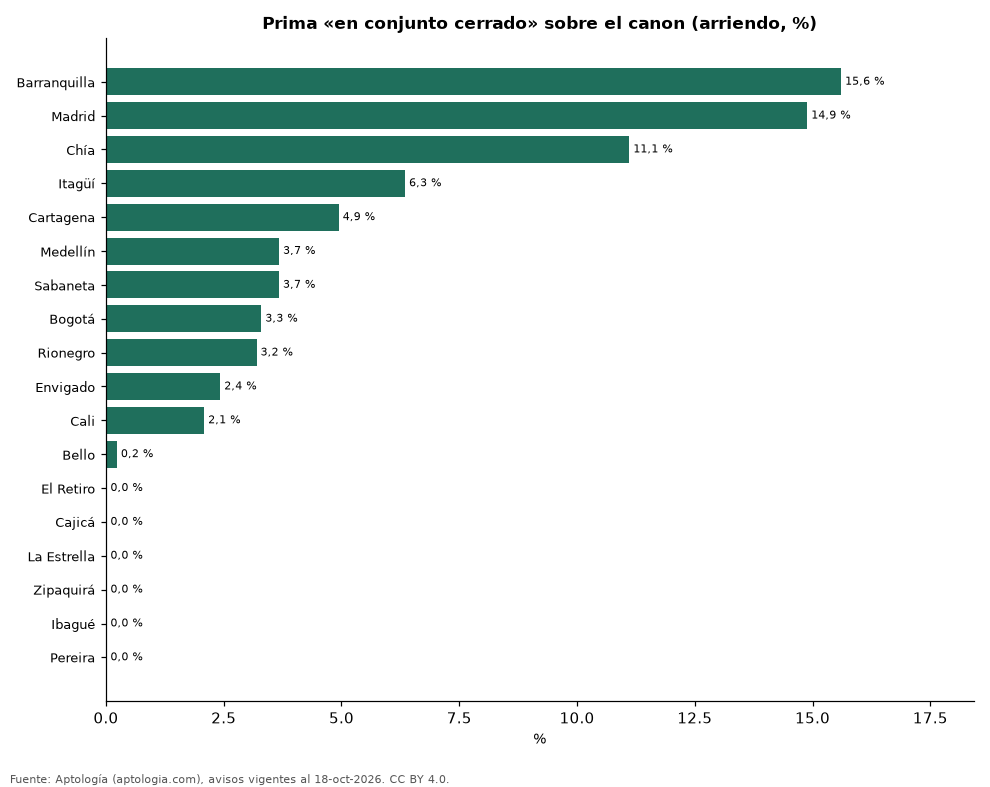

# Cuánto más cuesta arrendar un apartamento en conjunto cerrado en Colombia, ciudad por ciudad y por estrato (octubre 2026)

**Frente a apartamentos comparables de la misma ciudad, estrato, habitaciones y tamaño, la característica «en conjunto cerrado» cambia el canon +3,9 % en promedio en Colombia. La prima más alta está en Barranquilla (+15,6 %) y la más baja en Pereira (-17,2 %).**

*Resumen: comparamos 49.857 apartamentos en arriendo con y sin la característica en 159 celdas de ciudad × estrato × habitaciones × tamaño, con 30 avisos o más de cada lado.*

**Actualizado:** 18 de octubre de 2026 (datos del 18 de octubre de 2026) · **Próxima actualización:** mensual.

## Resumen

| Indicador | Valor |
|---|---|
| Prima promedio | +3,9 % |
| Más alta | Barranquilla: +15,6 % |
| Más baja | Pereira: -17,2 % |
| Ciudades | 18 |

## Prima por ciudad

| Ciudad | Diferencia en el canon | Celdas comparadas | Avisos con / sin |
|---|---|---|---|
| Barranquilla | +15,6 % | 20 | 1.552 / 1.520 |
| Madrid | +14,9 % | 1 | 73 / 35 |
| Chía | +11,1 % | 1 | 48 / 38 |
| Itagüí | +6,3 % | 6 | 351 / 286 |
| Cartagena | +4,9 % | 11 | 532 / 646 |
| Medellín | +3,7 % | 34 | 12.527 / 6.479 |
| Sabaneta | +3,7 % | 8 | 2.312 / 817 |
| Bogotá | +3,3 % | 37 | 4.677 / 7.543 |
| Rionegro | +3,2 % | 11 | 1.430 / 897 |
| Envigado | +2,4 % | 14 | 4.523 / 1.313 |
| Cali | +2,1 % | 3 | 314 / 285 |
| Bello | +0,2 % | 5 | 481 / 345 |
| El Retiro | -0,6 % | 1 | 76 / 37 |
| Cajicá | -1,4 % | 1 | 52 / 34 |
| La Estrella | -1,4 % | 3 | 145 / 141 |
| Zipaquirá | -3,3 % | 1 | 37 / 41 |
| Ibagué | -7,7 % | 1 | 40 / 34 |
| Pereira | -17,2 % | 1 | 164 / 32 |

Promedio de las diferencias de mediana en celdas comparables, ponderado por los avisos con la característica.

## Prima por estrato (todas las ciudades)

| Estrato | Diferencia en el canon | Celdas comparadas | Avisos con / sin |
|---|---|---|---|
| 2 | +3,9 % | 2 | 77 / 147 |
| 3 | +6,9 % | 28 | 2.464 / 3.543 |
| 4 | +5,9 % | 50 | 7.704 / 5.665 |
| 5 | +6,6 % | 46 | 8.529 / 5.564 |
| 6 | -0,5 % | 33 | 10.560 / 5.604 |

## Preguntas frecuentes

**¿Cuánto más cuesta arrendar un apartamento en conjunto cerrado en Colombia?**
+3,9 % en el canon frente a apartamentos comparables (octubre de 2026).

**¿En qué ciudad pesa más?**
En Barranquilla: +15,6 %.

## Metodología

- **Fuente:** exportes nocturnos de la base de datos de Aptología (aptologia.com) del 18 de octubre de 2026: avisos vigentes de vivienda en portales inmobiliarios de 13 países, recogidos por Aptología y vistos en línea entre el 11 y el 18 de octubre de 2026. Corte: 18 de octubre de 2026.
- **Depuración:** se eliminan duplicados exactos (misma ciudad, zona, tipo, precio, moneda, área, habitaciones y baños) y los precios fuera del percentil 1–99 de cada país, operación, moneda y tipo; el precio por m² usa solo avisos con área declarada entre 12 y 2.000 m² y también se recorta al P1–P99.
- **Qué se mide:** precios pedidos (publicados), no precios de cierre. En arriendo, el canon mensual sin administración, gastos comunes ni condominio.
- **Muestra mínima:** cada cifra publicada se apoya en al menos 30 avisos; las celdas con menos se omiten.
- **Colombia:** Precios en pesos colombianos, sin conversión de moneda.
- **Comparación emparejada:** dentro de cada celda de ciudad × estrato × habitaciones × rango de área se comparan las medianas del canon con y sin la característica; solo celdas con 30 avisos o más de cada lado; los promedios se ponderan por los avisos con la característica. Para no confundir el efecto con el tamaño, las celdas también se separan por rango de área declarada (<50, 50–70, 70–90, 90–120, 120–160 y más de 160 m²); solo entran avisos con área.
- **Limitaciones:** la cobertura depende de los portales que recorre Aptología en cada país y es mayor en las ciudades grandes y en los segmentos medio-alto y alto; el área es la que declara el aviso, sin verificar; los nombres de zona vienen de los portales.
- **Privacidad:** solo se publican agregados; no se publica ningún dato personal, enlace a avisos ni nombre de anunciante.
- **Datos abiertos:** [datos.csv](datos.csv), licencia CC BY 4.0.

## Cómo citar

Pinzón Pineda, D. M. (2026). *Cuánto más cuesta arrendar un apartamento en conjunto cerrado en Colombia, ciudad por ciudad y por estrato (octubre 2026)*. Aptología (aptologia.com). https://github.com/elbroker/aptologia-datos/tree/main/estudios/prima-conjunto-cerrado-arriendo-por-ciudad-y-estrato-colombia-2026. Datos: datos.csv, licencia CC BY 4.0.
