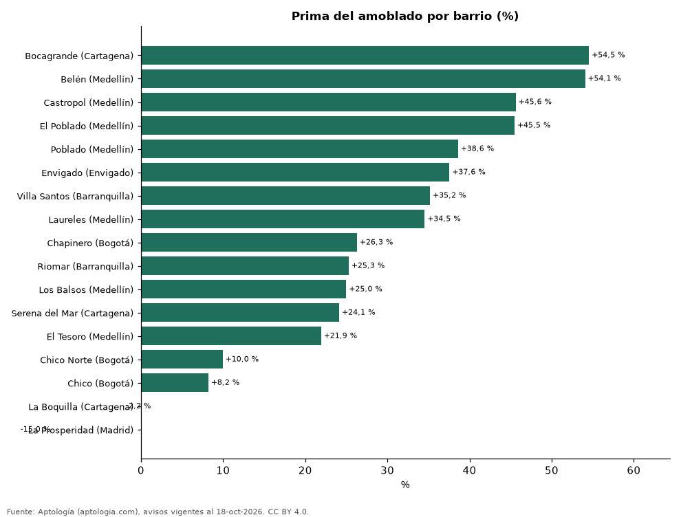

# Arriendo amoblado por barrio en Colombia: cuánto más se cobra en 17 barrios (octubre 2026)

**El barrio de Colombia donde más pesa el amoblado es Bocagrande (Cartagena): un apartamento amoblado se pide +54,5 % frente a uno sin amoblar del mismo número de habitaciones; en La Prosperidad (Madrid) la diferencia es -15,0 %.** En el conjunto de 17 barrios con 30 avisos o más de cada lado, la prima promedio ponderada es +36,6 %.

*Resumen: comparamos 2.567 apartamentos amoblados y 10.622 sin amoblar en 17 barrios, dentro de cada número de habitaciones.*

**Actualizado:** 18 de octubre de 2026 (datos del 18 de octubre de 2026) · **Próxima actualización:** mensual.

## Resumen

| Indicador | Valor |
|---|---|
| Barrios comparados | 17 |
| Mayor prima | Bocagrande (Cartagena): +54,5 % |
| Menor prima | La Prosperidad (Madrid): -15,0 % |
| Promedio ponderado | +36,6 % |

## Prima del amoblado por barrio

| Barrio | Ciudad | Prima del amoblado | Avisos (amoblado / sin amoblar) |
|---|---|---|---|
| Bocagrande | Cartagena | +54,5 % | 32 / 67 |
| Belén | Medellín | +54,1 % | 71 / 551 |
| Castropol | Medellín | +45,6 % | 49 / 298 |
| El Poblado | Medellín | +45,5 % | 1.337 / 4.970 |
| Poblado | Medellín | +38,6 % | 123 / 575 |
| Envigado | Envigado | +37,6 % | 118 / 1.065 |
| Villa Santos | Barranquilla | +35,2 % | 33 / 70 |
| Laureles | Medellín | +34,5 % | 210 / 1.477 |
| Chapinero | Bogotá | +26,3 % | 56 / 107 |
| Riomar | Barranquilla | +25,3 % | 30 / 116 |
| Los Balsos | Medellín | +25,0 % | 42 / 297 |
| Serena del Mar | Cartagena | +24,1 % | 61 / 168 |
| El Tesoro | Medellín | +21,9 % | 42 / 254 |
| Chico Norte | Bogotá | +10,0 % | 206 / 352 |
| Chico | Bogotá | +8,2 % | 81 / 126 |
| La Boquilla | Cartagena | -2,2 % | 45 / 47 |
| La Prosperidad | Madrid | -15,0 % | 31 / 82 |

Celdas barrio × habitaciones con 30 avisos o más amoblados y 30 o más sin amoblar; la prima del barrio pondera sus celdas por los avisos amoblados.

## Preguntas frecuentes

**¿En qué barrio cuesta más arrendar amoblado?**
En Bocagrande (Cartagena), con +54,5 % frente a un apartamento sin amoblar de las mismas habitaciones.

**¿Siempre es más caro el amoblado?**
Casi siempre; en La Prosperidad (Madrid) la diferencia es -15,0 %.

## Metodología

- **Fuente:** exportes nocturnos de la base de datos de Aptología (aptologia.com) del 18 de octubre de 2026: avisos vigentes de vivienda en portales inmobiliarios de 13 países, recogidos por Aptología y vistos en línea entre el 11 y el 18 de octubre de 2026. Corte: 18 de octubre de 2026.
- **Depuración:** se eliminan duplicados exactos (misma ciudad, zona, tipo, precio, moneda, área, habitaciones y baños) y los precios fuera del percentil 1–99 de cada país, operación, moneda y tipo; el precio por m² usa solo avisos con área declarada entre 12 y 2.000 m² y también se recorta al P1–P99.
- **Qué se mide:** precios pedidos (publicados), no precios de cierre. En arriendo, el canon mensual sin administración, gastos comunes ni condominio.
- **Muestra mínima:** cada cifra publicada se apoya en al menos 30 avisos; las celdas con menos se omiten.
- **Colombia:** Precios en pesos colombianos, sin conversión de moneda.
- **Limitaciones:** la cobertura depende de los portales que recorre Aptología en cada país y es mayor en las ciudades grandes y en los segmentos medio-alto y alto; el área es la que declara el aviso, sin verificar; los nombres de zona vienen de los portales.
- **Privacidad:** solo se publican agregados; no se publica ningún dato personal, enlace a avisos ni nombre de anunciante.
- **Datos abiertos:** [datos.csv](datos.csv), licencia CC BY 4.0.

## Cómo citar

Pinzón Pineda, D. M. (2026). *Arriendo amoblado por barrio en Colombia: cuánto más se cobra en 17 barrios (octubre 2026)*. Aptología (aptologia.com). https://github.com/elbroker/aptologia-datos/tree/main/estudios/prima-del-amoblado-por-barrio-colombia-2026. Datos: datos.csv, licencia CC BY 4.0.
