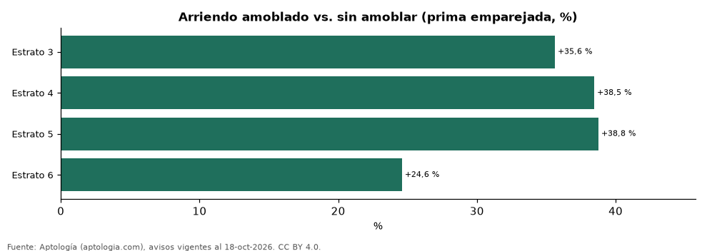

# Cuánto más cuesta un apartamento amoblado en Colombia según el estrato y el número de habitaciones (octubre 2026)

**En Colombia un apartamento amoblado se arrienda en promedio 31,2 % más caro que uno sin amoblar del mismo estrato, ciudad y número de habitaciones; la prima más alta está en el estrato 5 (+38,8 %) y la más baja en el estrato 6 (+24,6 %).** Por tamaño, la prima es +20,1 % con 1 habitación, +36,7 % con 2 habitaciones, +32,8 % con 3 o más habitaciones. El 13,8 % de la oferta de arriendo con estrato se anuncia amoblada.

*Resumen: comparamos 7.731 apartamentos amoblados con 41.790 sin amoblar en 57 celdas de ciudad, estrato y habitaciones.*

**Actualizado:** 18 de octubre de 2026 (datos del 18 de octubre de 2026) · **Próxima actualización:** mensual.

## Resumen

| Indicador | Valor |
|---|---|
| Prima nacional (emparejada) | +31,2 % |
| Estrato con mayor prima | 5: +38,8 % |
| Estrato con menor prima | 6: +24,6 % |
| Oferta amoblada | 13,8 % |

## Prima del amoblado por estrato

| Estrato | Prima del amoblado | Avisos amoblados | Avisos sin amoblar | Celdas |
|---|---|---|---|---|
| 3 | +35,6 % | 404 | 4.345 | 7 |
| 4 | +38,5 % | 1.285 | 10.955 | 14 |
| 5 | +38,8 % | 2.046 | 12.672 | 18 |
| 6 | +24,6 % | 3.996 | 13.818 | 18 |

Comparación emparejada: dentro de cada celda de ciudad × estrato × número de habitaciones con 30 avisos o más de cada lado se calcula la razón entre medianas; la prima es el promedio de esas razones ponderado por los avisos con la característica.

## Prima del amoblado por número de habitaciones

| Habitaciones | Prima del amoblado | Avisos amoblados |
|---|---|---|
| 1 | +20,1 % | 1.876 |
| 2 | +36,7 % | 2.970 |
| 3 o más | +32,8 % | 2.885 |

## Preguntas frecuentes

**¿Cuánto más cuesta arrendar amoblado en Colombia?**
En promedio 31,2 % más que un apartamento comparable sin amoblar (misma ciudad, estrato y habitaciones), según avisos de octubre de 2026.

**¿En qué estrato pesa más el amoblado?**
En el estrato 5, con una prima de +38,8 %.

## Metodología

- **Fuente:** exportes nocturnos de la base de datos de Aptología (aptologia.com) del 18 de octubre de 2026: avisos vigentes de vivienda en portales inmobiliarios de 13 países, recogidos por Aptología y vistos en línea entre el 11 y el 18 de octubre de 2026. Corte: 18 de octubre de 2026.
- **Depuración:** se eliminan duplicados exactos (misma ciudad, zona, tipo, precio, moneda, área, habitaciones y baños) y los precios fuera del percentil 1–99 de cada país, operación, moneda y tipo; el precio por m² usa solo avisos con área declarada entre 12 y 2.000 m² y también se recorta al P1–P99.
- **Qué se mide:** precios pedidos (publicados), no precios de cierre. En arriendo, el canon mensual sin administración, gastos comunes ni condominio.
- **Muestra mínima:** cada cifra publicada se apoya en al menos 30 avisos; las celdas con menos se omiten.
- **Colombia:** Precios en pesos colombianos, sin conversión de moneda.
- **Limitaciones:** la cobertura depende de los portales que recorre Aptología en cada país y es mayor en las ciudades grandes y en los segmentos medio-alto y alto; el área es la que declara el aviso, sin verificar; los nombres de zona vienen de los portales.
- **Privacidad:** solo se publican agregados; no se publica ningún dato personal, enlace a avisos ni nombre de anunciante.
- **Datos abiertos:** [datos.csv](datos.csv), licencia CC BY 4.0.

## Cómo citar

Pinzón Pineda, D. M. (2026). *Cuánto más cuesta un apartamento amoblado en Colombia según el estrato y el número de habitaciones (octubre 2026)*. Aptología (aptologia.com). https://github.com/elbroker/aptologia-datos/tree/main/estudios/prima-del-amoblado-por-estrato-y-habitaciones-colombia-2026. Datos: datos.csv, licencia CC BY 4.0.
