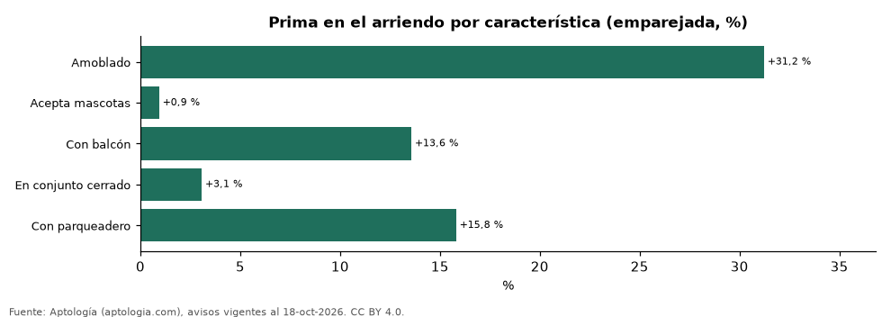
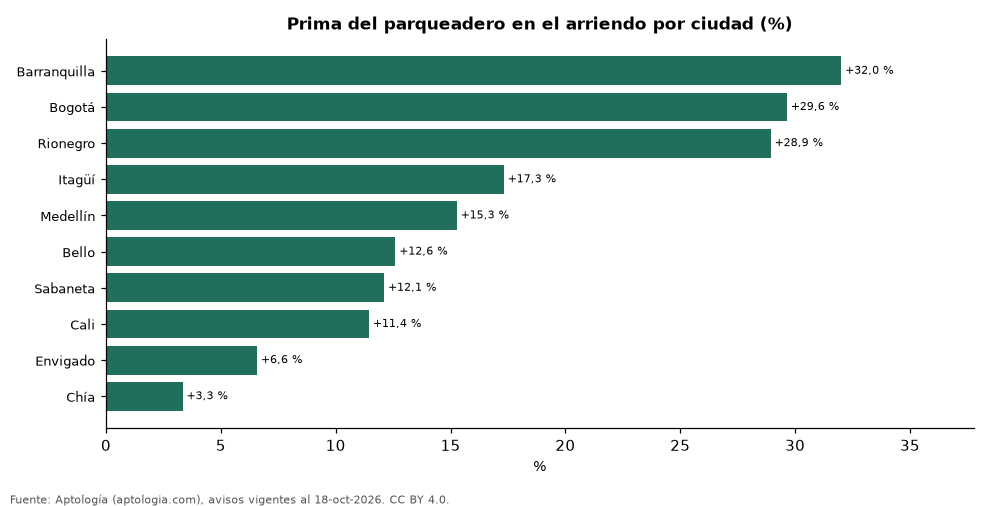

# Cuánto suben el arriendo el parqueadero, el balcón, el conjunto cerrado, el amoblado y las mascotas en cada ciudad de Colombia (octubre 2026)

**De cinco características del apartamento, la que más sube el arriendo en Colombia es «amoblado» (+31,2 % frente a un apartamento comparable de la misma ciudad, estrato y habitaciones) y la que menos, «acepta mascotas» (+0,9 %).** El parqueadero suma +15,8 % en promedio, desde +3,3 % en Chía hasta +32,0 % en Barranquilla. Los avisos no traen piscina, gimnasio ni ascensor de forma estructurada, así que no se miden aquí.

*Resumen: comparamos 65.369 apartamentos en arriendo con y sin cada característica dentro de celdas de ciudad, estrato y habitaciones, en 15 ciudades.*

**Actualizado:** 18 de octubre de 2026 (datos del 18 de octubre de 2026) · **Próxima actualización:** mensual.

## Resumen

| Indicador | Valor |
|---|---|
| Amoblado | +31,2 % |
| Acepta mascotas | +0,9 % |
| Con balcón | +13,6 % |
| En conjunto cerrado | +3,1 % |
| Con parqueadero | +15,8 % |
| Ciudades | 15 |

## Prima por característica y ciudad

| Ciudad | Amoblado | Acepta mascotas | Con balcón | En conjunto cerrado | Con parqueadero |
|---|---|---|---|---|---|
| Barranquilla | +40,3 % | +4,9 % | +22,7 % | +18,5 % | +32,0 % |
| Bogotá | +16,4 % | +0,6 % | +30,1 % | +0,0 % | +29,6 % |
| Rionegro | +90,9 % | -5,1 % | +6,4 % | +8,3 % | +28,9 % |
| Itagüí | — | +2,6 % | +1,6 % | +7,7 % | +17,3 % |
| Medellín | +37,3 % | +6,5 % | +13,3 % | +3,0 % | +15,3 % |
| Bello | — | +1,1 % | +5,5 % | -1,1 % | +12,6 % |
| Sabaneta | +42,1 % | -0,4 % | +5,6 % | +2,7 % | +12,1 % |
| Cali | +32,7 % | +4,0 % | +22,7 % | +1,3 % | +11,4 % |
| Envigado | +45,4 % | -0,7 % | +2,8 % | +1,6 % | +6,6 % |
| Chía | — | — | +10,3 % | +1,7 % | +3,3 % |
| Cartagena | +25,3 % | — | +13,0 % | +7,6 % | — |
| El Retiro | — | -18,3 % | -23,4 % | +19,0 % | — |
| La Estrella | — | -0,3 % | -1,8 % | +0,5 % | — |
| Madrid | — | +8,7 % | -0,8 % | +11,2 % | — |
| Pereira | +29,8 % | -9,0 % | +6,2 % | -13,9 % | — |

Comparación emparejada: dentro de cada celda de ciudad × estrato × número de habitaciones con 30 avisos o más de cada lado se calcula la razón entre medianas; la prima es el promedio de esas razones ponderado por los avisos con la característica. — indica que la ciudad no tiene celdas suficientes para esa característica.

## Preguntas frecuentes

**¿Cuánto sube el arriendo un parqueadero en Colombia?**
En promedio +15,8 % frente a un apartamento comparable sin parqueadero.

**¿Cuánto vale el balcón en el arriendo?**
+13,6 % en promedio nacional (emparejado por ciudad, estrato y habitaciones).

**¿Se pueden medir piscina, gimnasio o ascensor?**
No con estos datos: los portales no publican esos campos de forma estructurada.

## Metodología

- **Fuente:** exportes nocturnos de la base de datos de Aptología (aptologia.com) del 18 de octubre de 2026: avisos vigentes de vivienda en portales inmobiliarios de 13 países, recogidos por Aptología y vistos en línea entre el 11 y el 18 de octubre de 2026. Corte: 18 de octubre de 2026.
- **Depuración:** se eliminan duplicados exactos (misma ciudad, zona, tipo, precio, moneda, área, habitaciones y baños) y los precios fuera del percentil 1–99 de cada país, operación, moneda y tipo; el precio por m² usa solo avisos con área declarada entre 12 y 2.000 m² y también se recorta al P1–P99.
- **Qué se mide:** precios pedidos (publicados), no precios de cierre. En arriendo, el canon mensual sin administración, gastos comunes ni condominio.
- **Muestra mínima:** cada cifra publicada se apoya en al menos 30 avisos; las celdas con menos se omiten.
- **Colombia:** Precios en pesos colombianos, sin conversión de moneda.
- **Limitaciones:** la cobertura depende de los portales que recorre Aptología en cada país y es mayor en las ciudades grandes y en los segmentos medio-alto y alto; el área es la que declara el aviso, sin verificar; los nombres de zona vienen de los portales.
- **Privacidad:** solo se publican agregados; no se publica ningún dato personal, enlace a avisos ni nombre de anunciante.
- **Datos abiertos:** [datos.csv](datos.csv), licencia CC BY 4.0.

## Cómo citar

Pinzón Pineda, D. M. (2026). *Cuánto suben el arriendo el parqueadero, el balcón, el conjunto cerrado, el amoblado y las mascotas en cada ciudad de Colombia (octubre 2026)*. Aptología (aptologia.com). https://github.com/elbroker/aptologia-datos/tree/main/estudios/prima-por-amenidades-arriendo-ciudades-colombia-2026. Datos: datos.csv, licencia CC BY 4.0.
