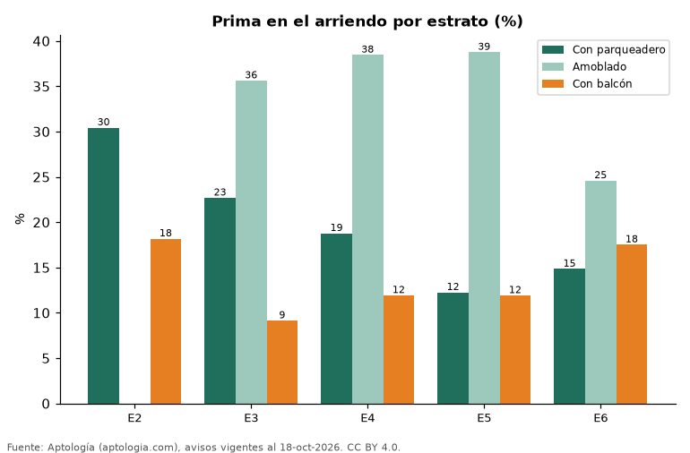

# Qué vale más en cada estrato: parqueadero, balcón, conjunto cerrado, amoblado o mascotas en el arriendo en Colombia (octubre 2026)

**El parqueadero sube el arriendo +30,4 % en el estrato 2 y +14,8 % en el estrato 6, frente a apartamentos comparables sin parqueadero de la misma ciudad y habitaciones.** El amoblado va de +24,6 % (estrato 6) a +38,8 % (estrato 5).

*Resumen: comparamos 65.369 apartamentos en arriendo con y sin cada característica dentro de celdas de ciudad, estrato y habitaciones.*

**Actualizado:** 18 de octubre de 2026 (datos del 18 de octubre de 2026) · **Próxima actualización:** mensual.

## Resumen

| Indicador | Valor |
|---|---|
| Parqueadero, estrato 2 | +30,4 % |
| Parqueadero, estrato 3 | +22,7 % |
| Parqueadero, estrato 4 | +18,8 % |
| Parqueadero, estrato 5 | +12,3 % |
| Parqueadero, estrato 6 | +14,8 % |

## Prima por característica y estrato

| Estrato | Amoblado | Acepta mascotas | Con balcón | En conjunto cerrado | Con parqueadero |
|---|---|---|---|---|---|
| 2 | — | — | +18,2 % | -1,7 % | +30,4 % |
| 3 | +35,6 % | +0,1 % | +9,1 % | +3,7 % | +22,7 % |
| 4 | +38,5 % | -0,4 % | +11,9 % | +6,8 % | +18,8 % |
| 5 | +38,8 % | +0,8 % | +11,9 % | +4,2 % | +12,3 % |
| 6 | +24,6 % | +2,8 % | +17,5 % | -0,6 % | +14,8 % |

Comparación emparejada: dentro de cada celda de ciudad × estrato × número de habitaciones con 30 avisos o más de cada lado se calcula la razón entre medianas; la prima es el promedio de esas razones ponderado por los avisos con la característica.

## Preguntas frecuentes

**¿En qué estrato vale más el parqueadero?**
En el estrato 2: +30,4 %.

**¿El amoblado vale lo mismo en todos los estratos?**
No: va de +24,6 % a +38,8 % según el estrato.

## Metodología

- **Fuente:** exportes nocturnos de la base de datos de Aptología (aptologia.com) del 18 de octubre de 2026: avisos vigentes de vivienda en portales inmobiliarios de 13 países, recogidos por Aptología y vistos en línea entre el 11 y el 18 de octubre de 2026. Corte: 18 de octubre de 2026.
- **Depuración:** se eliminan duplicados exactos (misma ciudad, zona, tipo, precio, moneda, área, habitaciones y baños) y los precios fuera del percentil 1–99 de cada país, operación, moneda y tipo; el precio por m² usa solo avisos con área declarada entre 12 y 2.000 m² y también se recorta al P1–P99.
- **Qué se mide:** precios pedidos (publicados), no precios de cierre. En arriendo, el canon mensual sin administración, gastos comunes ni condominio.
- **Muestra mínima:** cada cifra publicada se apoya en al menos 30 avisos; las celdas con menos se omiten.
- **Colombia:** Precios en pesos colombianos, sin conversión de moneda.
- **Limitaciones:** la cobertura depende de los portales que recorre Aptología en cada país y es mayor en las ciudades grandes y en los segmentos medio-alto y alto; el área es la que declara el aviso, sin verificar; los nombres de zona vienen de los portales.
- **Privacidad:** solo se publican agregados; no se publica ningún dato personal, enlace a avisos ni nombre de anunciante.
- **Datos abiertos:** [datos.csv](datos.csv), licencia CC BY 4.0.

## Cómo citar

Pinzón Pineda, D. M. (2026). *Qué vale más en cada estrato: parqueadero, balcón, conjunto cerrado, amoblado o mascotas en el arriendo en Colombia (octubre 2026)*. Aptología (aptologia.com). https://github.com/elbroker/aptologia-datos/tree/main/estudios/prima-por-amenidades-arriendo-por-estrato-colombia-2026. Datos: datos.csv, licencia CC BY 4.0.
