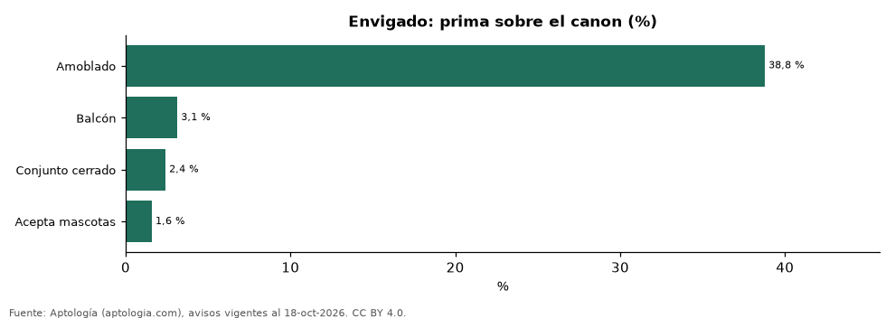

# Cuánto suben el arriendo el amoblado, las mascotas, el balcón, el conjunto y el parqueadero en Envigado (octubre 2026)

**En Envigado, la característica que más sube el arriendo frente a apartamentos comparables del mismo estrato, habitaciones y tamaño es «amoblado»: +38,8 % en el canon. La que menos pesa es «acepta mascotas» (+1,6 %).**

*Resumen: comparamos 7.331 apartamentos en arriendo en Envigado con y sin cada característica dentro de celdas de mismo estrato, número de habitaciones y rango de área.*

**Actualizado:** 18 de octubre de 2026 (datos del 18 de octubre de 2026) · **Próxima actualización:** mensual.

## Resumen

| Indicador | Valor |
|---|---|
| Amoblado | +38,8 % |
| Balcón | +3,1 % |
| Conjunto cerrado | +2,4 % |
| Acepta mascotas | +1,6 % |

## Prima de cada característica sobre el canon

| Característica | Diferencia en el canon | Celdas comparadas | Avisos con / sin | % de la oferta que la tiene |
|---|---|---|---|---|
| Amoblado | +38,8 % | 4 | 227 / 2.759 | 7,3 % |
| Balcón | +3,1 % | 11 | 4.805 / 495 | 89,6 % |
| Conjunto cerrado | +2,4 % | 14 | 4.523 / 1.313 | 75,6 % |
| Acepta mascotas | +1,6 % | 12 | 703 / 4.968 | 11,0 % |

Diferencia ponderada entre la mediana del canon con y sin la característica en celdas comparables (30 avisos o más de cada lado).

## Preguntas frecuentes

**¿Cuánto más cuesta un apartamento amoblado en Envigado?**
+38,8 % en el canon frente a apartamentos comparables sin amoblar.

**¿Cuánto vale el parqueadero en el arriendo en Envigado?**
No hay celdas suficientes.

## Metodología

- **Fuente:** exportes nocturnos de la base de datos de Aptología (aptologia.com) del 18 de octubre de 2026: avisos vigentes de vivienda en portales inmobiliarios de 13 países, recogidos por Aptología y vistos en línea entre el 11 y el 18 de octubre de 2026. Corte: 18 de octubre de 2026.
- **Depuración:** se eliminan duplicados exactos (misma ciudad, zona, tipo, precio, moneda, área, habitaciones y baños) y los precios fuera del percentil 1–99 de cada país, operación, moneda y tipo; el precio por m² usa solo avisos con área declarada entre 12 y 2.000 m² y también se recorta al P1–P99.
- **Qué se mide:** precios pedidos (publicados), no precios de cierre. En arriendo, el canon mensual sin administración, gastos comunes ni condominio.
- **Muestra mínima:** cada cifra publicada se apoya en al menos 30 avisos; las celdas con menos se omiten.
- **Colombia:** Precios en pesos colombianos, sin conversión de moneda.
- **Comparación emparejada:** dentro de cada celda de estrato × habitaciones × rango de área se comparan las medianas del canon con y sin la característica; solo celdas con 30 avisos o más de cada lado; el promedio se pondera por los avisos con la característica. Para no confundir el efecto con el tamaño, las celdas también se separan por rango de área declarada (<50, 50–70, 70–90, 90–120, 120–160 y más de 160 m²); solo entran avisos con área.
- **Limitaciones:** la cobertura depende de los portales que recorre Aptología en cada país y es mayor en las ciudades grandes y en los segmentos medio-alto y alto; el área es la que declara el aviso, sin verificar; los nombres de zona vienen de los portales.
- **Privacidad:** solo se publican agregados; no se publica ningún dato personal, enlace a avisos ni nombre de anunciante.
- **Datos abiertos:** [datos.csv](datos.csv), licencia CC BY 4.0.

## Cómo citar

Pinzón Pineda, D. M. (2026). *Cuánto suben el arriendo el amoblado, las mascotas, el balcón, el conjunto y el parqueadero en Envigado (octubre 2026)*. Aptología (aptologia.com). https://github.com/elbroker/aptologia-datos/tree/main/estudios/primas-de-amenidades-arriendo-envigado-2026. Datos: datos.csv, licencia CC BY 4.0.
