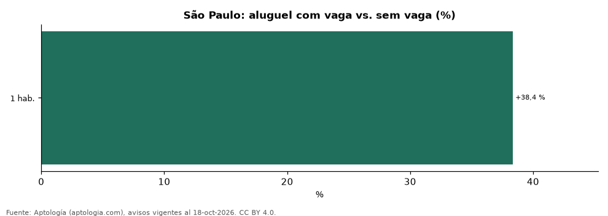

# Quanto vale uma vaga de garagem no aluguel em São Paulo: cuánto más se paga con parqueadero (octubre 2026)

**En São Paulo, un apartamento en alquiler con vaga de garagem se pide +38,4 % frente a uno sin vaga del mismo bairro, número de quartos y rango de área; una segunda vaga suma +28,0 % frente a una sola (mismos quartos y rango de área).** El 14,6 % de los apartamentos en alquiler que informan vagas no tiene ninguna.

*Resumen: comparamos 77 apartamentos con vaga y 31 sin vaga en 1 celdas de bairro y quartos.*

**Actualizado:** 18 de octubre de 2026 (datos del 18 de octubre de 2026) · **Próxima actualización:** mensual.

## Resumen

| Indicador | Valor |
|---|---|
| Prima de la vaga (emparejada) | +38,4 % |
| Segunda vaga vs. una | +28,0 % |
| Sin vaga | 14,6 % |
| Prima en 1 hab. | +38,4 % |

## Prima de la vaga por bairro y quartos

| Bairro | Quartos | Área (m²) | Com vaga | Sem vaga | Diferença | Anúncios (com / sem) |
|---|---|---|---|---|---|---|
| Pinheiros | 1 hab. | <50 | 4.400 reales (USD 865) | 3.180 reales (USD 625) | +38,4 % | 77 / 31 |

Celdas bairro × quartos × rango de área con 30 anuncios o más con vaga y 30 o más sin vaga; medianas del aluguel en reales.

## Preguntas frecuentes

**Quanto a mais custa um aluguel com vaga em São Paulo?**
En promedio +38,4 % frente a un apartamento comparable sin vaga (mismo bairro, quartos y rango de área).

**E uma segunda vaga?**
Suma +28,0 % frente a una sola vaga.

## Metodología

- **Fuente:** exportes nocturnos de la base de datos de Aptología (aptologia.com) del 18 de octubre de 2026: avisos vigentes de vivienda en portales inmobiliarios de 13 países, recogidos por Aptología y vistos en línea entre el 11 y el 18 de octubre de 2026. Corte: 18 de octubre de 2026.
- **Depuración:** se eliminan duplicados exactos (misma ciudad, zona, tipo, precio, moneda, área, habitaciones y baños) y los precios fuera del percentil 1–99 de cada país, operación, moneda y tipo; el precio por m² usa solo avisos con área declarada entre 12 y 2.000 m² y también se recorta al P1–P99.
- **Qué se mide:** precios pedidos (publicados), no precios de cierre. En arriendo, el canon mensual sin administración, gastos comunes ni condominio.
- **Muestra mínima:** cada cifra publicada se apoya en al menos 30 avisos; las celdas con menos se omiten.
- **Monedas:** nunca se mezclan avisos de monedas distintas sin convertirlos. Conversión a dólares con la tasa de mercado de ExchangeRate-API (open.er-api.com, actualización del 18 Oct 2026): 1 USD = 3.182,80 COP, 1 USD = 18,47 M.N, 1 USD = 5,09 BRL, 1 USD = 3,44 PEN, 1 USD = 982,44 CLP, 1 USD = 1.514,57 ARS, 1 USD = 40,20 UYU, 1 USD = 5.705,37 PYG, 1 USD = 61,27 DOP, 1 USD = 0,89 EUR, 1 USD = 11,72 BOB; la UF chilena a 41.178,64 CLP (mindicador,cl. 18-oct-2026). Los avisos publicados en dólares se usan tal cual.
- **Moneda:** reales brasileños (BRL); equivalencias en dólares con la tasa citada.
- **Aluguel:** valor mensual pedido, sin condomínio ni IPTU (salvo que se indique).
- **Comparación emparejada:** dentro de cada bairro y número de quartos, mediana con vaga ÷ mediana sin vaga (30 anuncios o más de cada lado), promediada con peso por anuncios con vaga. Para no confundir el efecto con el tamaño, las celdas también se separan por rango de área declarada (<50, 50–70, 70–90, 90–120, 120–160 y más de 160 m²); solo entran avisos con área.
- **Limitaciones:** la cobertura depende de los portales que recorre Aptología en cada país y es mayor en las ciudades grandes y en los segmentos medio-alto y alto; el área es la que declara el aviso, sin verificar; los nombres de zona vienen de los portales.
- **Privacidad:** solo se publican agregados; no se publica ningún dato personal, enlace a avisos ni nombre de anunciante.
- **Datos abiertos:** [datos.csv](datos.csv), licencia CC BY 4.0.

## Cómo citar

Pinzón Pineda, D. M. (2026). *Quanto vale uma vaga de garagem no aluguel em São Paulo: cuánto más se paga con parqueadero (octubre 2026)*. Aptología (aptologia.com). https://github.com/elbroker/aptologia-datos/tree/main/estudios/quanto-vale-uma-vaga-de-garagem-aluguel-sao-paulo-2026. Datos: datos.csv, licencia CC BY 4.0.
