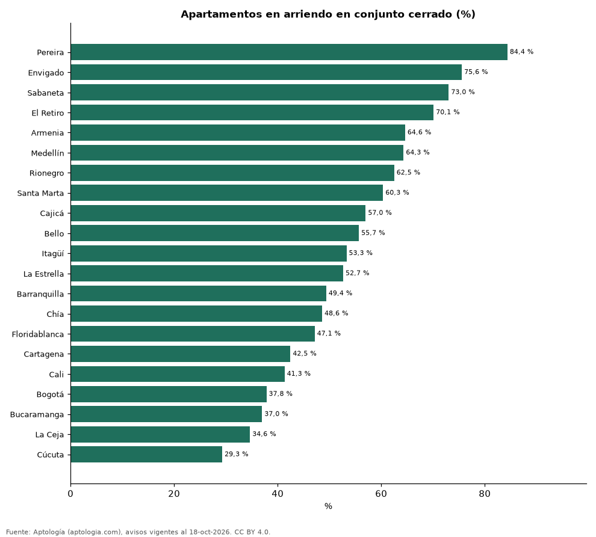

# Conjunto cerrado, parqueadero, balcón, amoblado y mascotas: qué tan común es cada uno en el arriendo de cada ciudad de Colombia (octubre 2026)

**En Pereira el 84,4 % de los apartamentos en arriendo está en conjunto cerrado, el mayor porcentaje del país; en Cúcuta solo el 29,3 %.** En toda Colombia, el 87,6 % de los avisos tiene parqueadero, el 70,3 % balcón, el 14,0 % está amoblado y el 10,6 % acepta mascotas. La ciudad con más balcones es Envigado (89,6 %).

*Resumen: medimos cinco características en 65.974 avisos de apartamentos en arriendo de 21 ciudades con 300 avisos o más.*

**Actualizado:** 18 de octubre de 2026 (datos del 18 de octubre de 2026) · **Próxima actualización:** mensual.

## Resumen

| Indicador | Valor |
|---|---|
| Colombia: amoblado | 14,0 % |
| Colombia: acepta mascotas | 10,6 % |
| Colombia: con balcón | 70,3 % |
| Colombia: en conjunto cerrado | 57,4 % |
| Colombia: con parqueadero | 87,6 % |

## Porcentaje de avisos con cada característica por ciudad

| Ciudad | Amoblado | Acepta mascotas | Con balcón | En conjunto cerrado | Con parqueadero | Avisos |
|---|---|---|---|---|---|---|
| Pereira | 9,9 % | 21,7 % | 65,7 % | 84,4 % | 98,3 % | 1.561 |
| Envigado | 7,3 % | 11,0 % | 89,6 % | 75,6 % | 95,5 % | 7.354 |
| Sabaneta | 6,3 % | 13,8 % | 84,9 % | 73,0 % | 91,5 % | 3.890 |
| El Retiro | 3,9 % | 19,6 % | 73,1 % | 70,1 % | 100,0 % | 542 |
| Armenia | 10,9 % | 9,4 % | 69,3 % | 64,6 % | 93,6 % | 339 |
| Medellín | 16,5 % | 6,0 % | 75,6 % | 64,3 % | 86,6 % | 20.480 |
| Rionegro | 6,4 % | 14,9 % | 75,8 % | 62,5 % | 92,0 % | 3.197 |
| Santa Marta | 43,1 % | 12,1 % | 87,0 % | 60,3 % | 87,0 % | 686 |
| Cajicá | 8,8 % | 16,8 % | 67,9 % | 57,0 % | 96,8 % | 386 |
| Bello | 1,7 % | 16,1 % | 81,0 % | 55,7 % | 74,9 % | 1.090 |
| Itagüí | 3,5 % | 18,1 % | 79,9 % | 53,3 % | 79,9 % | 912 |
| La Estrella | 1,2 % | 27,6 % | 81,0 % | 52,7 % | 100,0 % | 490 |
| Barranquilla | 20,2 % | 10,0 % | 62,5 % | 49,4 % | 93,7 % | 3.826 |
| Chía | 14,6 % | 16,8 % | 49,8 % | 48,6 % | 78,2 % | 494 |
| Floridablanca | 2,5 % | 4,4 % | 64,3 % | 47,1 % | 89,5 % | 367 |
| Cartagena | 32,5 % | 5,3 % | 78,0 % | 42,5 % | 91,4 % | 2.035 |
| Cali | 13,4 % | 11,6 % | 64,9 % | 41,3 % | 81,8 % | 1.614 |
| Bogotá | 17,0 % | 12,3 % | 49,3 % | 37,8 % | 79,5 % | 13.293 |
| Bucaramanga | 1,8 % | 4,8 % | 51,8 % | 37,0 % | 86,9 % | 438 |
| La Ceja | 2,8 % | 16,3 % | 68,5 % | 34,6 % | 100,0 % | 355 |
| Cúcuta | 5,3 % | 3,3 % | 56,1 % | 29,3 % | 92,5 % | 396 |

Porcentaje sobre los avisos que informan el campo; — indica menos de 100 avisos con el campo.

## Preguntas frecuentes

**¿Qué porcentaje de arriendos en Colombia tiene parqueadero?**
El 87,6 % de los avisos de apartamentos.

**¿Dónde hay más conjuntos cerrados?**
En Pereira: 84,4 % de la oferta.

## Metodología

- **Fuente:** exportes nocturnos de la base de datos de Aptología (aptologia.com) del 18 de octubre de 2026: avisos vigentes de vivienda en portales inmobiliarios de 13 países, recogidos por Aptología y vistos en línea entre el 11 y el 18 de octubre de 2026. Corte: 18 de octubre de 2026.
- **Depuración:** se eliminan duplicados exactos (misma ciudad, zona, tipo, precio, moneda, área, habitaciones y baños) y los precios fuera del percentil 1–99 de cada país, operación, moneda y tipo; el precio por m² usa solo avisos con área declarada entre 12 y 2.000 m² y también se recorta al P1–P99.
- **Qué se mide:** precios pedidos (publicados), no precios de cierre. En arriendo, el canon mensual sin administración, gastos comunes ni condominio.
- **Muestra mínima:** cada cifra publicada se apoya en al menos 30 avisos; las celdas con menos se omiten.
- **Colombia:** Precios en pesos colombianos, sin conversión de moneda.
- **Limitaciones:** la cobertura depende de los portales que recorre Aptología en cada país y es mayor en las ciudades grandes y en los segmentos medio-alto y alto; el área es la que declara el aviso, sin verificar; los nombres de zona vienen de los portales.
- **Privacidad:** solo se publican agregados; no se publica ningún dato personal, enlace a avisos ni nombre de anunciante.
- **Datos abiertos:** [datos.csv](datos.csv), licencia CC BY 4.0.

## Cómo citar

Pinzón Pineda, D. M. (2026). *Conjunto cerrado, parqueadero, balcón, amoblado y mascotas: qué tan común es cada uno en el arriendo de cada ciudad de Colombia (octubre 2026)*. Aptología (aptologia.com). https://github.com/elbroker/aptologia-datos/tree/main/estudios/que-tan-comun-es-cada-amenidad-arriendo-ciudades-colombia-2026. Datos: datos.csv, licencia CC BY 4.0.
