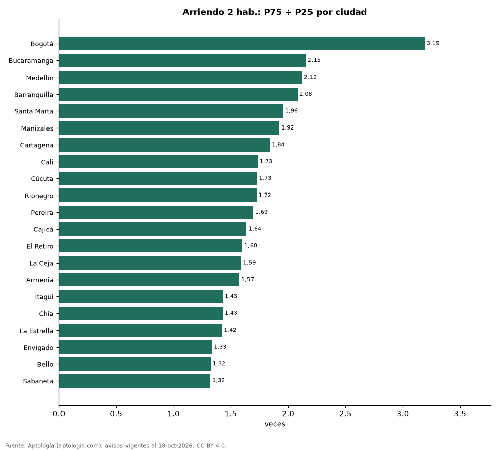

# Cuánto varía el arriendo de un apartamento de 2 habitaciones dentro de cada ciudad de Colombia: rango normal en 21 ciudades (octubre 2026)

**En Bogotá el arriendo de un apartamento de 2 habitaciones caro típico (percentil 75) es 3,19 veces el barato típico (percentil 25), la mayor dispersión de 21 ciudades; en Sabaneta, solo 1,32 veces.** En Bogotá la mitad central de la oferta de 2 habitaciones va de 1,60 millones de pesos a 5,09 millones de pesos al mes, y el 10 % más barato está por debajo de 1,25 millones de pesos.

*Resumen: calculamos los percentiles del canon de 23.618 apartamentos de 2 habitaciones en arriendo en 21 ciudades con 100 avisos o más.*

**Actualizado:** 18 de octubre de 2026 (datos del 18 de octubre de 2026) · **Próxima actualización:** mensual.

## Resumen

| Indicador | Valor |
|---|---|
| Mayor dispersión | Bogotá: 3,19× |
| Menor dispersión | Sabaneta: 1,32× |
| Bogotá (P25–P75) | 1,60 millones de pesos – 5,09 millones de pesos |

## Percentiles del canon de 2 habitaciones por ciudad

| Ciudad | P10 | P25 | Mediana | P75 | P90 | P75 ÷ P25 | Avisos |
|---|---|---|---|---|---|---|---|
| Bogotá | 1,25 millones de pesos | 1,60 millones de pesos | 2,65 millones de pesos | 5,09 millones de pesos | 8,50 millones de pesos | 3,19 | 4.530 |
| Bucaramanga | 1,10 millones de pesos | 1,30 millones de pesos | 2,00 millones de pesos | 2,80 millones de pesos | 3,24 millones de pesos | 2,15 | 113 |
| Medellín | 2,00 millones de pesos | 2,90 millones de pesos | 4,20 millones de pesos | 6,15 millones de pesos | 8,00 millones de pesos | 2,12 | 6.601 |
| Barranquilla | 1,29 millones de pesos | 1,60 millones de pesos | 2,30 millones de pesos | 3,33 millones de pesos | 4,50 millones de pesos | 2,08 | 1.442 |
| Santa Marta | 1,70 millones de pesos | 2,30 millones de pesos | 3,50 millones de pesos | 4,50 millones de pesos | 6,59 millones de pesos | 1,96 | 268 |
| Manizales | 1,10 millones de pesos | 1,30 millones de pesos | 1,65 millones de pesos | 2,50 millones de pesos | 3,30 millones de pesos | 1,92 | 126 |
| Cartagena | 1,90 millones de pesos | 2,50 millones de pesos | 3,40 millones de pesos | 4,60 millones de pesos | 6,20 millones de pesos | 1,84 | 983 |
| Cali | 1,00 millones de pesos | 1,27 millones de pesos | 1,55 millones de pesos | 2,20 millones de pesos | 3,84 millones de pesos | 1,73 | 633 |
| Cúcuta | 0,85 millones de pesos | 1,00 millones de pesos | 1,30 millones de pesos | 1,73 millones de pesos | 2,23 millones de pesos | 1,73 | 108 |
| Rionegro | 1,60 millones de pesos | 1,80 millones de pesos | 2,60 millones de pesos | 3,10 millones de pesos | 6,21 millones de pesos | 1,72 | 1.750 |
| Pereira | 1,60 millones de pesos | 1,95 millones de pesos | 2,60 millones de pesos | 3,30 millones de pesos | 4,20 millones de pesos | 1,69 | 535 |
| Cajicá | 1,45 millones de pesos | 1,61 millones de pesos | 1,90 millones de pesos | 2,64 millones de pesos | 2,90 millones de pesos | 1,64 | 206 |
| El Retiro | 2,80 millones de pesos | 3,50 millones de pesos | 4,30 millones de pesos | 5,60 millones de pesos | 6,50 millones de pesos | 1,60 | 346 |
| La Ceja | 1,54 millones de pesos | 1,82 millones de pesos | 2,50 millones de pesos | 2,90 millones de pesos | 3,96 millones de pesos | 1,59 | 159 |
| Armenia | 1,20 millones de pesos | 1,72 millones de pesos | 2,25 millones de pesos | 2,70 millones de pesos | 3,52 millones de pesos | 1,57 | 149 |
| Itagüí | 1,80 millones de pesos | 2,10 millones de pesos | 2,50 millones de pesos | 3,00 millones de pesos | 3,60 millones de pesos | 1,43 | 295 |
| Chía | 1,30 millones de pesos | 1,40 millones de pesos | 1,55 millones de pesos | 2,00 millones de pesos | 2,69 millones de pesos | 1,43 | 233 |
| La Estrella | 1,70 millones de pesos | 1,90 millones de pesos | 2,40 millones de pesos | 2,70 millones de pesos | 2,90 millones de pesos | 1,42 | 252 |
| Envigado | 3,10 millones de pesos | 3,60 millones de pesos | 4,20 millones de pesos | 4,80 millones de pesos | 6,00 millones de pesos | 1,33 | 2.529 |
| Bello | 1,50 millones de pesos | 1,66 millones de pesos | 1,80 millones de pesos | 2,20 millones de pesos | 2,50 millones de pesos | 1,32 | 306 |
| Sabaneta | 2,10 millones de pesos | 2,50 millones de pesos | 2,90 millones de pesos | 3,30 millones de pesos | 3,70 millones de pesos | 1,32 | 1.301 |

Canon mensual pedido sin administración. P10…P90 = percentiles.

## Preguntas frecuentes

**¿Cuánto cuesta normalmente arrendar 2 habitaciones en Bogotá?**
La mitad central de los avisos está entre 1,60 millones de pesos y 5,09 millones de pesos al mes.

**¿En qué ciudad varía más el arriendo?**
En Bogotá: el P75 es 3,19 veces el P25.

## Metodología

- **Fuente:** exportes nocturnos de la base de datos de Aptología (aptologia.com) del 18 de octubre de 2026: avisos vigentes de vivienda en portales inmobiliarios de 13 países, recogidos por Aptología y vistos en línea entre el 11 y el 18 de octubre de 2026. Corte: 18 de octubre de 2026.
- **Depuración:** se eliminan duplicados exactos (misma ciudad, zona, tipo, precio, moneda, área, habitaciones y baños) y los precios fuera del percentil 1–99 de cada país, operación, moneda y tipo; el precio por m² usa solo avisos con área declarada entre 12 y 2.000 m² y también se recorta al P1–P99.
- **Qué se mide:** precios pedidos (publicados), no precios de cierre. En arriendo, el canon mensual sin administración, gastos comunes ni condominio.
- **Muestra mínima:** cada cifra publicada se apoya en al menos 30 avisos; las celdas con menos se omiten.
- **Colombia:** Precios en pesos colombianos, sin conversión de moneda.
- **Limitaciones:** la cobertura depende de los portales que recorre Aptología en cada país y es mayor en las ciudades grandes y en los segmentos medio-alto y alto; el área es la que declara el aviso, sin verificar; los nombres de zona vienen de los portales.
- **Privacidad:** solo se publican agregados; no se publica ningún dato personal, enlace a avisos ni nombre de anunciante.
- **Datos abiertos:** [datos.csv](datos.csv), licencia CC BY 4.0.

## Cómo citar

Pinzón Pineda, D. M. (2026). *Cuánto varía el arriendo de un apartamento de 2 habitaciones dentro de cada ciudad de Colombia: rango normal en 21 ciudades (octubre 2026)*. Aptología (aptologia.com). https://github.com/elbroker/aptologia-datos/tree/main/estudios/rango-de-precios-del-arriendo-2-habitaciones-ciudades-colombia-2026. Datos: datos.csv, licencia CC BY 4.0.
