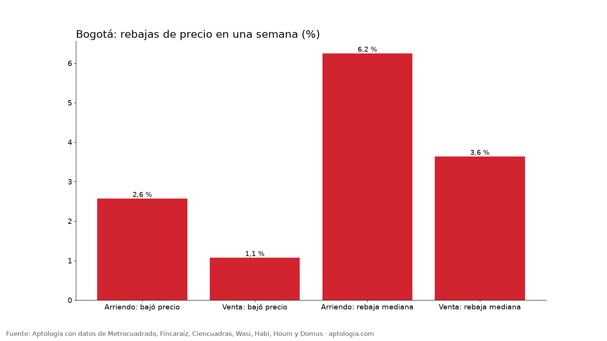
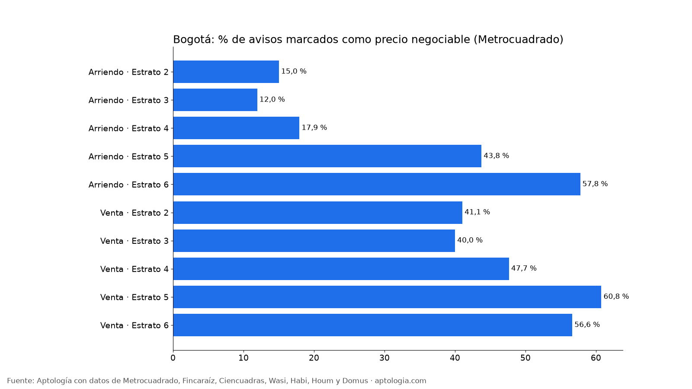

# Rebajas de precio y cuánto negociar en Bogotá: cuántos avisos bajan el arriendo o el precio de venta en una semana (octubre 2026)

**En una semana, el 2,6 % de los avisos de arriendo en Bogotá bajó su precio, con una rebaja mediana del 6,2 %; en venta bajó el 1,1 %, con una rebaja mediana del 3,6 %.** Además, el 52,1 % de los avisos de venta y el 38,0 % de los de arriendo en Metrocuadrado se declaran negociables.

*Resumen: seguimos a diario el precio de 73.624 avisos únicos de vivienda en Bogotá del 11 al 18 de octubre de 2026.*

**Actualizado:** 18 de octubre de 2026 (datos del 18 de octubre de 2026) · **Próxima actualización:** mensual.

## Resumen

| Indicador | Arriendo | Venta |
|---|---|---|
| Avisos seguidos toda la semana | 19.126 | 54.498 |
| Bajaron el precio en la semana | 2,6 % | 1,1 % |
| Rebaja mediana (entre los que bajaron) | 6,2 % | 3,6 % |
| Rebaja del 25 % que más bajó (o más) | 9,3 % | 6,5 % |
| Subieron el precio en la semana | 0,5 % | 0,5 % |
| Avisos marcados "negociable" (Metrocuadrado) | 38,0 % | 52,1 % |

En Habi, que muestra el precio anterior de sus inmuebles en venta, la rebaja mediana acumulada es 3,9 % (122 avisos).

## Por estrato

| Operación | Estrato | Bajaron precio | Rebaja mediana | Negociable | Avisos |
|---|---|---|---|---|---|
| Arriendo | Estrato 2 | 3,4 % | 8,6 % | 15,0 % | 626 |
| Arriendo | Estrato 3 | 3,0 % | 6,2 % | 12,0 % | 4.074 |
| Arriendo | Estrato 4 | 3,2 % | 5,9 % | 17,9 % | 4.924 |
| Arriendo | Estrato 5 | 2,7 % | 6,1 % | 43,8 % | 2.801 |
| Arriendo | Estrato 6 | 1,7 % | 6,4 % | 57,8 % | 6.532 |
| Venta | Estrato 2 | 1,0 % | 4,3 % | 41,1 % | 3.126 |
| Venta | Estrato 3 | 1,2 % | 3,5 % | 40,0 % | 11.502 |
| Venta | Estrato 4 | 1,6 % | 3,4 % | 47,7 % | 11.368 |
| Venta | Estrato 5 | 1,2 % | 3,7 % | 60,8 % | 9.738 |
| Venta | Estrato 6 | 0,7 % | 3,8 % | 56,6 % | 17.604 |

**Cómo usarlo para decidir (cuánto negociar):** una rebaja de 6,2 % en arriendo y de 3,6 % en venta es lo que los propios dueños están cediendo en pocos días: es un punto de partida razonable para ofrecer. En los estratos donde más avisos se declaran negociables, hay más margen. Si un aviso lleva semanas publicado, pide más.

## Preguntas frecuentes

**¿Cuánto se puede negociar el arriendo en Bogotá?**
Cuando un dueño baja el precio, la rebaja mediana es del 6,2 %; en una sola semana lo hizo el 2,6 % de los avisos (datos del 11 al 18 de octubre de 2026).

**¿Cuánto se puede negociar el precio de un apartamento en venta en Bogotá?**
La rebaja mediana observada en una semana fue del 3,6 %, y en Habi la rebaja acumulada mediana es del 3,9 %; el 52,1 % de los avisos de venta en Metrocuadrado se declara negociable.

**¿Qué porcentaje de avisos baja de precio?**
En una semana, el 2,6 % en arriendo y el 1,1 % en venta.

## Metodología

- **Fuente:** avisos vivos de vivienda recogidos por la ingesta de Aptología en Metrocuadrado, Fincaraíz, Ciencuadras, Wasi, Habi, Houm y Domus, del 11 al 18 de octubre de 2026. Corte: 18 de octubre de 2026.
- **Depuración:** un mismo inmueble publicado varias veces se cuenta una sola vez (agrupación por portal y, entre portales, por precio, área, habitaciones y coordenadas). Se descartan precios y áreas fuera de rango y, en arriendo, se resta la administración cuando el portal la incluye en el canon.
- **Qué se mide:** precios pedidos (publicados), no precios de cierre.
- **Rebaja:** avisos vistos desde el 11 de octubre cuyo último precio es entre 0,5 % y 40 % menor que el primero. Se descartan cambios que equivalen exactamente a sumar o restar la administración.
- **Negociable:** marca que el anunciante elige en Metrocuadrado (único portal que la publica).
- **Ventana corta:** una semana de seguimiento; en ventanas más largas la proporción de rebajas es mayor.
- **Limitaciones:** son precios pedidos en portales, que pueden diferir del valor final de arriendo o venta. La cobertura es mayor en el norte de Bogotá y en estratos 4 a 6, porque ahí se concentra la oferta publicada. Los barrios y la localidad vienen de lo que escribe cada portal; cuando falta la localidad se asigna por los avisos vecinos más cercanos.
- **Datos abiertos:** [datos.csv](datos.csv), licencia CC BY 4.0.

## Cómo citar

Pinzón Pineda, D. M. (2026). *Rebajas de precio y cuánto negociar en Bogotá: cuántos avisos bajan el arriendo o el precio de venta en una semana (octubre 2026)*. Aptología. https://www.aptologia.com/estudios/rebajas-de-precio-y-cuanto-negociar-vivienda-bogota-2026. Datos: datos.csv, licencia CC BY 4.0.
