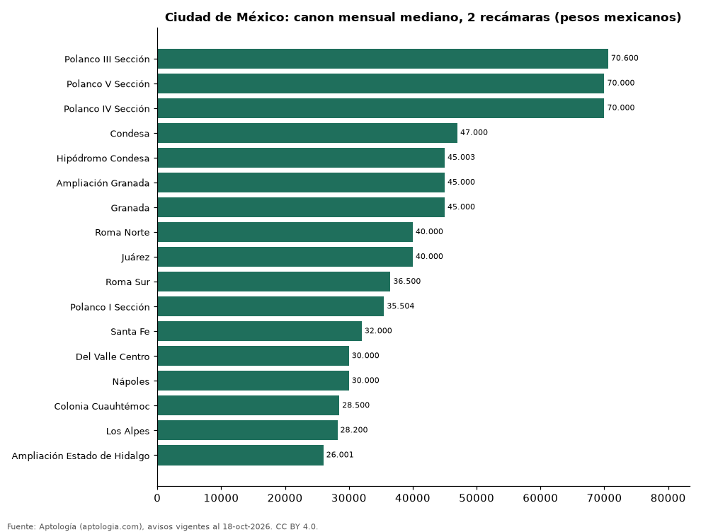

# Dónde es más caro y más barato rentar un departamento de 2 recámaras en Ciudad de México: ranking de colonias (octubre 2026)

**En Ciudad de México, un departamento de 2 recámaras se renta por 70.600 pesos mexicanos (USD 3.823) al mes en la mediana en Polanco III Sección, la colonia más cara, y 26.001 pesos mexicanos (USD 1.408) al mes en Ampliación Estado de Hidalgo, la más barata: 2,7 veces menos.** Comparamos 17 colonias con al menos 30 avisos de 2 recámaras.

*Resumen: analizamos 1.089 departamentos en renta de 2 recámaras en 17 colonias de Ciudad de México.*

**Actualizado:** 18 de octubre de 2026 (datos del 18 de octubre de 2026) · **Próxima actualización:** mensual.

## Resumen

| Indicador | Valor |
|---|---|
| Más caro | Polanco III Sección: 70.600 pesos mexicanos (USD 3.823) |
| Más barato | Ampliación Estado de Hidalgo: 26.001 pesos mexicanos (USD 1.408) |
| Diferencia | 2,7 veces |
| Colonias | 17 |

## Canon mensual de un departamento de 2 recámaras por colonia

| Colonia | Canon mensual (mediana) | Rango típico (P25–P75) | Área mediana (m²) | Avisos |
|---|---|---|---|---|
| Polanco III Sección | 70.600 pesos mexicanos (USD 3.823) | 58.000 pesos mexicanos (USD 3.141) – 90.000 pesos mexicanos (USD 4.874) | 153 | 39 |
| Polanco V Sección | 70.000 pesos mexicanos (USD 3.791) | 52.000 pesos mexicanos (USD 2.816) – 90.000 pesos mexicanos (USD 4.874) | 180 | 45 |
| Polanco IV Sección | 70.000 pesos mexicanos (USD 3.791) | 55.000 pesos mexicanos (USD 2.979) – 87.000 pesos mexicanos (USD 4.712) | 160 | 135 |
| Condesa | 47.000 pesos mexicanos (USD 2.545) | 37.250 pesos mexicanos (USD 2.017) – 61.000 pesos mexicanos (USD 3.303) | 98 | 47 |
| Hipódromo Condesa | 45.003 pesos mexicanos (USD 2.437) | 37.000 pesos mexicanos (USD 2.004) – 58.000 pesos mexicanos (USD 3.141) | 100 | 49 |
| Ampliación Granada | 45.000 pesos mexicanos (USD 2.437) | 39.000 pesos mexicanos (USD 2.112) – 60.000 pesos mexicanos (USD 3.249) | 105 | 69 |
| Granada | 45.000 pesos mexicanos (USD 2.437) | 39.000 pesos mexicanos (USD 2.112) – 64.000 pesos mexicanos (USD 3.466) | 116 | 55 |
| Roma Norte | 40.000 pesos mexicanos (USD 2.166) | 32.000 pesos mexicanos (USD 1.733) – 55.000 pesos mexicanos (USD 2.979) | 96 | 95 |
| Juárez | 40.000 pesos mexicanos (USD 2.166) | 32.000 pesos mexicanos (USD 1.733) – 48.165 pesos mexicanos (USD 2.608) | 90 | 57 |
| Roma Sur | 36.500 pesos mexicanos (USD 1.977) | 30.375 pesos mexicanos (USD 1.645) – 44.025 pesos mexicanos (USD 2.384) | 82 | 38 |
| Polanco I Sección | 35.504 pesos mexicanos (USD 1.923) | 25.384 pesos mexicanos (USD 1.375) – 55.753 pesos mexicanos (USD 3.019) | 110 | 124 |
| Santa Fe | 32.000 pesos mexicanos (USD 1.733) | 24.750 pesos mexicanos (USD 1.340) – 39.125 pesos mexicanos (USD 2.119) | 108 | 48 |
| Del Valle Centro | 30.000 pesos mexicanos (USD 1.625) | 25.500 pesos mexicanos (USD 1.381) – 35.000 pesos mexicanos (USD 1.895) | 90 | 53 |
| Nápoles | 30.000 pesos mexicanos (USD 1.625) | 24.500 pesos mexicanos (USD 1.327) – 36.000 pesos mexicanos (USD 1.950) | 86 | 37 |
| Colonia Cuauhtémoc | 28.500 pesos mexicanos (USD 1.543) | 21.700 pesos mexicanos (USD 1.175) – 39.650 pesos mexicanos (USD 2.147) | 80 | 107 |
| Los Alpes | 28.200 pesos mexicanos (USD 1.527) | 24.500 pesos mexicanos (USD 1.327) – 34.250 pesos mexicanos (USD 1.855) | 94 | 36 |
| Ampliación Estado de Hidalgo | 26.001 pesos mexicanos (USD 1.408) | 21.542 pesos mexicanos (USD 1.167) – 28.013 pesos mexicanos (USD 1.517) | 103 | 55 |

Medianas del canon pedido, sin administración ni gastos comunes; solo colonias con 30 avisos o más.

## Preguntas frecuentes

**¿Cuánto cuesta rentar un departamento de 2 recámaras en Polanco III Sección?**
70.600 pesos mexicanos (USD 3.823) al mes en la mediana (octubre de 2026); la mitad central entre 58.000 pesos mexicanos (USD 3.141) y 90.000 pesos mexicanos (USD 4.874).

**¿Dónde es más barato rentar un departamento de 2 recámaras en Ciudad de México?**
En Ampliación Estado de Hidalgo: 26.001 pesos mexicanos (USD 1.408) al mes en la mediana.

## Metodología

- **Fuente:** exportes nocturnos de la base de datos de Aptología (aptologia.com) del 18 de octubre de 2026: avisos vigentes de vivienda en portales inmobiliarios de 13 países, recogidos por Aptología y vistos en línea entre el 11 y el 18 de octubre de 2026. Corte: 18 de octubre de 2026.
- **Depuración:** se eliminan duplicados exactos (misma ciudad, zona, tipo, precio, moneda, área, habitaciones y baños) y los precios fuera del percentil 1–99 de cada país, operación, moneda y tipo; el precio por m² usa solo avisos con área declarada entre 12 y 2.000 m² y también se recorta al P1–P99.
- **Qué se mide:** precios pedidos (publicados), no precios de cierre. En arriendo, el canon mensual sin administración, gastos comunes ni condominio.
- **Muestra mínima:** cada cifra publicada se apoya en al menos 30 avisos; las celdas con menos se omiten.
- **Monedas:** nunca se mezclan avisos de monedas distintas sin convertirlos. Conversión a dólares con la tasa de mercado de ExchangeRate-API (open.er-api.com, actualización del 18 Oct 2026): 1 USD = 3.182,80 COP, 1 USD = 18,47 M.N, 1 USD = 5,09 BRL, 1 USD = 3,44 PEN, 1 USD = 982,44 CLP, 1 USD = 1.514,57 ARS, 1 USD = 40,20 UYU, 1 USD = 5.705,37 PYG, 1 USD = 61,27 DOP, 1 USD = 0,89 EUR, 1 USD = 11,72 BOB; la UF chilena a 41.178,64 CLP (mindicador,cl. 18-oct-2026). Los avisos publicados en dólares se usan tal cual.
- **Monedas:** en cada ciudad y operación se usa solo la moneda mayoritaria de los avisos (los avisos en otra moneda se excluyen) y la mediana se convierte a dólares con la tasa citada; nunca se promedian avisos de monedas distintas.
- **Limitaciones:** la cobertura depende de los portales que recorre Aptología en cada país y es mayor en las ciudades grandes y en los segmentos medio-alto y alto; el área es la que declara el aviso, sin verificar; los nombres de zona vienen de los portales.
- **Privacidad:** solo se publican agregados; no se publica ningún dato personal, enlace a avisos ni nombre de anunciante.
- **Datos abiertos:** [datos.csv](datos.csv), licencia CC BY 4.0.

## Cómo citar

Pinzón Pineda, D. M. (2026). *Dónde es más caro y más barato rentar un departamento de 2 recámaras en Ciudad de México: ranking de colonias (octubre 2026)*. Aptología (aptologia.com). https://github.com/elbroker/aptologia-datos/tree/main/estudios/renta-departamentos-de-2-recamaras-por-colonia-ciudad-de-mexico-2026. Datos: datos.csv, licencia CC BY 4.0.
