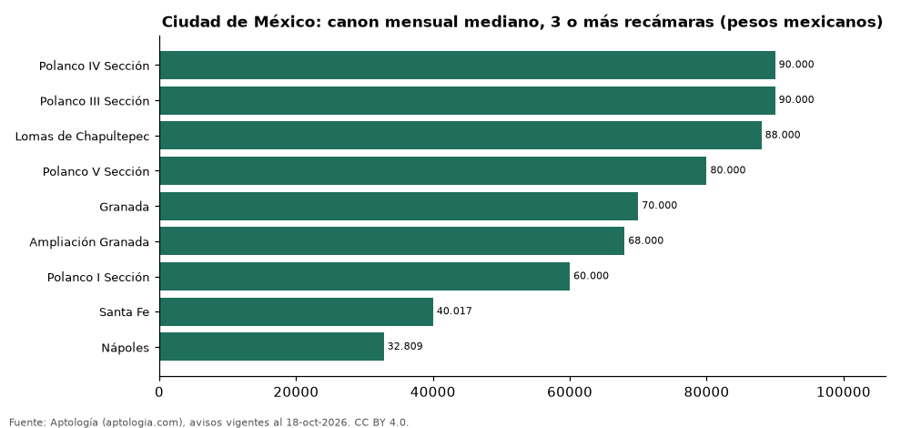

# Dónde es más caro y más barato rentar un departamento de 3 o más recámaras en Ciudad de México: ranking de colonias (octubre 2026)

**En Ciudad de México, un departamento de 3 o más recámaras se renta por 90.000 pesos mexicanos (USD 4.874) al mes en la mediana en Polanco IV Sección, la colonia más cara, y 32.809 pesos mexicanos (USD 1.777) al mes en Nápoles, la más barata: 2,7 veces menos.** Comparamos 9 colonias con al menos 30 avisos de 3 o más recámaras.

*Resumen: analizamos 601 departamentos en renta de 3 o más recámaras en 9 colonias de Ciudad de México.*

**Actualizado:** 18 de octubre de 2026 (datos del 18 de octubre de 2026) · **Próxima actualización:** mensual.

## Resumen

| Indicador | Valor |
|---|---|
| Más caro | Polanco IV Sección: 90.000 pesos mexicanos (USD 4.874) |
| Más barato | Nápoles: 32.809 pesos mexicanos (USD 1.777) |
| Diferencia | 2,7 veces |
| Colonias | 9 |

## Canon mensual de un departamento de 3 o más recámaras por colonia

| Colonia | Canon mensual (mediana) | Rango típico (P25–P75) | Área mediana (m²) | Avisos |
|---|---|---|---|---|
| Polanco IV Sección | 90.000 pesos mexicanos (USD 4.874) | 70.000 pesos mexicanos (USD 3.791) – 120.000 pesos mexicanos (USD 6.499) | 244 | 155 |
| Polanco III Sección | 90.000 pesos mexicanos (USD 4.874) | 79.500 pesos mexicanos (USD 4.305) – 102.500 pesos mexicanos (USD 5.551) | 265 | 52 |
| Lomas de Chapultepec | 88.000 pesos mexicanos (USD 4.766) | 58.000 pesos mexicanos (USD 3.141) – 110.000 pesos mexicanos (USD 5.957) | 314 | 41 |
| Polanco V Sección | 80.000 pesos mexicanos (USD 4.332) | 62.000 pesos mexicanos (USD 3.358) – 92.465 pesos mexicanos (USD 5.007) | 247 | 65 |
| Granada | 70.000 pesos mexicanos (USD 3.791) | 55.002 pesos mexicanos (USD 2.979) – 90.500 pesos mexicanos (USD 4.901) | 168 | 35 |
| Ampliación Granada | 68.000 pesos mexicanos (USD 3.683) | 46.425 pesos mexicanos (USD 2.514) – 80.000 pesos mexicanos (USD 4.332) | 146 | 50 |
| Polanco I Sección | 60.000 pesos mexicanos (USD 3.249) | 45.000 pesos mexicanos (USD 2.437) – 85.000 pesos mexicanos (USD 4.603) | 220 | 133 |
| Santa Fe | 40.017 pesos mexicanos (USD 2.167) | 34.000 pesos mexicanos (USD 1.841) – 57.500 pesos mexicanos (USD 3.114) | 167 | 31 |
| Nápoles | 32.809 pesos mexicanos (USD 1.777) | 28.900 pesos mexicanos (USD 1.565) – 37.250 pesos mexicanos (USD 2.017) | 111 | 39 |

Medianas del canon pedido, sin administración ni gastos comunes; solo colonias con 30 avisos o más.

## Preguntas frecuentes

**¿Cuánto cuesta rentar un departamento de 3 o más recámaras en Polanco IV Sección?**
90.000 pesos mexicanos (USD 4.874) al mes en la mediana (octubre de 2026); la mitad central entre 70.000 pesos mexicanos (USD 3.791) y 120.000 pesos mexicanos (USD 6.499).

**¿Dónde es más barato rentar un departamento de 3 o más recámaras en Ciudad de México?**
En Nápoles: 32.809 pesos mexicanos (USD 1.777) al mes en la mediana.

## Metodología

- **Fuente:** exportes nocturnos de la base de datos de Aptología (aptologia.com) del 18 de octubre de 2026: avisos vigentes de vivienda en portales inmobiliarios de 13 países, recogidos por Aptología y vistos en línea entre el 11 y el 18 de octubre de 2026. Corte: 18 de octubre de 2026.
- **Depuración:** se eliminan duplicados exactos (misma ciudad, zona, tipo, precio, moneda, área, habitaciones y baños) y los precios fuera del percentil 1–99 de cada país, operación, moneda y tipo; el precio por m² usa solo avisos con área declarada entre 12 y 2.000 m² y también se recorta al P1–P99.
- **Qué se mide:** precios pedidos (publicados), no precios de cierre. En arriendo, el canon mensual sin administración, gastos comunes ni condominio.
- **Muestra mínima:** cada cifra publicada se apoya en al menos 30 avisos; las celdas con menos se omiten.
- **Monedas:** nunca se mezclan avisos de monedas distintas sin convertirlos. Conversión a dólares con la tasa de mercado de ExchangeRate-API (open.er-api.com, actualización del 18 Oct 2026): 1 USD = 3.182,80 COP, 1 USD = 18,47 M.N, 1 USD = 5,09 BRL, 1 USD = 3,44 PEN, 1 USD = 982,44 CLP, 1 USD = 1.514,57 ARS, 1 USD = 40,20 UYU, 1 USD = 5.705,37 PYG, 1 USD = 61,27 DOP, 1 USD = 0,89 EUR, 1 USD = 11,72 BOB; la UF chilena a 41.178,64 CLP (mindicador,cl. 18-oct-2026). Los avisos publicados en dólares se usan tal cual.
- **Monedas:** en cada ciudad y operación se usa solo la moneda mayoritaria de los avisos (los avisos en otra moneda se excluyen) y la mediana se convierte a dólares con la tasa citada; nunca se promedian avisos de monedas distintas.
- **Limitaciones:** la cobertura depende de los portales que recorre Aptología en cada país y es mayor en las ciudades grandes y en los segmentos medio-alto y alto; el área es la que declara el aviso, sin verificar; los nombres de zona vienen de los portales.
- **Privacidad:** solo se publican agregados; no se publica ningún dato personal, enlace a avisos ni nombre de anunciante.
- **Datos abiertos:** [datos.csv](datos.csv), licencia CC BY 4.0.

## Cómo citar

Pinzón Pineda, D. M. (2026). *Dónde es más caro y más barato rentar un departamento de 3 o más recámaras en Ciudad de México: ranking de colonias (octubre 2026)*. Aptología (aptologia.com). https://github.com/elbroker/aptologia-datos/tree/main/estudios/renta-departamentos-de-3-o-mas-recamaras-por-colonia-ciudad-de-mexico-2026. Datos: datos.csv, licencia CC BY 4.0.
