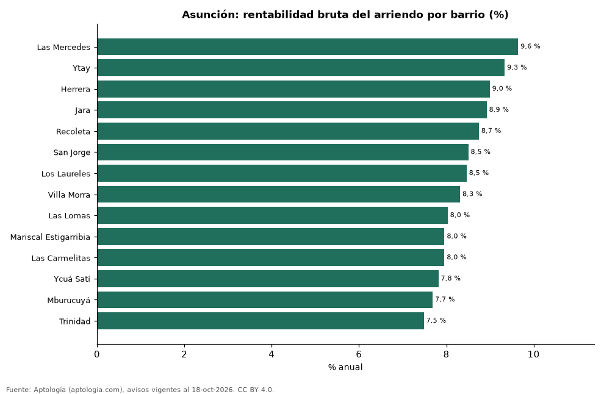

# Rentabilidad del arriendo en Asunción por barrio: dónde rinde más comprar para arrendar (octubre 2026)

**En Asunción, comprar un apartamento para arrendarlo rinde en el barrio típico 8,4 % bruto al año: el precio pedido equivale a 11,9 años de arriendo. El barrio con mayor rentabilidad bruta es Las Mercedes (9,6 %) y el de menor, Trinidad (7,5 %).** Para toda la ciudad, con las medianas por m², la rentabilidad bruta implícita es 8,0 %.

*Resumen: comparamos el precio por m² de 3.050 apartamentos en venta con el canon por m² de 1.330 en arriendo en 14 barrios de Asunción.*

**Actualizado:** 18 de octubre de 2026 (datos del 18 de octubre de 2026) · **Próxima actualización:** mensual.

## Resumen

| Indicador | Valor |
|---|---|
| Mayor rentabilidad | Las Mercedes: 9,6 % |
| Menor rentabilidad | Trinidad: 7,5 % |
| Barrio típico (mediana) | 8,4 % |
| Ciudad (medianas por m²) | 8,0 % |
| Barrios comparados | 14 |

## Rentabilidad bruta por barrio

| Barrio | Venta por m² (dólares) | Arriendo por m² al mes (guaraníes) | Rentabilidad bruta | Años de arriendo | Avisos (venta / arriendo) |
|---|---|---|---|---|---|
| Las Mercedes | 1.575 | 72.222 | 9,6 % | 10,4 | 281 / 181 |
| Ytay | 1.630 | 72.368 | 9,3 % | 10,7 | 79 / 39 |
| Herrera | 1.628 | 69.643 | 9,0 % | 11,1 | 141 / 117 |
| Jara | 1.607 | 68.182 | 8,9 % | 11,2 | 141 / 78 |
| Recoleta | 1.930 | 80.247 | 8,7 % | 11,4 | 407 / 113 |
| San Jorge | 1.988 | 80.357 | 8,5 % | 11,8 | 78 / 33 |
| Los Laureles | 1.711 | 68.831 | 8,5 % | 11,8 | 71 / 87 |
| Villa Morra | 1.941 | 76.743 | 8,3 % | 12,0 | 411 / 178 |
| Las Lomas | 2.143 | 81.818 | 8,0 % | 12,5 | 539 / 123 |
| Mariscal Estigarribia | 1.865 | 70.556 | 8,0 % | 12,6 | 56 / 43 |
| Las Carmelitas | 2.000 | 75.648 | 8,0 % | 12,6 | 167 / 60 |
| Ycuá Satí | 2.018 | 75.000 | 7,8 % | 12,8 | 303 / 99 |
| Mburucuyá | 2.052 | 75.000 | 7,7 % | 13,0 | 266 / 149 |
| Trinidad | 1.895 | 67.424 | 7,5 % | 13,4 | 110 / 30 |

Ordenado de mayor a menor rentabilidad. Antes de administración, impuestos, vacancia y financiación.

## Preguntas frecuentes

**¿En qué barrio de Asunción rinde más comprar para arrendar?**
En Las Mercedes, con 9,6 % bruto anual (10,4 años de arriendo), según avisos de octubre de 2026.

**¿Dónde rinde menos?**
En Trinidad: 7,5 % bruto anual (13,4 años de arriendo).

**¿Cuánto renta un apartamento en Asunción?**
En el barrio típico, 8,4 % bruto al año.

## Metodología

- **Fuente:** exportes nocturnos de la base de datos de Aptología (aptologia.com) del 18 de octubre de 2026: avisos vigentes de vivienda en portales inmobiliarios de 13 países, recogidos por Aptología y vistos en línea entre el 11 y el 18 de octubre de 2026. Corte: 18 de octubre de 2026.
- **Depuración:** se eliminan duplicados exactos (misma ciudad, zona, tipo, precio, moneda, área, habitaciones y baños) y los precios fuera del percentil 1–99 de cada país, operación, moneda y tipo; el precio por m² usa solo avisos con área declarada entre 12 y 2.000 m² y también se recorta al P1–P99.
- **Qué se mide:** precios pedidos (publicados), no precios de cierre. En arriendo, el canon mensual sin administración, gastos comunes ni condominio.
- **Muestra mínima:** cada cifra publicada se apoya en al menos 30 avisos; las celdas con menos se omiten.
- **Monedas:** nunca se mezclan avisos de monedas distintas sin convertirlos. Conversión a dólares con la tasa de mercado de ExchangeRate-API (open.er-api.com, actualización del 18 Oct 2026): 1 USD = 3.182,80 COP, 1 USD = 18,47 M.N, 1 USD = 5,09 BRL, 1 USD = 3,44 PEN, 1 USD = 982,44 CLP, 1 USD = 1.514,57 ARS, 1 USD = 40,20 UYU, 1 USD = 5.705,37 PYG, 1 USD = 61,27 DOP, 1 USD = 0,89 EUR, 1 USD = 11,72 BOB; la UF chilena a 41.178,64 CLP (mindicador,cl. 18-oct-2026). Los avisos publicados en dólares se usan tal cual.
- **Monedas:** en cada ciudad y operación se usa solo la moneda mayoritaria de los avisos (los avisos en otra moneda se excluyen) y la mediana se convierte a dólares con la tasa citada; nunca se promedian avisos de monedas distintas.
- **Años de arriendo para pagar la vivienda:** precio de venta mediano ÷ (canon mensual mediano × 12), entre avisos del mismo tipo y celda; es la relación precio/arriendo (price-to-rent ratio) y equivale a 100 ÷ rentabilidad bruta. No incluye administración, impuestos, vacancia, financiación ni valorización: es una referencia para comparar comprar con arrendar, no una recomendación de inversión.
- **Rentabilidad por barrio:** canon mediano por m² × 12 ÷ precio de venta mediano por m² de apartamentos del mismo barrio; solo barrios con 30 avisos o más de venta y 30 o más de arriendo con área declarada. Usar el m² y no el precio total evita que el tamaño típico de cada barrio sesgue la comparación.
- **Monedas distintas:** la venta se publica sobre todo en dólares y el arriendo en guaraníes; cada mediana se calcula en su propia moneda y solo después se convierte a dólares con la tasa citada, así que la rentabilidad depende de esa tasa.
- **Limitaciones:** la cobertura depende de los portales que recorre Aptología en cada país y es mayor en las ciudades grandes y en los segmentos medio-alto y alto; el área es la que declara el aviso, sin verificar; los nombres de zona vienen de los portales.
- **Privacidad:** solo se publican agregados; no se publica ningún dato personal, enlace a avisos ni nombre de anunciante.
- **Datos abiertos:** [datos.csv](datos.csv), licencia CC BY 4.0.

## Cómo citar

Pinzón Pineda, D. M. (2026). *Rentabilidad del arriendo en Asunción por barrio: dónde rinde más comprar para arrendar (octubre 2026)*. Aptología (aptologia.com). https://github.com/elbroker/aptologia-datos/tree/main/estudios/rentabilidad-alquiler-asuncion-por-barrio-2026. Datos: datos.csv, licencia CC BY 4.0.
