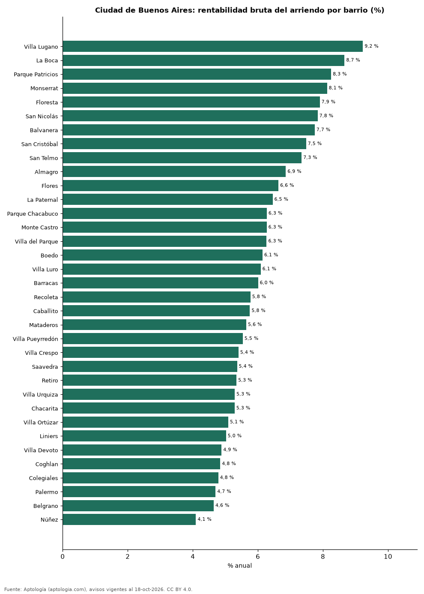

# Rentabilidad del arriendo en Ciudad de Buenos Aires por barrio: dónde rinde más comprar para arrendar (octubre 2026)

**En Ciudad de Buenos Aires, comprar un apartamento para arrendarlo rinde en el barrio típico 6,0 % bruto al año: el precio pedido equivale a 16,7 años de arriendo. El barrio con mayor rentabilidad bruta es Villa Lugano (9,2 %) y el de menor, Núñez (4,1 %).** Para toda la ciudad, con las medianas por m², la rentabilidad bruta implícita es 5,8 %.

*Resumen: comparamos el precio por m² de 7.111 apartamentos en venta con el canon por m² de 2.838 en arriendo en 35 barrios de Ciudad de Buenos Aires.*

**Actualizado:** 18 de octubre de 2026 (datos del 18 de octubre de 2026) · **Próxima actualización:** mensual.

## Resumen

| Indicador | Valor |
|---|---|
| Mayor rentabilidad | Villa Lugano: 9,2 % |
| Menor rentabilidad | Núñez: 4,1 % |
| Barrio típico (mediana) | 6,0 % |
| Ciudad (medianas por m²) | 5,8 % |
| Barrios comparados | 35 |

## Rentabilidad bruta por barrio

| Barrio | Venta por m² (dólares) | Arriendo por m² al mes (pesos argentinos) | Rentabilidad bruta | Años de arriendo | Avisos (venta / arriendo) |
|---|---|---|---|---|---|
| Villa Lugano | 1.213 | 14.124 | 9,2 % | 10,8 | 113 / 58 |
| La Boca | 1.472 | 16.095 | 8,7 % | 11,5 | 124 / 30 |
| Parque Patricios | 1.783 | 18.571 | 8,3 % | 12,1 | 141 / 35 |
| Monserrat | 1.625 | 16.667 | 8,1 % | 12,3 | 192 / 61 |
| Floresta | 1.705 | 17.000 | 7,9 % | 12,7 | 159 / 71 |
| San Nicolás | 1.618 | 16.000 | 7,8 % | 12,8 | 200 / 88 |
| Balvanera | 1.701 | 16.629 | 7,7 % | 12,9 | 471 / 152 |
| San Cristóbal | 1.857 | 17.538 | 7,5 % | 13,4 | 159 / 70 |
| San Telmo | 1.894 | 17.553 | 7,3 % | 13,6 | 161 / 59 |
| Almagro | 2.167 | 18.750 | 6,9 % | 14,6 | 167 / 120 |
| Flores | 2.115 | 17.704 | 6,6 % | 15,1 | 195 / 124 |
| La Paternal | 2.171 | 17.679 | 6,5 % | 15,5 | 136 / 36 |
| Parque Chacabuco | 2.357 | 18.661 | 6,3 % | 15,9 | 155 / 56 |
| Monte Castro | 2.442 | 19.321 | 6,3 % | 16,0 | 129 / 40 |
| Villa del Parque | 2.444 | 19.333 | 6,3 % | 16,0 | 148 / 89 |
| Boedo | 2.317 | 17.959 | 6,1 % | 16,3 | 149 / 69 |
| Villa Luro | 2.387 | 18.333 | 6,1 % | 16,4 | 145 / 65 |
| Barracas | 2.285 | 17.321 | 6,0 % | 16,7 | 152 / 58 |
| Recoleta | 2.712 | 19.753 | 5,8 % | 17,3 | 341 / 179 |
| Caballito | 2.617 | 19.000 | 5,8 % | 17,4 | 72 / 135 |
| Mataderos | 2.558 | 18.218 | 5,6 % | 17,7 | 141 / 54 |
| Villa Pueyrredón | 2.684 | 18.750 | 5,5 % | 18,1 | 142 / 59 |
| Villa Crespo | 3.014 | 20.554 | 5,4 % | 18,5 | 154 / 88 |
| Saavedra | 3.143 | 21.263 | 5,4 % | 18,7 | 127 / 56 |
| Retiro | 2.500 | 16.854 | 5,3 % | 18,7 | 198 / 51 |
| Villa Urquiza | 3.142 | 20.968 | 5,3 % | 18,9 | 154 / 103 |
| Chacarita | 3.037 | 20.256 | 5,3 % | 18,9 | 128 / 40 |
| Villa Ortúzar | 3.114 | 20.000 | 5,1 % | 19,6 | 137 / 34 |
| Liniers | 2.631 | 16.667 | 5,0 % | 19,9 | 156 / 64 |
| Villa Devoto | 3.257 | 20.075 | 4,9 % | 20,5 | 169 / 94 |
| Coghlan | 3.272 | 20.000 | 4,8 % | 20,6 | 146 / 34 |
| Colegiales | 3.444 | 20.789 | 4,8 % | 20,9 | 153 / 75 |
| Palermo | 3.719 | 22.053 | 4,7 % | 21,3 | 1.021 / 258 |
| Belgrano | 3.734 | 21.875 | 4,6 % | 21,5 | 653 / 159 |
| Núñez | 4.444 | 22.967 | 4,1 % | 24,4 | 123 / 74 |

Ordenado de mayor a menor rentabilidad. Antes de administración, impuestos, vacancia y financiación.

## Preguntas frecuentes

**¿En qué barrio de Ciudad de Buenos Aires rinde más comprar para arrendar?**
En Villa Lugano, con 9,2 % bruto anual (10,8 años de arriendo), según avisos de octubre de 2026.

**¿Dónde rinde menos?**
En Núñez: 4,1 % bruto anual (24,4 años de arriendo).

**¿Cuánto renta un apartamento en Ciudad de Buenos Aires?**
En el barrio típico, 6,0 % bruto al año.

## Metodología

- **Fuente:** exportes nocturnos de la base de datos de Aptología (aptologia.com) del 18 de octubre de 2026: avisos vigentes de vivienda en portales inmobiliarios de 13 países, recogidos por Aptología y vistos en línea entre el 11 y el 18 de octubre de 2026. Corte: 18 de octubre de 2026.
- **Depuración:** se eliminan duplicados exactos (misma ciudad, zona, tipo, precio, moneda, área, habitaciones y baños) y los precios fuera del percentil 1–99 de cada país, operación, moneda y tipo; el precio por m² usa solo avisos con área declarada entre 12 y 2.000 m² y también se recorta al P1–P99.
- **Qué se mide:** precios pedidos (publicados), no precios de cierre. En arriendo, el canon mensual sin administración, gastos comunes ni condominio.
- **Muestra mínima:** cada cifra publicada se apoya en al menos 30 avisos; las celdas con menos se omiten.
- **Monedas:** nunca se mezclan avisos de monedas distintas sin convertirlos. Conversión a dólares con la tasa de mercado de ExchangeRate-API (open.er-api.com, actualización del 18 Oct 2026): 1 USD = 3.182,80 COP, 1 USD = 18,47 M.N, 1 USD = 5,09 BRL, 1 USD = 3,44 PEN, 1 USD = 982,44 CLP, 1 USD = 1.514,57 ARS, 1 USD = 40,20 UYU, 1 USD = 5.705,37 PYG, 1 USD = 61,27 DOP, 1 USD = 0,89 EUR, 1 USD = 11,72 BOB; la UF chilena a 41.178,64 CLP (mindicador,cl. 18-oct-2026). Los avisos publicados en dólares se usan tal cual.
- **Monedas:** en cada ciudad y operación se usa solo la moneda mayoritaria de los avisos (los avisos en otra moneda se excluyen) y la mediana se convierte a dólares con la tasa citada; nunca se promedian avisos de monedas distintas.
- **Años de arriendo para pagar la vivienda:** precio de venta mediano ÷ (canon mensual mediano × 12), entre avisos del mismo tipo y celda; es la relación precio/arriendo (price-to-rent ratio) y equivale a 100 ÷ rentabilidad bruta. No incluye administración, impuestos, vacancia, financiación ni valorización: es una referencia para comparar comprar con arrendar, no una recomendación de inversión.
- **Rentabilidad por barrio:** canon mediano por m² × 12 ÷ precio de venta mediano por m² de apartamentos del mismo barrio; solo barrios con 30 avisos o más de venta y 30 o más de arriendo con área declarada. Usar el m² y no el precio total evita que el tamaño típico de cada barrio sesgue la comparación.
- **Monedas distintas:** la venta se publica sobre todo en dólares y el arriendo en pesos argentinos; cada mediana se calcula en su propia moneda y solo después se convierte a dólares con la tasa citada, así que la rentabilidad depende de esa tasa.
- **Limitaciones:** la cobertura depende de los portales que recorre Aptología en cada país y es mayor en las ciudades grandes y en los segmentos medio-alto y alto; el área es la que declara el aviso, sin verificar; los nombres de zona vienen de los portales.
- **Privacidad:** solo se publican agregados; no se publica ningún dato personal, enlace a avisos ni nombre de anunciante.
- **Datos abiertos:** [datos.csv](datos.csv), licencia CC BY 4.0.

## Cómo citar

Pinzón Pineda, D. M. (2026). *Rentabilidad del arriendo en Ciudad de Buenos Aires por barrio: dónde rinde más comprar para arrendar (octubre 2026)*. Aptología (aptologia.com). https://github.com/elbroker/aptologia-datos/tree/main/estudios/rentabilidad-alquiler-ciudad-de-buenos-aires-por-barrio-2026. Datos: datos.csv, licencia CC BY 4.0.
