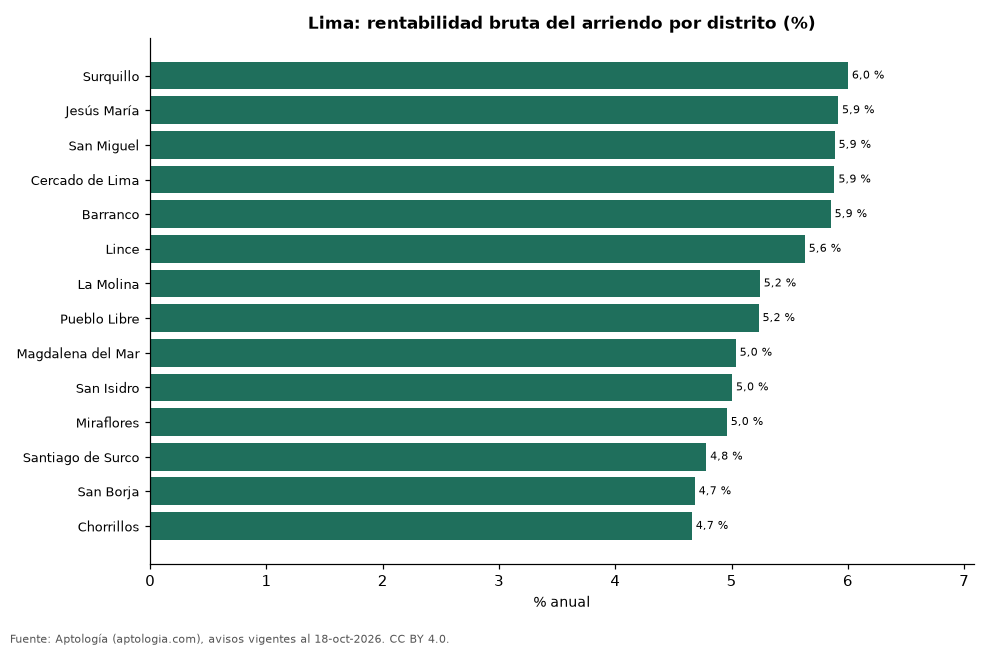

# Rentabilidad del arriendo en Lima por distrito: dónde rinde más comprar para arrendar (octubre 2026)

**En Lima, comprar un apartamento para arrendarlo rinde en el distrito típico 5,2 % bruto al año: el precio pedido equivale a 19,1 años de arriendo. El distrito con mayor rentabilidad bruta es Surquillo (6,0 %) y el de menor, Chorrillos (4,7 %).** Para toda la ciudad, con las medianas por m², la rentabilidad bruta implícita es 5,4 %.

*Resumen: comparamos el precio por m² de 5.640 apartamentos en venta con el canon por m² de 2.709 en arriendo en 14 distritos de Lima.*

**Actualizado:** 18 de octubre de 2026 (datos del 18 de octubre de 2026) · **Próxima actualización:** mensual.

## Resumen

| Indicador | Valor |
|---|---|
| Mayor rentabilidad | Surquillo: 6,0 % |
| Menor rentabilidad | Chorrillos: 4,7 % |
| Distrito típico (mediana) | 5,2 % |
| Ciudad (medianas por m²) | 5,4 % |
| Distritos comparados | 14 |

## Rentabilidad bruta por distrito

| Distrito | Venta por m² (soles) | Arriendo por m² al mes (soles) | Rentabilidad bruta | Años de arriendo | Avisos (venta / arriendo) |
|---|---|---|---|---|---|
| Surquillo | 7.222 | 36,11 | 6,0 % | 16,7 | 346 / 85 |
| Jesús María | 7.245 | 35,71 | 5,9 % | 16,9 | 272 / 89 |
| San Miguel | 6.155 | 30,19 | 5,9 % | 17,0 | 399 / 140 |
| Cercado de Lima | 6.502 | 31,88 | 5,9 % | 17,0 | 315 / 31 |
| Barranco | 9.016 | 43,97 | 5,9 % | 17,1 | 180 / 155 |
| Lince | 7.661 | 35,94 | 5,6 % | 17,8 | 211 / 71 |
| La Molina | 5.203 | 22,73 | 5,2 % | 19,1 | 69 / 63 |
| Pueblo Libre | 6.574 | 28,66 | 5,2 % | 19,1 | 214 / 56 |
| Magdalena del Mar | 7.631 | 32,02 | 5,0 % | 19,9 | 286 / 94 |
| San Isidro | 8.877 | 37,01 | 5,0 % | 20,0 | 685 / 466 |
| Miraflores | 8.884 | 36,71 | 5,0 % | 20,2 | 1.114 / 919 |
| Santiago de Surco | 6.776 | 27,00 | 4,8 % | 20,9 | 1.039 / 403 |
| San Borja | 7.452 | 29,08 | 4,7 % | 21,4 | 268 / 92 |
| Chorrillos | 6.083 | 23,61 | 4,7 % | 21,5 | 242 / 45 |

Ordenado de mayor a menor rentabilidad. Antes de administración, impuestos, vacancia y financiación.

## Preguntas frecuentes

**¿En qué distrito de Lima rinde más comprar para arrendar?**
En Surquillo, con 6,0 % bruto anual (16,7 años de arriendo), según avisos de octubre de 2026.

**¿Dónde rinde menos?**
En Chorrillos: 4,7 % bruto anual (21,5 años de arriendo).

**¿Cuánto renta un apartamento en Lima?**
En el distrito típico, 5,2 % bruto al año.

## Metodología

- **Fuente:** exportes nocturnos de la base de datos de Aptología (aptologia.com) del 18 de octubre de 2026: avisos vigentes de vivienda en portales inmobiliarios de 13 países, recogidos por Aptología y vistos en línea entre el 11 y el 18 de octubre de 2026. Corte: 18 de octubre de 2026.
- **Depuración:** se eliminan duplicados exactos (misma ciudad, zona, tipo, precio, moneda, área, habitaciones y baños) y los precios fuera del percentil 1–99 de cada país, operación, moneda y tipo; el precio por m² usa solo avisos con área declarada entre 12 y 2.000 m² y también se recorta al P1–P99.
- **Qué se mide:** precios pedidos (publicados), no precios de cierre. En arriendo, el canon mensual sin administración, gastos comunes ni condominio.
- **Muestra mínima:** cada cifra publicada se apoya en al menos 30 avisos; las celdas con menos se omiten.
- **Monedas:** nunca se mezclan avisos de monedas distintas sin convertirlos. Conversión a dólares con la tasa de mercado de ExchangeRate-API (open.er-api.com, actualización del 18 Oct 2026): 1 USD = 3.182,80 COP, 1 USD = 18,47 M.N, 1 USD = 5,09 BRL, 1 USD = 3,44 PEN, 1 USD = 982,44 CLP, 1 USD = 1.514,57 ARS, 1 USD = 40,20 UYU, 1 USD = 5.705,37 PYG, 1 USD = 61,27 DOP, 1 USD = 0,89 EUR, 1 USD = 11,72 BOB; la UF chilena a 41.178,64 CLP (mindicador,cl. 18-oct-2026). Los avisos publicados en dólares se usan tal cual.
- **Monedas:** en cada ciudad y operación se usa solo la moneda mayoritaria de los avisos (los avisos en otra moneda se excluyen) y la mediana se convierte a dólares con la tasa citada; nunca se promedian avisos de monedas distintas.
- **Años de arriendo para pagar la vivienda:** precio de venta mediano ÷ (canon mensual mediano × 12), entre avisos del mismo tipo y celda; es la relación precio/arriendo (price-to-rent ratio) y equivale a 100 ÷ rentabilidad bruta. No incluye administración, impuestos, vacancia, financiación ni valorización: es una referencia para comparar comprar con arrendar, no una recomendación de inversión.
- **Rentabilidad por distrito:** canon mediano por m² × 12 ÷ precio de venta mediano por m² de apartamentos del mismo distrito; solo distritos con 30 avisos o más de venta y 30 o más de arriendo con área declarada. Usar el m² y no el precio total evita que el tamaño típico de cada distrito sesgue la comparación.
- **Limitaciones:** la cobertura depende de los portales que recorre Aptología en cada país y es mayor en las ciudades grandes y en los segmentos medio-alto y alto; el área es la que declara el aviso, sin verificar; los nombres de zona vienen de los portales.
- **Privacidad:** solo se publican agregados; no se publica ningún dato personal, enlace a avisos ni nombre de anunciante.
- **Datos abiertos:** [datos.csv](datos.csv), licencia CC BY 4.0.

## Cómo citar

Pinzón Pineda, D. M. (2026). *Rentabilidad del arriendo en Lima por distrito: dónde rinde más comprar para arrendar (octubre 2026)*. Aptología (aptologia.com). https://github.com/elbroker/aptologia-datos/tree/main/estudios/rentabilidad-alquiler-lima-por-distrito-2026. Datos: datos.csv, licencia CC BY 4.0.
