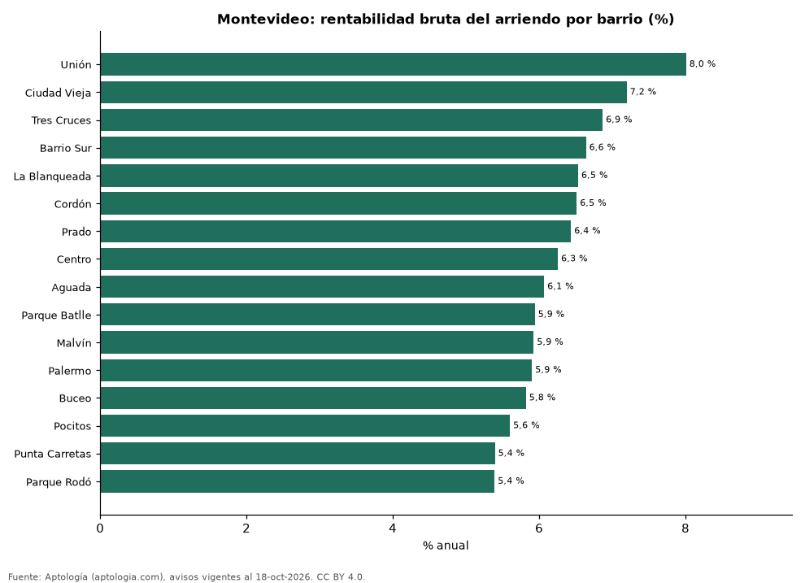

# Rentabilidad del arriendo en Montevideo por barrio: dónde rinde más comprar para arrendar (octubre 2026)

**En Montevideo, comprar un apartamento para arrendarlo rinde en el barrio típico 6,2 % bruto al año: el precio pedido equivale a 16,2 años de arriendo. El barrio con mayor rentabilidad bruta es Unión (8,0 %) y el de menor, Parque Rodó (5,4 %).** Para toda la ciudad, con las medianas por m², la rentabilidad bruta implícita es 5,8 %.

*Resumen: comparamos el precio por m² de 3.581 apartamentos en venta con el canon por m² de 2.442 en arriendo en 16 barrios de Montevideo.*

**Actualizado:** 18 de octubre de 2026 (datos del 18 de octubre de 2026) · **Próxima actualización:** mensual.

## Resumen

| Indicador | Valor |
|---|---|
| Mayor rentabilidad | Unión: 8,0 % |
| Menor rentabilidad | Parque Rodó: 5,4 % |
| Barrio típico (mediana) | 6,2 % |
| Ciudad (medianas por m²) | 5,8 % |
| Barrios comparados | 16 |

## Rentabilidad bruta por barrio

| Barrio | Venta por m² (dólares) | Arriendo por m² al mes (pesos uruguayos) | Rentabilidad bruta | Años de arriendo | Avisos (venta / arriendo) |
|---|---|---|---|---|---|
| Unión | 1.864 | 500 | 8,0 % | 12,5 | 33 / 75 |
| Ciudad Vieja | 2.126 | 512 | 7,2 % | 13,9 | 48 / 95 |
| Tres Cruces | 2.613 | 601 | 6,9 % | 14,6 | 232 / 210 |
| Barrio Sur | 2.652 | 590 | 6,6 % | 15,1 | 105 / 70 |
| La Blanqueada | 2.856 | 625 | 6,5 % | 15,3 | 353 / 233 |
| Cordón | 2.647 | 578 | 6,5 % | 15,4 | 557 / 373 |
| Prado | 2.636 | 568 | 6,4 % | 15,5 | 103 / 54 |
| Centro | 2.577 | 540 | 6,3 % | 16,0 | 274 / 281 |
| Aguada | 2.460 | 500 | 6,1 % | 16,5 | 88 / 86 |
| Parque Batlle | 3.019 | 601 | 5,9 % | 16,8 | 133 / 98 |
| Malvín | 3.241 | 643 | 5,9 % | 16,9 | 370 / 168 |
| Palermo | 3.000 | 593 | 5,9 % | 16,9 | 93 / 75 |
| Buceo | 3.044 | 593 | 5,8 % | 17,2 | 190 / 91 |
| Pocitos | 3.464 | 650 | 5,6 % | 17,9 | 614 / 340 |
| Punta Carretas | 3.868 | 699 | 5,4 % | 18,5 | 290 / 118 |
| Parque Rodó | 3.497 | 632 | 5,4 % | 18,5 | 98 / 75 |

Ordenado de mayor a menor rentabilidad. Antes de administración, impuestos, vacancia y financiación.

## Preguntas frecuentes

**¿En qué barrio de Montevideo rinde más comprar para arrendar?**
En Unión, con 8,0 % bruto anual (12,5 años de arriendo), según avisos de octubre de 2026.

**¿Dónde rinde menos?**
En Parque Rodó: 5,4 % bruto anual (18,5 años de arriendo).

**¿Cuánto renta un apartamento en Montevideo?**
En el barrio típico, 6,2 % bruto al año.

## Metodología

- **Fuente:** exportes nocturnos de la base de datos de Aptología (aptologia.com) del 18 de octubre de 2026: avisos vigentes de vivienda en portales inmobiliarios de 13 países, recogidos por Aptología y vistos en línea entre el 11 y el 18 de octubre de 2026. Corte: 18 de octubre de 2026.
- **Depuración:** se eliminan duplicados exactos (misma ciudad, zona, tipo, precio, moneda, área, habitaciones y baños) y los precios fuera del percentil 1–99 de cada país, operación, moneda y tipo; el precio por m² usa solo avisos con área declarada entre 12 y 2.000 m² y también se recorta al P1–P99.
- **Qué se mide:** precios pedidos (publicados), no precios de cierre. En arriendo, el canon mensual sin administración, gastos comunes ni condominio.
- **Muestra mínima:** cada cifra publicada se apoya en al menos 30 avisos; las celdas con menos se omiten.
- **Monedas:** nunca se mezclan avisos de monedas distintas sin convertirlos. Conversión a dólares con la tasa de mercado de ExchangeRate-API (open.er-api.com, actualización del 18 Oct 2026): 1 USD = 3.182,80 COP, 1 USD = 18,47 M.N, 1 USD = 5,09 BRL, 1 USD = 3,44 PEN, 1 USD = 982,44 CLP, 1 USD = 1.514,57 ARS, 1 USD = 40,20 UYU, 1 USD = 5.705,37 PYG, 1 USD = 61,27 DOP, 1 USD = 0,89 EUR, 1 USD = 11,72 BOB; la UF chilena a 41.178,64 CLP (mindicador,cl. 18-oct-2026). Los avisos publicados en dólares se usan tal cual.
- **Monedas:** en cada ciudad y operación se usa solo la moneda mayoritaria de los avisos (los avisos en otra moneda se excluyen) y la mediana se convierte a dólares con la tasa citada; nunca se promedian avisos de monedas distintas.
- **Años de arriendo para pagar la vivienda:** precio de venta mediano ÷ (canon mensual mediano × 12), entre avisos del mismo tipo y celda; es la relación precio/arriendo (price-to-rent ratio) y equivale a 100 ÷ rentabilidad bruta. No incluye administración, impuestos, vacancia, financiación ni valorización: es una referencia para comparar comprar con arrendar, no una recomendación de inversión.
- **Rentabilidad por barrio:** canon mediano por m² × 12 ÷ precio de venta mediano por m² de apartamentos del mismo barrio; solo barrios con 30 avisos o más de venta y 30 o más de arriendo con área declarada. Usar el m² y no el precio total evita que el tamaño típico de cada barrio sesgue la comparación.
- **Monedas distintas:** la venta se publica sobre todo en dólares y el arriendo en pesos uruguayos; cada mediana se calcula en su propia moneda y solo después se convierte a dólares con la tasa citada, así que la rentabilidad depende de esa tasa.
- **Limitaciones:** la cobertura depende de los portales que recorre Aptología en cada país y es mayor en las ciudades grandes y en los segmentos medio-alto y alto; el área es la que declara el aviso, sin verificar; los nombres de zona vienen de los portales.
- **Privacidad:** solo se publican agregados; no se publica ningún dato personal, enlace a avisos ni nombre de anunciante.
- **Datos abiertos:** [datos.csv](datos.csv), licencia CC BY 4.0.

## Cómo citar

Pinzón Pineda, D. M. (2026). *Rentabilidad del arriendo en Montevideo por barrio: dónde rinde más comprar para arrendar (octubre 2026)*. Aptología (aptologia.com). https://github.com/elbroker/aptologia-datos/tree/main/estudios/rentabilidad-alquiler-montevideo-por-barrio-2026. Datos: datos.csv, licencia CC BY 4.0.
