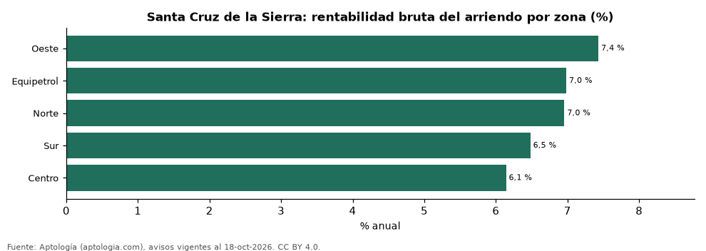

# Rentabilidad del arriendo en Santa Cruz de la Sierra por zona: dónde rinde más comprar para arrendar (octubre 2026)

**En Santa Cruz de la Sierra, comprar un apartamento para arrendarlo rinde en la zona típica 7,0 % bruto al año: el precio pedido equivale a 14,4 años de arriendo. La zona con mayor rentabilidad bruta es Oeste (7,4 %) y la de menor, Centro (6,1 %).** Para toda la ciudad, con las medianas por m², la rentabilidad bruta implícita es 7,0 %.

*Resumen: comparamos el precio por m² de 1.347 apartamentos en venta con el canon por m² de 787 en arriendo en 5 zonas de Santa Cruz de la Sierra.*

**Actualizado:** 18 de octubre de 2026 (datos del 18 de octubre de 2026) · **Próxima actualización:** mensual.

## Resumen

| Indicador | Valor |
|---|---|
| Mayor rentabilidad | Oeste: 7,4 % |
| Menor rentabilidad | Centro: 6,1 % |
| Zona típica (mediana) | 7,0 % |
| Ciudad (medianas por m²) | 7,0 % |
| Zonas comparadas | 5 |

## Rentabilidad bruta por zona

| Zona | Venta por m² (dólares) | Arriendo por m² al mes (dólares) | Rentabilidad bruta | Años de arriendo | Avisos (venta / arriendo) |
|---|---|---|---|---|---|
| Oeste | 1.101 | 6,82 | 7,4 % | 13,5 | 189 / 105 |
| Equipetrol | 1.553 | 9,03 | 7,0 % | 14,3 | 446 / 320 |
| Norte | 1.150 | 6,67 | 7,0 % | 14,4 | 499 / 233 |
| Sur | 1.032 | 5,57 | 6,5 % | 15,4 | 104 / 50 |
| Centro | 1.058 | 5,41 | 6,1 % | 16,3 | 109 / 79 |

Ordenado de mayor a menor rentabilidad. Antes de administración, impuestos, vacancia y financiación.

## Preguntas frecuentes

**¿En qué zona de Santa Cruz de la Sierra rinde más comprar para arrendar?**
En Oeste, con 7,4 % bruto anual (13,5 años de arriendo), según avisos de octubre de 2026.

**¿Dónde rinde menos?**
En Centro: 6,1 % bruto anual (16,3 años de arriendo).

**¿Cuánto renta un apartamento en Santa Cruz de la Sierra?**
En la zona típica, 7,0 % bruto al año.

## Metodología

- **Fuente:** exportes nocturnos de la base de datos de Aptología (aptologia.com) del 18 de octubre de 2026: avisos vigentes de vivienda en portales inmobiliarios de 13 países, recogidos por Aptología y vistos en línea entre el 11 y el 18 de octubre de 2026. Corte: 18 de octubre de 2026.
- **Depuración:** se eliminan duplicados exactos (misma ciudad, zona, tipo, precio, moneda, área, habitaciones y baños) y los precios fuera del percentil 1–99 de cada país, operación, moneda y tipo; el precio por m² usa solo avisos con área declarada entre 12 y 2.000 m² y también se recorta al P1–P99.
- **Qué se mide:** precios pedidos (publicados), no precios de cierre. En arriendo, el canon mensual sin administración, gastos comunes ni condominio.
- **Muestra mínima:** cada cifra publicada se apoya en al menos 30 avisos; las celdas con menos se omiten.
- **Monedas:** nunca se mezclan avisos de monedas distintas sin convertirlos. Conversión a dólares con la tasa de mercado de ExchangeRate-API (open.er-api.com, actualización del 18 Oct 2026): 1 USD = 3.182,80 COP, 1 USD = 18,47 M.N, 1 USD = 5,09 BRL, 1 USD = 3,44 PEN, 1 USD = 982,44 CLP, 1 USD = 1.514,57 ARS, 1 USD = 40,20 UYU, 1 USD = 5.705,37 PYG, 1 USD = 61,27 DOP, 1 USD = 0,89 EUR, 1 USD = 11,72 BOB; la UF chilena a 41.178,64 CLP (mindicador,cl. 18-oct-2026). Los avisos publicados en dólares se usan tal cual.
- **Monedas:** en cada ciudad y operación se usa solo la moneda mayoritaria de los avisos (los avisos en otra moneda se excluyen) y la mediana se convierte a dólares con la tasa citada; nunca se promedian avisos de monedas distintas.
- **Años de arriendo para pagar la vivienda:** precio de venta mediano ÷ (canon mensual mediano × 12), entre avisos del mismo tipo y celda; es la relación precio/arriendo (price-to-rent ratio) y equivale a 100 ÷ rentabilidad bruta. No incluye administración, impuestos, vacancia, financiación ni valorización: es una referencia para comparar comprar con arrendar, no una recomendación de inversión.
- **Rentabilidad por zona:** canon mediano por m² × 12 ÷ precio de venta mediano por m² de apartamentos del mismo zona; solo zonas con 30 avisos o más de venta y 30 o más de arriendo con área declarada. Usar el m² y no el precio total evita que el tamaño típico de cada zona sesgue la comparación.
- **Limitaciones:** la cobertura depende de los portales que recorre Aptología en cada país y es mayor en las ciudades grandes y en los segmentos medio-alto y alto; el área es la que declara el aviso, sin verificar; los nombres de zona vienen de los portales.
- **Privacidad:** solo se publican agregados; no se publica ningún dato personal, enlace a avisos ni nombre de anunciante.
- **Datos abiertos:** [datos.csv](datos.csv), licencia CC BY 4.0.

## Cómo citar

Pinzón Pineda, D. M. (2026). *Rentabilidad del arriendo en Santa Cruz de la Sierra por zona: dónde rinde más comprar para arrendar (octubre 2026)*. Aptología (aptologia.com). https://github.com/elbroker/aptologia-datos/tree/main/estudios/rentabilidad-alquiler-santa-cruz-de-la-sierra-por-zona-2026. Datos: datos.csv, licencia CC BY 4.0.
