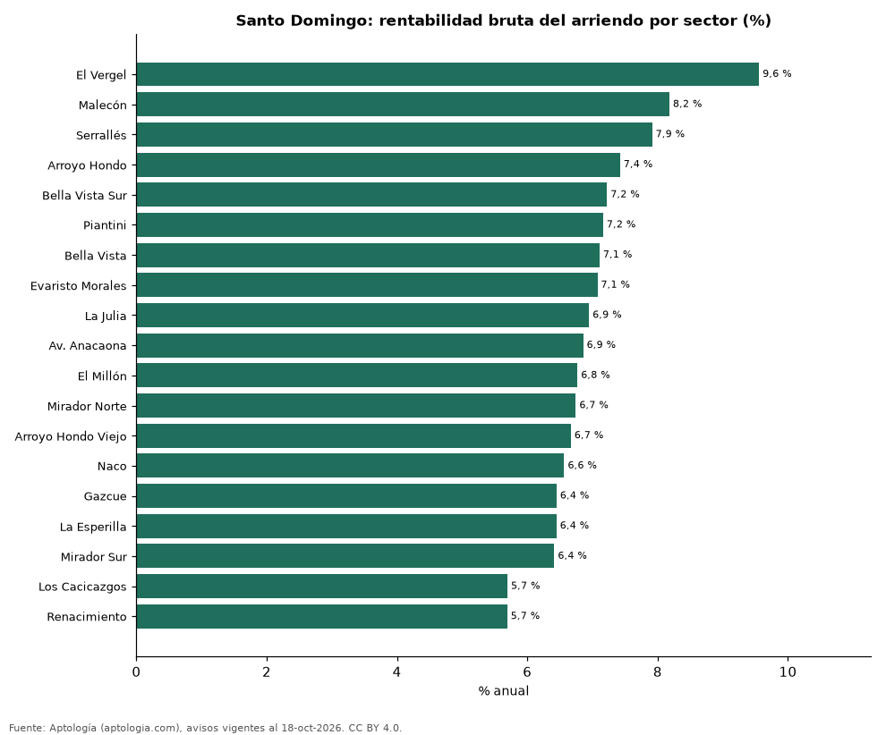

# Rentabilidad del arriendo en Santo Domingo por sector: dónde rinde más comprar para arrendar (octubre 2026)

**En Santo Domingo, comprar un apartamento para arrendarlo rinde en el sector típico 6,9 % bruto al año: el precio pedido equivale a 14,6 años de arriendo. El sector con mayor rentabilidad bruta es El Vergel (9,6 %) y el de menor, Renacimiento (5,7 %).** Para toda la ciudad, con las medianas por m², la rentabilidad bruta implícita es 7,4 %.

*Resumen: comparamos el precio por m² de 3.943 apartamentos en venta con el canon por m² de 2.021 en arriendo en 19 sectores de Santo Domingo.*

**Actualizado:** 18 de octubre de 2026 (datos del 18 de octubre de 2026) · **Próxima actualización:** mensual.

## Resumen

| Indicador | Valor |
|---|---|
| Mayor rentabilidad | El Vergel: 9,6 % |
| Menor rentabilidad | Renacimiento: 5,7 % |
| Sector típico (mediana) | 6,9 % |
| Ciudad (medianas por m²) | 7,4 % |
| Sectores comparados | 19 |

## Rentabilidad bruta por sector

| Sector | Venta por m² (dólares) | Arriendo por m² al mes (dólares) | Rentabilidad bruta | Años de arriendo | Avisos (venta / arriendo) |
|---|---|---|---|---|---|
| El Vergel | 1.766 | 14,06 | 9,6 % | 10,5 | 36 / 33 |
| Malecón | 1.519 | 10,36 | 8,2 % | 12,2 | 61 / 36 |
| Serrallés | 2.229 | 14,71 | 7,9 % | 12,6 | 86 / 51 |
| Arroyo Hondo | 1.778 | 11,00 | 7,4 % | 13,5 | 136 / 31 |
| Bella Vista Sur | 2.291 | 13,79 | 7,2 % | 13,8 | 98 / 75 |
| Piantini | 2.633 | 15,71 | 7,2 % | 14,0 | 587 / 485 |
| Bella Vista | 2.098 | 12,42 | 7,1 % | 14,1 | 400 / 276 |
| Evaristo Morales | 1.896 | 11,18 | 7,1 % | 14,1 | 348 / 177 |
| La Julia | 2.259 | 13,08 | 6,9 % | 14,4 | 72 / 30 |
| Av. Anacaona | 2.500 | 14,29 | 6,9 % | 14,6 | 67 / 31 |
| El Millón | 1.759 | 9,92 | 6,8 % | 14,8 | 234 / 71 |
| Mirador Norte | 1.749 | 9,83 | 6,7 % | 14,8 | 100 / 33 |
| Arroyo Hondo Viejo | 1.951 | 10,84 | 6,7 % | 15,0 | 62 / 32 |
| Naco | 2.459 | 13,46 | 6,6 % | 15,2 | 817 / 348 |
| Gazcue | 2.030 | 10,91 | 6,4 % | 15,5 | 111 / 61 |
| La Esperilla | 2.232 | 11,99 | 6,4 % | 15,5 | 220 / 70 |
| Mirador Sur | 1.871 | 10,00 | 6,4 % | 15,6 | 87 / 41 |
| Los Cacicazgos | 2.107 | 10,00 | 5,7 % | 17,6 | 112 / 52 |
| Renacimiento | 1.886 | 8,95 | 5,7 % | 17,6 | 309 / 88 |

Ordenado de mayor a menor rentabilidad. Antes de administración, impuestos, vacancia y financiación.

## Preguntas frecuentes

**¿En qué sector de Santo Domingo rinde más comprar para arrendar?**
En El Vergel, con 9,6 % bruto anual (10,5 años de arriendo), según avisos de octubre de 2026.

**¿Dónde rinde menos?**
En Renacimiento: 5,7 % bruto anual (17,6 años de arriendo).

**¿Cuánto renta un apartamento en Santo Domingo?**
En el sector típico, 6,9 % bruto al año.

## Metodología

- **Fuente:** exportes nocturnos de la base de datos de Aptología (aptologia.com) del 18 de octubre de 2026: avisos vigentes de vivienda en portales inmobiliarios de 13 países, recogidos por Aptología y vistos en línea entre el 11 y el 18 de octubre de 2026. Corte: 18 de octubre de 2026.
- **Depuración:** se eliminan duplicados exactos (misma ciudad, zona, tipo, precio, moneda, área, habitaciones y baños) y los precios fuera del percentil 1–99 de cada país, operación, moneda y tipo; el precio por m² usa solo avisos con área declarada entre 12 y 2.000 m² y también se recorta al P1–P99.
- **Qué se mide:** precios pedidos (publicados), no precios de cierre. En arriendo, el canon mensual sin administración, gastos comunes ni condominio.
- **Muestra mínima:** cada cifra publicada se apoya en al menos 30 avisos; las celdas con menos se omiten.
- **Monedas:** nunca se mezclan avisos de monedas distintas sin convertirlos. Conversión a dólares con la tasa de mercado de ExchangeRate-API (open.er-api.com, actualización del 18 Oct 2026): 1 USD = 3.182,80 COP, 1 USD = 18,47 M.N, 1 USD = 5,09 BRL, 1 USD = 3,44 PEN, 1 USD = 982,44 CLP, 1 USD = 1.514,57 ARS, 1 USD = 40,20 UYU, 1 USD = 5.705,37 PYG, 1 USD = 61,27 DOP, 1 USD = 0,89 EUR, 1 USD = 11,72 BOB; la UF chilena a 41.178,64 CLP (mindicador,cl. 18-oct-2026). Los avisos publicados en dólares se usan tal cual.
- **Monedas:** en cada ciudad y operación se usa solo la moneda mayoritaria de los avisos (los avisos en otra moneda se excluyen) y la mediana se convierte a dólares con la tasa citada; nunca se promedian avisos de monedas distintas.
- **Años de arriendo para pagar la vivienda:** precio de venta mediano ÷ (canon mensual mediano × 12), entre avisos del mismo tipo y celda; es la relación precio/arriendo (price-to-rent ratio) y equivale a 100 ÷ rentabilidad bruta. No incluye administración, impuestos, vacancia, financiación ni valorización: es una referencia para comparar comprar con arrendar, no una recomendación de inversión.
- **Rentabilidad por sector:** canon mediano por m² × 12 ÷ precio de venta mediano por m² de apartamentos del mismo sector; solo sectores con 30 avisos o más de venta y 30 o más de arriendo con área declarada. Usar el m² y no el precio total evita que el tamaño típico de cada sector sesgue la comparación.
- **Limitaciones:** la cobertura depende de los portales que recorre Aptología en cada país y es mayor en las ciudades grandes y en los segmentos medio-alto y alto; el área es la que declara el aviso, sin verificar; los nombres de zona vienen de los portales.
- **Privacidad:** solo se publican agregados; no se publica ningún dato personal, enlace a avisos ni nombre de anunciante.
- **Datos abiertos:** [datos.csv](datos.csv), licencia CC BY 4.0.

## Cómo citar

Pinzón Pineda, D. M. (2026). *Rentabilidad del arriendo en Santo Domingo por sector: dónde rinde más comprar para arrendar (octubre 2026)*. Aptología (aptologia.com). https://github.com/elbroker/aptologia-datos/tree/main/estudios/rentabilidad-alquiler-santo-domingo-por-sector-2026. Datos: datos.csv, licencia CC BY 4.0.
