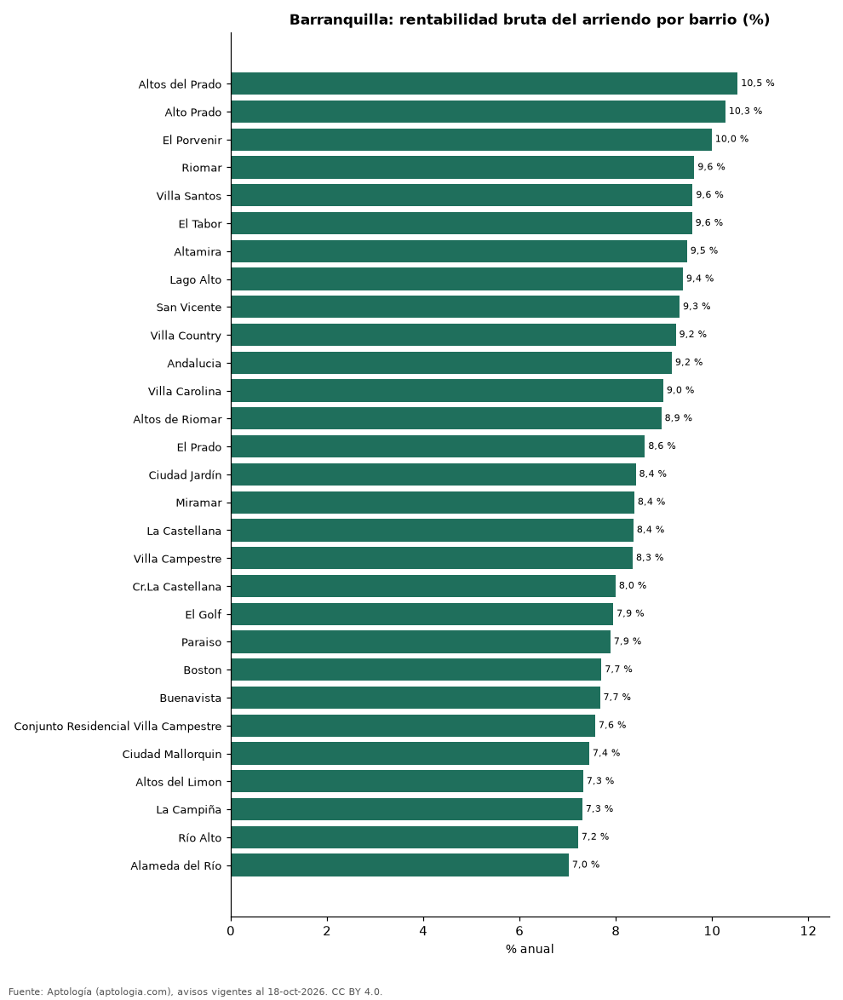

# Rentabilidad del arriendo en Barranquilla por barrio: dónde rinde más comprar para arrendar (octubre 2026)

**En Barranquilla, comprar un apartamento para arrendarlo rinde en el barrio típico 8,4 % bruto al año: el precio pedido equivale a 11,9 años de arriendo. El barrio con mayor rentabilidad bruta es Altos del Prado (10,5 %) y el de menor, Alameda del Río (7,0 %).** Para toda la ciudad, con las medianas por m², la rentabilidad bruta implícita es 8,9 %.

*Resumen: comparamos el precio por m² de 5.548 apartamentos en venta con el canon por m² de 2.858 en arriendo en 29 barrios de Barranquilla.*

**Actualizado:** 18 de octubre de 2026 (datos del 18 de octubre de 2026) · **Próxima actualización:** mensual.

## Resumen

| Indicador | Valor |
|---|---|
| Mayor rentabilidad | Altos del Prado: 10,5 % |
| Menor rentabilidad | Alameda del Río: 7,0 % |
| Barrio típico (mediana) | 8,4 % |
| Ciudad (medianas por m²) | 8,9 % |
| Barrios comparados | 29 |

## Rentabilidad bruta por barrio

| Barrio | Venta por m² (millones de pesos) | Arriendo por m² al mes (pesos) | Rentabilidad bruta | Años de arriendo | Avisos (venta / arriendo) |
|---|---|---|---|---|---|
| Altos del Prado | 3,85 | 33.750 | 10,5 % | 9,5 | 461 / 195 |
| Alto Prado | 3,82 | 32.697 | 10,3 % | 9,7 | 421 / 160 |
| El Porvenir | 3,70 | 30.769 | 10,0 % | 10,0 | 75 / 65 |
| Riomar | 5,10 | 40.952 | 9,6 % | 10,4 | 340 / 198 |
| Villa Santos | 4,75 | 37.975 | 9,6 % | 10,4 | 379 / 195 |
| El Tabor | 3,68 | 29.377 | 9,6 % | 10,4 | 83 / 56 |
| Altamira | 5,35 | 42.242 | 9,5 % | 10,6 | 39 / 32 |
| Lago Alto | 5,43 | 42.464 | 9,4 % | 10,6 | 81 / 38 |
| San Vicente | 4,23 | 32.899 | 9,3 % | 10,7 | 112 / 84 |
| Villa Country | 4,14 | 31.875 | 9,2 % | 10,8 | 165 / 77 |
| Andalucia | 4,27 | 32.585 | 9,2 % | 10,9 | 110 / 50 |
| Villa Carolina | 4,65 | 34.808 | 9,0 % | 11,1 | 134 / 74 |
| Altos de Riomar | 4,36 | 32.520 | 8,9 % | 11,2 | 513 / 201 |
| El Prado | 3,26 | 23.345 | 8,6 % | 11,6 | 176 / 42 |
| Ciudad Jardín | 4,32 | 30.288 | 8,4 % | 11,9 | 288 / 92 |
| Miramar | 4,74 | 33.134 | 8,4 % | 11,9 | 344 / 185 |
| La Castellana | 6,84 | 47.680 | 8,4 % | 12,0 | 67 / 56 |
| Villa Campestre | 4,79 | 33.333 | 8,3 % | 12,0 | 173 / 110 |
| Cr.La Castellana | 7,02 | 46.755 | 8,0 % | 12,5 | 50 / 46 |
| El Golf | 5,15 | 34.091 | 7,9 % | 12,6 | 150 / 43 |
| Paraiso | 4,83 | 31.742 | 7,9 % | 12,7 | 175 / 90 |
| Boston | 4,32 | 27.711 | 7,7 % | 13,0 | 132 / 47 |
| Buenavista | 6,89 | 44.000 | 7,7 % | 13,0 | 222 / 84 |
| Conjunto Residencial Villa Campestre | 5,23 | 33.013 | 7,6 % | 13,2 | 72 / 46 |
| Ciudad Mallorquin | 4,98 | 30.896 | 7,4 % | 13,4 | 121 / 142 |
| Altos del Limon | 5,93 | 36.149 | 7,3 % | 13,7 | 99 / 67 |
| La Campiña | 4,57 | 27.778 | 7,3 % | 13,7 | 76 / 39 |
| Río Alto | 7,04 | 42.333 | 7,2 % | 13,9 | 134 / 92 |
| Alameda del Río | 4,27 | 25.000 | 7,0 % | 14,2 | 356 / 252 |

Ordenado de mayor a menor rentabilidad. Antes de administración, impuestos, vacancia y financiación.

## Preguntas frecuentes

**¿En qué barrio de Barranquilla rinde más comprar para arrendar?**
En Altos del Prado, con 10,5 % bruto anual (9,5 años de arriendo), según avisos de octubre de 2026.

**¿Dónde rinde menos?**
En Alameda del Río: 7,0 % bruto anual (14,2 años de arriendo).

**¿Cuánto renta un apartamento en Barranquilla?**
En el barrio típico, 8,4 % bruto al año.

## Metodología

- **Fuente:** exportes nocturnos de la base de datos de Aptología (aptologia.com) del 18 de octubre de 2026: avisos vigentes de vivienda en portales inmobiliarios de 13 países, recogidos por Aptología y vistos en línea entre el 11 y el 18 de octubre de 2026. Corte: 18 de octubre de 2026.
- **Depuración:** se eliminan duplicados exactos (misma ciudad, zona, tipo, precio, moneda, área, habitaciones y baños) y los precios fuera del percentil 1–99 de cada país, operación, moneda y tipo; el precio por m² usa solo avisos con área declarada entre 12 y 2.000 m² y también se recorta al P1–P99.
- **Qué se mide:** precios pedidos (publicados), no precios de cierre. En arriendo, el canon mensual sin administración, gastos comunes ni condominio.
- **Muestra mínima:** cada cifra publicada se apoya en al menos 30 avisos; las celdas con menos se omiten.
- **Colombia:** Precios en pesos colombianos, sin conversión de moneda.
- **Años de arriendo para pagar la vivienda:** precio de venta mediano ÷ (canon mensual mediano × 12), entre avisos del mismo tipo y celda; es la relación precio/arriendo (price-to-rent ratio) y equivale a 100 ÷ rentabilidad bruta. No incluye administración, impuestos, vacancia, financiación ni valorización: es una referencia para comparar comprar con arrendar, no una recomendación de inversión.
- **Rentabilidad por barrio:** canon mediano por m² × 12 ÷ precio de venta mediano por m² de apartamentos del mismo barrio; solo barrios con 30 avisos o más de venta y 30 o más de arriendo con área declarada. Usar el m² y no el precio total evita que el tamaño típico de cada barrio sesgue la comparación.
- **Limitaciones:** la cobertura depende de los portales que recorre Aptología en cada país y es mayor en las ciudades grandes y en los segmentos medio-alto y alto; el área es la que declara el aviso, sin verificar; los nombres de zona vienen de los portales.
- **Privacidad:** solo se publican agregados; no se publica ningún dato personal, enlace a avisos ni nombre de anunciante.
- **Datos abiertos:** [datos.csv](datos.csv), licencia CC BY 4.0.

## Cómo citar

Pinzón Pineda, D. M. (2026). *Rentabilidad del arriendo en Barranquilla por barrio: dónde rinde más comprar para arrendar (octubre 2026)*. Aptología (aptologia.com). https://github.com/elbroker/aptologia-datos/tree/main/estudios/rentabilidad-arriendo-barranquilla-por-barrio-2026. Datos: datos.csv, licencia CC BY 4.0.
