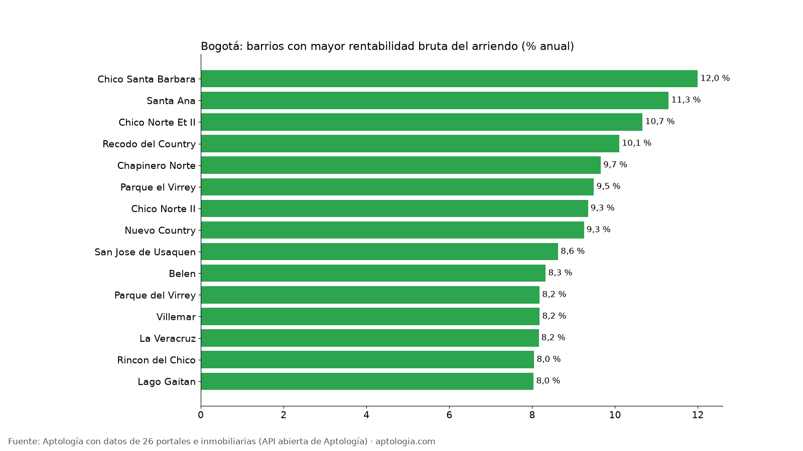
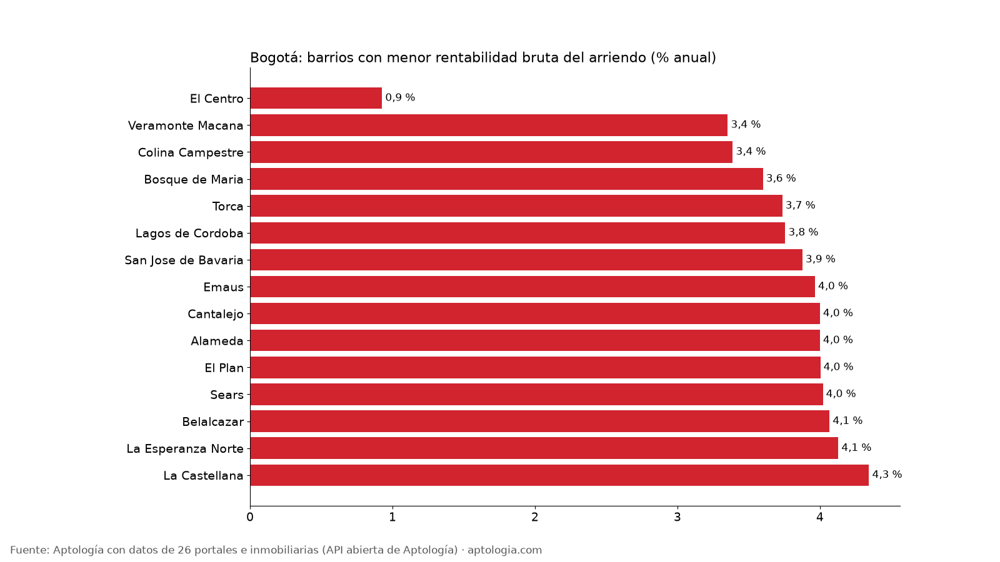

# Rentabilidad del arriendo en Bogotá por barrio: dónde rinde más comprar para arrendar (octubre 2026)

**En Bogotá, comprar un apartamento para arrendarlo rinde en el barrio típico 6,1 % bruto al año: el precio pedido equivale a 16,4 años de arriendo.** El barrio con mayor rentabilidad bruta es Chico Santa Barbara (12,0 %) y el de menor El Centro (0,9 %), entre 197 barrios con 30 avisos o más de arriendo y de venta.

*Resumen: cruzamos el arriendo pedido y el precio de venta pedido de apartamentos en 197 barrios de Bogotá con 30 avisos o más de cada uno.*

**Actualizado:** 18 de octubre de 2026 (datos del 5 de octubre de 2026) · **Próxima actualización:** mensual.

## Resumen

| Indicador | Valor |
|---|---|
| Rentabilidad bruta mediana entre barrios (todos los tamaños) | 6,1 % |
| Rentabilidad bruta mediana, 2 alcobas | 7,0 % |
| Años de arriendo para pagar el precio (mediana) | 16,4 |
| Barrios comparables | 197 |
| Barrios comparables en 2 alcobas | 86 |

## Barrios con mayor rentabilidad bruta

| Barrio | Rentabilidad bruta | Años de arriendo | Arriendo mediano | Precio de venta mediano | Avisos (arriendo / venta) |
|---|---|---|---|---|---|
| Chico Santa Barbara | 12,0 % | 8,3 | $9.000.000 | $900 millones | 40 / 33 |
| Santa Ana | 11,3 % | 8,9 | $12.050.000 | $1,28 mil millones | 122 / 109 |
| Chico Norte Et II | 10,7 % | 9,4 | $8.000.000 | $900 millones | 39 / 75 |
| Recodo del Country | 10,1 % | 9,9 | $8.000.000 | $950 millones | 35 / 65 |
| Chapinero Norte | 9,7 % | 10,4 | $3.500.000 | $435 millones | 91 / 61 |
| Parque el Virrey | 9,5 % | 10,5 | $8.700.000 | $1,10 mil millones | 48 / 31 |
| Chico Norte II | 9,3 % | 10,7 | $7.400.000 | $950 millones | 112 / 97 |
| Nuevo Country | 9,3 % | 10,8 | $3.200.000 | $415 millones | 73 / 161 |
| San Jose de Usaquen | 8,6 % | 11,6 | $1.926.954 | $268 millones | 88 / 132 |
| Belen | 8,3 % | 12,0 | $1.700.000 | $245 millones | 54 / 41 |
| Parque del Virrey | 8,2 % | 12,2 | $7.500.000 | $1,10 mil millones | 112 / 63 |
| Villemar | 8,2 % | 12,2 | $1.650.000 | $242 millones | 50 / 35 |
| La Veracruz | 8,2 % | 12,3 | $1.700.000 | $250 millones | 105 / 84 |
| Rincon del Chico | 8,0 % | 12,4 | $5.500.000 | $820 millones | 247 / 423 |
| Lago Gaitan | 8,0 % | 12,4 | $2.800.000 | $418 millones | 43 / 68 |

Rentabilidades brutas por encima de 10 % suelen indicar que los apartamentos en arriendo y en venta de ese barrio son distintos (tamaño, estado o amoblado); tómalas como señal para revisar, no como dato de inversión.

## Barrios con menor rentabilidad bruta

| Barrio | Rentabilidad bruta | Años de arriendo | Arriendo mediano | Precio de venta mediano | Avisos (arriendo / venta) |
|---|---|---|---|---|---|
| El Centro | 0,9 % | 107,8 | $1.700.000 | $2,20 mil millones | 50 / 51 |
| Veramonte Macana | 3,4 % | 29,8 | $1.900.000 | $680 millones | 88 / 193 |
| Colina Campestre | 3,4 % | 29,5 | $2.400.000 | $850 millones | 372 / 912 |
| Bosque de Maria | 3,6 % | 27,8 | $1.800.000 | $600 millones | 41 / 120 |
| Torca | 3,7 % | 26,8 | $1.650.000 | $530 millones | 105 / 35 |
| Lagos de Cordoba | 3,8 % | 26,6 | $3.550.000 | $1,13 mil millones | 56 / 64 |
| San Jose de Bavaria | 3,9 % | 25,8 | $2.100.000 | $650 millones | 185 / 148 |
| Emaus | 4,0 % | 25,2 | $4.229.404 | $1,28 mil millones | 72 / 41 |
| Cantalejo | 4,0 % | 25,0 | $2.200.000 | $660 millones | 41 / 75 |
| Alameda | 4,0 % | 25,0 | $1.850.000 | $555 millones | 98 / 170 |
| El Plan | 4,0 % | 25,0 | $2.235.000 | $670 millones | 32 / 127 |
| Sears | 4,0 % | 24,9 | $1.625.000 | $485 millones | 30 / 42 |
| Belalcazar | 4,1 % | 24,6 | $2.000.000 | $590 millones | 59 / 100 |
| La Esperanza Norte | 4,1 % | 24,2 | $3.200.000 | $930 millones | 39 / 48 |
| La Castellana | 4,3 % | 23,0 | $2.100.000 | $580 millones | 237 / 359 |

## Solo apartamentos de 2 alcobas (los 10 más rentables)

Comparar apartamentos del mismo tamaño acerca la cifra a la de un inmueble real.

| Barrio | Rentabilidad bruta 2 alcobas | Arriendo 2 alcobas | Venta 2 alcobas |
|---|---|---|---|
| Chico Norte II | 10,7 % | $8.500.000 | $950 millones |
| Chapinero Central | 9,6 % | $3.200.000 | $400 millones |
| Chico Norte | 9,5 % | $7.500.000 | $950 millones |
| Parque el Virrey | 9,3 % | $8.500.000 | $1,10 mil millones |
| Chico Reservado | 8,8 % | $8.791.000 | $1,20 mil millones |
| Santa Bibiana | 8,6 % | $6.500.000 | $903 millones |
| El Nogal | 8,5 % | $8.600.000 | $1,22 mil millones |
| Chico | 8,4 % | $7.850.000 | $1,11 mil millones |
| La Carolina | 8,2 % | $5.500.000 | $800 millones |
| Chico Norte III | 8,2 % | $5.600.000 | $820 millones |

**Cómo usarlo para decidir:** la rentabilidad bruta es un filtro inicial, no la ganancia: réstale administración, predial, vacancia (meses sin arrendar), comisión y mantenimiento, que juntos suelen comerse varios puntos. Un barrio con rentabilidad alta pero pocas ventas o mucha rotación puede ser más riesgoso. Valida siempre con el arriendo real de apartamentos iguales al que vas a comprar.

## Preguntas frecuentes

**¿Cuánto renta un apartamento arrendado en Bogotá?**
En el barrio típico, 6,1 % bruto anual: 12 meses de arriendo pedido sobre el precio de venta pedido, antes de gastos e impuestos, con datos del 5 de octubre de 2026.

**¿En qué barrio de Bogotá es más rentable comprar para arrendar?**
Chico Santa Barbara, con 12,0 % bruto anual (arriendo mediano $9.000.000, venta mediana $900 millones).

**¿Cuántos años de arriendo cuesta un apartamento en Bogotá?**
En la mediana de los barrios, 16,4 años de arriendo pedido.

## Metodología

- **Fuente:** API abierta de Aptología ([aptologia.com/datos-abiertos](https://www.aptologia.com/datos-abiertos)), que cada noche revisa los avisos vivos de 26 portales e inmobiliarias. Foto de los datos: 5 de octubre de 2026.
- **Qué se mide:** precio pedido de apartamentos (no casas ni habitaciones), sin administración. Son precios publicados, no cerrados.
- **Barrios:** etiquetas depuradas. Se excluyen nombres de localidad o comuna, textos de aviso, zonas genéricas, barrios de otro municipio y variantes del mismo nombre, para no contar dos veces el mismo barrio.
- **Rentabilidad bruta (calculada):** 12 × mediana del arriendo pedido ÷ mediana del precio de venta pedido del mismo barrio, en % anual. Años de arriendo = 100 ÷ rentabilidad. Solo barrios con 30 avisos o más de arriendo y de venta (20 o más en la versión de 2 alcobas).
- **No es la rentabilidad de un inmueble:** las medianas salen de avisos distintos; no descuenta administración, predial, vacancia, comisión, mantenimiento ni impuestos.
- **Limitaciones:** un mismo apartamento puede estar publicado en más de un portal, por lo que los conteos de avisos pueden incluir repetidos. Los barrios vienen tal como los escribe cada portal, después de la depuración.
- **Datos abiertos:** [datos.csv](datos.csv), licencia CC BY 4.0.

## Cómo citar

Pinzón Pineda, D. M. (2026). *Rentabilidad del arriendo en Bogotá por barrio: dónde rinde más comprar para arrendar (octubre 2026)*. Aptología. https://www.aptologia.com/estudios/rentabilidad-arriendo-bogota-por-barrio-2026. Datos: datos.csv, licencia CC BY 4.0.
