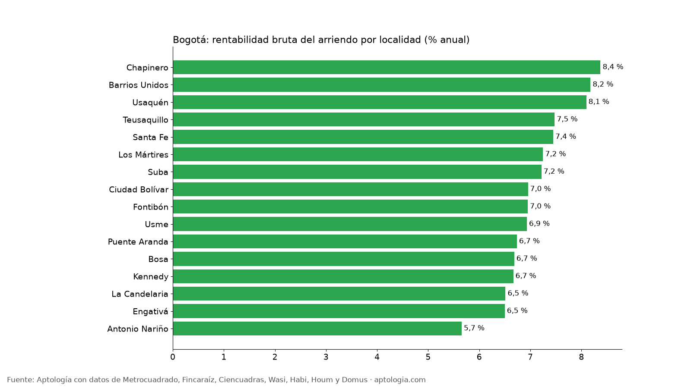
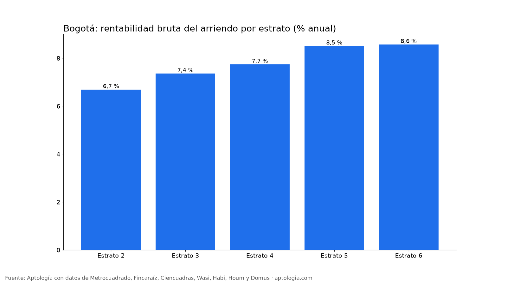

# Rentabilidad del arriendo en Bogotá por localidad y estrato: dónde rinde más comprar para arrendar (octubre 2026)

**Comprar un apartamento para arrendarlo en Bogotá rinde en bruto 8,2 % al año (el precio equivale a 12,3 años de arriendo).** Por localidad, la rentabilidad bruta va de 5,7 % en Antonio Nariño a 8,4 % en Chapinero; por estrato, de 6,7 % (estrato 2) a 8,6 % (estrato 6).

*Resumen: cruzamos el arriendo y el precio de venta por m² de 14.931 apartamentos en arriendo y 36.813 en venta, únicos, en Bogotá.*

**Actualizado:** 18 de octubre de 2026 (datos del 18 de octubre de 2026) · **Próxima actualización:** mensual.

## Por localidad

| Localidad | Rentabilidad bruta | Años de arriendo | Arriendo por m² | Venta por m² | Arriendo mediano | Venta mediana | Avisos (arriendo / venta) |
|---|---|---|---|---|---|---|---|
| Chapinero | 8,4 % | 11,9 | $66.176 | $9.482.759 | $9.000.000 | $1,68 mil millones | 4.014 / 7.412 |
| Barrios Unidos | 8,2 % | 12,2 | $56.000 | $8.216.732 | $2.767.000 | $680 millones | 644 / 1.061 |
| Usaquén | 8,1 % | 12,4 | $50.000 | $7.410.714 | $4.100.000 | $880 millones | 4.062 / 12.111 |
| Teusaquillo | 7,5 % | 13,4 | $49.194 | $7.894.737 | $2.573.352 | $650 millones | 644 / 1.401 |
| Santa Fe | 7,4 % | 13,4 | $56.164 | $9.047.619 | $2.350.000 | $500 millones | 557 / 766 |
| Los Mártires | 7,2 % | 13,8 | $41.953 | $6.944.444 | $1.700.000 | $290 millones | 191 / 390 |
| Suba | 7,2 % | 13,9 | $40.217 | $6.686.047 | $2.360.000 | $650 millones | 1.697 / 5.966 |
| Ciudad Bolívar | 7,0 % | 14,4 | $28.269 | $4.878.049 | $1.300.000 | $230 millones | 112 / 396 |
| Fontibón | 7,0 % | 14,4 | $40.000 | $6.904.762 | $1.800.000 | $425 millones | 812 / 1.639 |
| Usme | 6,9 % | 14,4 | $21.118 | $3.655.495 | $1.000.000 | $170 millones | 103 / 248 |
| Puente Aranda | 6,7 % | 14,8 | $39.504 | $7.036.033 | $1.800.000 | $334 millones | 327 / 501 |
| Bosa | 6,7 % | 15,0 | $22.406 | $4.021.739 | $1.000.000 | $185 millones | 149 / 643 |
| Kennedy | 6,7 % | 15,0 | $31.746 | $5.714.286 | $1.500.000 | $275 millones | 513 / 1.431 |
| La Candelaria | 6,5 % | 15,4 | $48.628 | $8.958.333 | $2.000.000 | $509 millones | 86 / 103 |
| Engativá | 6,5 % | 15,4 | $30.053 | $5.548.780 | $1.650.000 | $330 millones | 392 / 1.084 |
| Antonio Nariño | 5,7 % | 17,7 | $28.452 | $6.036.725 | $1.480.000 | $330 millones | 85 / 172 |

## Por estrato

| Estrato | Rentabilidad bruta | Años de arriendo | Arriendo por m² | Venta por m² | Arriendo mediano | Venta mediana | Avisos (arriendo / venta) |
|---|---|---|---|---|---|---|---|
| 2 | 6,7 % | 14,9 | $23.478 | $4.208.333 | $1.149.950 | $200 millones | 520 / 1.587 |
| 3 | 7,4 % | 13,6 | $34.524 | $5.625.000 | $1.585.981 | $285 millones | 3.214 / 6.561 |
| 4 | 7,7 % | 12,9 | $46.875 | $7.262.829 | $2.550.000 | $550 millones | 3.476 / 7.637 |
| 5 | 8,5 % | 11,7 | $54.054 | $7.619.048 | $4.200.000 | $857 millones | 1.977 / 6.091 |
| 6 | 8,6 % | 11,7 | $62.500 | $8.744.356 | $9.000.000 | $1,53 mil millones | 5.609 / 14.219 |

**Cómo usarlo para decidir:** la rentabilidad bruta es un primer filtro. Réstale administración, predial, vacancia, comisión y mantenimiento, que suelen comerse de 1 a 2 puntos. Para el detalle barrio por barrio, mira el estudio de rentabilidad por barrio de Aptología.

## Preguntas frecuentes

**¿Cuánto renta un apartamento arrendado en Bogotá?**
En bruto, 8,2 % anual: 12 meses de arriendo por m² sobre el precio de venta por m², antes de gastos (datos del 18 de octubre de 2026).

**¿En qué localidad de Bogotá es más rentable comprar para arrendar?**
Chapinero, con 8,4 % bruto anual entre las localidades con 80 avisos o más de arriendo y de venta.

**¿Qué estrato da más rentabilidad en arriendo en Bogotá?**
El estrato 6, con 8,6 % bruto anual.

## Metodología

- **Fuente:** avisos vivos de vivienda recogidos por la ingesta de Aptología en Metrocuadrado, Fincaraíz, Ciencuadras, Wasi, Habi, Houm y Domus, del 11 al 18 de octubre de 2026. Corte: 18 de octubre de 2026.
- **Depuración:** un mismo inmueble publicado varias veces se cuenta una sola vez (agrupación por portal y, entre portales, por precio, área, habitaciones y coordenadas). Se descartan precios y áreas fuera de rango y, en arriendo, se resta la administración cuando el portal la incluye en el canon.
- **Qué se mide:** precios pedidos (publicados), no precios de cierre.
- **Rentabilidad bruta:** 12 × mediana del arriendo por m² ÷ mediana del precio de venta por m² del mismo grupo, en % anual. Años de arriendo = 100 ÷ rentabilidad. Solo grupos con 80 avisos o más de arriendo y de venta.
- **No es la rentabilidad de un inmueble:** las medianas salen de avisos distintos y no descuentan gastos ni impuestos.
- **Limitaciones:** son precios pedidos en portales, que pueden diferir del valor final de arriendo o venta. La cobertura es mayor en el norte de Bogotá y en estratos 4 a 6, porque ahí se concentra la oferta publicada. Los barrios y la localidad vienen de lo que escribe cada portal; cuando falta la localidad se asigna por los avisos vecinos más cercanos.
- **Datos abiertos:** [datos.csv](datos.csv), licencia CC BY 4.0.

## Cómo citar

Pinzón Pineda, D. M. (2026). *Rentabilidad del arriendo en Bogotá por localidad y estrato: dónde rinde más comprar para arrendar (octubre 2026)*. Aptología. https://www.aptologia.com/estudios/rentabilidad-arriendo-bogota-por-localidad-y-estrato-2026. Datos: datos.csv, licencia CC BY 4.0.
