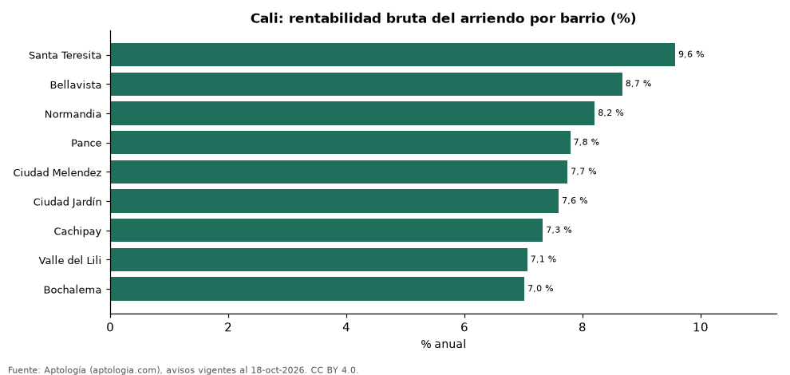

# Rentabilidad del arriendo en Cali por barrio: dónde rinde más comprar para arrendar (octubre 2026)

**En Cali, comprar un apartamento para arrendarlo rinde en el barrio típico 7,7 % bruto al año: el precio pedido equivale a 12,9 años de arriendo. El barrio con mayor rentabilidad bruta es Santa Teresita (9,6 %) y el de menor, Bochalema (7,0 %).** Para toda la ciudad, con las medianas por m², la rentabilidad bruta implícita es 7,7 %.

*Resumen: comparamos el precio por m² de 3.405 apartamentos en venta con el canon por m² de 581 en arriendo en 9 barrios de Cali.*

**Actualizado:** 18 de octubre de 2026 (datos del 18 de octubre de 2026) · **Próxima actualización:** mensual.

## Resumen

| Indicador | Valor |
|---|---|
| Mayor rentabilidad | Santa Teresita: 9,6 % |
| Menor rentabilidad | Bochalema: 7,0 % |
| Barrio típico (mediana) | 7,7 % |
| Ciudad (medianas por m²) | 7,7 % |
| Barrios comparados | 9 |

## Rentabilidad bruta por barrio

| Barrio | Venta por m² (millones de pesos) | Arriendo por m² al mes (pesos) | Rentabilidad bruta | Años de arriendo | Avisos (venta / arriendo) |
|---|---|---|---|---|---|
| Santa Teresita | 5,47 | 43.614 | 9,6 % | 10,4 | 364 / 62 |
| Bellavista | 6,15 | 44.444 | 8,7 % | 11,5 | 223 / 45 |
| Normandia | 6,00 | 41.036 | 8,2 % | 12,2 | 229 / 36 |
| Pance | 7,00 | 45.455 | 7,8 % | 12,8 | 483 / 91 |
| Ciudad Melendez | 4,35 | 28.070 | 7,7 % | 12,9 | 262 / 41 |
| Ciudad Jardín | 6,36 | 40.283 | 7,6 % | 13,2 | 397 / 56 |
| Cachipay | 4,17 | 25.455 | 7,3 % | 13,6 | 94 / 31 |
| Valle del Lili | 4,66 | 27.434 | 7,1 % | 14,2 | 797 / 135 |
| Bochalema | 4,42 | 25.820 | 7,0 % | 14,3 | 556 / 84 |

Ordenado de mayor a menor rentabilidad. Antes de administración, impuestos, vacancia y financiación.

## Preguntas frecuentes

**¿En qué barrio de Cali rinde más comprar para arrendar?**
En Santa Teresita, con 9,6 % bruto anual (10,4 años de arriendo), según avisos de octubre de 2026.

**¿Dónde rinde menos?**
En Bochalema: 7,0 % bruto anual (14,3 años de arriendo).

**¿Cuánto renta un apartamento en Cali?**
En el barrio típico, 7,7 % bruto al año.

## Metodología

- **Fuente:** exportes nocturnos de la base de datos de Aptología (aptologia.com) del 18 de octubre de 2026: avisos vigentes de vivienda en portales inmobiliarios de 13 países, recogidos por Aptología y vistos en línea entre el 11 y el 18 de octubre de 2026. Corte: 18 de octubre de 2026.
- **Depuración:** se eliminan duplicados exactos (misma ciudad, zona, tipo, precio, moneda, área, habitaciones y baños) y los precios fuera del percentil 1–99 de cada país, operación, moneda y tipo; el precio por m² usa solo avisos con área declarada entre 12 y 2.000 m² y también se recorta al P1–P99.
- **Qué se mide:** precios pedidos (publicados), no precios de cierre. En arriendo, el canon mensual sin administración, gastos comunes ni condominio.
- **Muestra mínima:** cada cifra publicada se apoya en al menos 30 avisos; las celdas con menos se omiten.
- **Colombia:** Precios en pesos colombianos, sin conversión de moneda.
- **Años de arriendo para pagar la vivienda:** precio de venta mediano ÷ (canon mensual mediano × 12), entre avisos del mismo tipo y celda; es la relación precio/arriendo (price-to-rent ratio) y equivale a 100 ÷ rentabilidad bruta. No incluye administración, impuestos, vacancia, financiación ni valorización: es una referencia para comparar comprar con arrendar, no una recomendación de inversión.
- **Rentabilidad por barrio:** canon mediano por m² × 12 ÷ precio de venta mediano por m² de apartamentos del mismo barrio; solo barrios con 30 avisos o más de venta y 30 o más de arriendo con área declarada. Usar el m² y no el precio total evita que el tamaño típico de cada barrio sesgue la comparación.
- **Limitaciones:** la cobertura depende de los portales que recorre Aptología en cada país y es mayor en las ciudades grandes y en los segmentos medio-alto y alto; el área es la que declara el aviso, sin verificar; los nombres de zona vienen de los portales.
- **Privacidad:** solo se publican agregados; no se publica ningún dato personal, enlace a avisos ni nombre de anunciante.
- **Datos abiertos:** [datos.csv](datos.csv), licencia CC BY 4.0.

## Cómo citar

Pinzón Pineda, D. M. (2026). *Rentabilidad del arriendo en Cali por barrio: dónde rinde más comprar para arrendar (octubre 2026)*. Aptología (aptologia.com). https://github.com/elbroker/aptologia-datos/tree/main/estudios/rentabilidad-arriendo-cali-por-barrio-2026. Datos: datos.csv, licencia CC BY 4.0.
