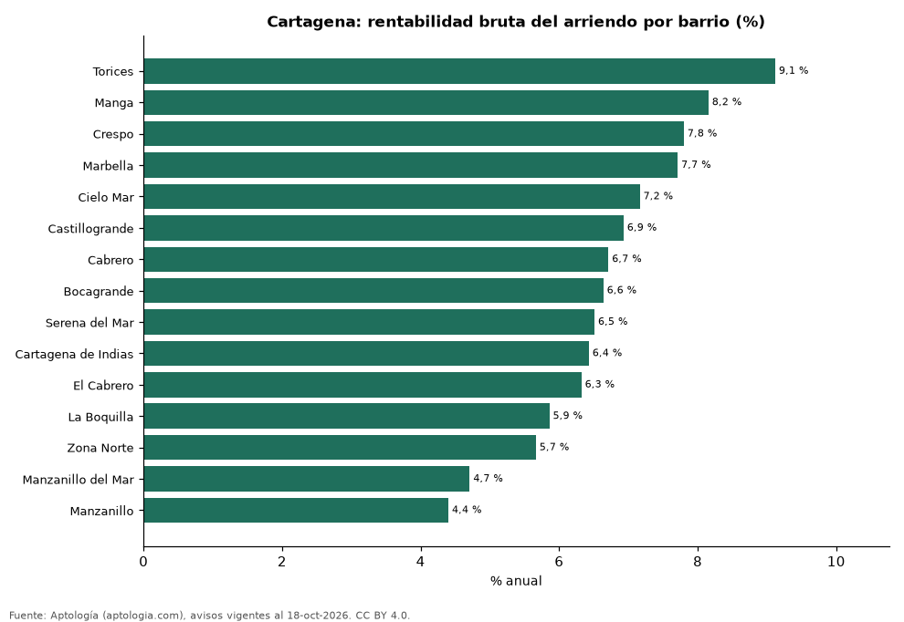

# Rentabilidad del arriendo en Cartagena por barrio: dónde rinde más comprar para arrendar (octubre 2026)

**En Cartagena, comprar un apartamento para arrendarlo rinde en el barrio típico 6,6 % bruto al año: el precio pedido equivale a 15,1 años de arriendo. El barrio con mayor rentabilidad bruta es Torices (9,1 %) y el de menor, Manzanillo (4,4 %).** Para toda la ciudad, con las medianas por m², la rentabilidad bruta implícita es 6,8 %.

*Resumen: comparamos el precio por m² de 3.729 apartamentos en venta con el canon por m² de 1.541 en arriendo en 15 barrios de Cartagena.*

**Actualizado:** 18 de octubre de 2026 (datos del 18 de octubre de 2026) · **Próxima actualización:** mensual.

## Resumen

| Indicador | Valor |
|---|---|
| Mayor rentabilidad | Torices: 9,1 % |
| Menor rentabilidad | Manzanillo: 4,4 % |
| Barrio típico (mediana) | 6,6 % |
| Ciudad (medianas por m²) | 6,8 % |
| Barrios comparados | 15 |

## Rentabilidad bruta por barrio

| Barrio | Venta por m² (millones de pesos) | Arriendo por m² al mes (pesos) | Rentabilidad bruta | Años de arriendo | Avisos (venta / arriendo) |
|---|---|---|---|---|---|
| Torices | 6,20 | 47.128 | 9,1 % | 11,0 | 110 / 52 |
| Manga | 6,55 | 44.508 | 8,2 % | 12,3 | 393 / 160 |
| Crespo | 6,85 | 44.495 | 7,8 % | 12,8 | 280 / 112 |
| Marbella | 6,97 | 44.776 | 7,7 % | 13,0 | 176 / 99 |
| Cielo Mar | 8,15 | 48.684 | 7,2 % | 14,0 | 148 / 48 |
| Castillogrande | 9,74 | 56.261 | 6,9 % | 14,4 | 265 / 76 |
| Cabrero | 8,33 | 46.602 | 6,7 % | 14,9 | 50 / 37 |
| Bocagrande | 8,80 | 48.673 | 6,6 % | 15,1 | 686 / 185 |
| Serena del Mar | 8,10 | 43.959 | 6,5 % | 15,4 | 517 / 354 |
| Cartagena de Indias | 8,17 | 43.750 | 6,4 % | 15,6 | 288 / 35 |
| El Cabrero | 8,42 | 44.355 | 6,3 % | 15,8 | 117 / 75 |
| La Boquilla | 10,00 | 48.816 | 5,9 % | 17,1 | 384 / 152 |
| Zona Norte | 8,98 | 42.370 | 5,7 % | 17,7 | 122 / 36 |
| Manzanillo del Mar | 11,22 | 44.017 | 4,7 % | 21,2 | 69 / 56 |
| Manzanillo | 11,98 | 43.923 | 4,4 % | 22,7 | 124 / 64 |

Ordenado de mayor a menor rentabilidad. Antes de administración, impuestos, vacancia y financiación.

## Preguntas frecuentes

**¿En qué barrio de Cartagena rinde más comprar para arrendar?**
En Torices, con 9,1 % bruto anual (11,0 años de arriendo), según avisos de octubre de 2026.

**¿Dónde rinde menos?**
En Manzanillo: 4,4 % bruto anual (22,7 años de arriendo).

**¿Cuánto renta un apartamento en Cartagena?**
En el barrio típico, 6,6 % bruto al año.

## Metodología

- **Fuente:** exportes nocturnos de la base de datos de Aptología (aptologia.com) del 18 de octubre de 2026: avisos vigentes de vivienda en portales inmobiliarios de 13 países, recogidos por Aptología y vistos en línea entre el 11 y el 18 de octubre de 2026. Corte: 18 de octubre de 2026.
- **Depuración:** se eliminan duplicados exactos (misma ciudad, zona, tipo, precio, moneda, área, habitaciones y baños) y los precios fuera del percentil 1–99 de cada país, operación, moneda y tipo; el precio por m² usa solo avisos con área declarada entre 12 y 2.000 m² y también se recorta al P1–P99.
- **Qué se mide:** precios pedidos (publicados), no precios de cierre. En arriendo, el canon mensual sin administración, gastos comunes ni condominio.
- **Muestra mínima:** cada cifra publicada se apoya en al menos 30 avisos; las celdas con menos se omiten.
- **Colombia:** Precios en pesos colombianos, sin conversión de moneda.
- **Años de arriendo para pagar la vivienda:** precio de venta mediano ÷ (canon mensual mediano × 12), entre avisos del mismo tipo y celda; es la relación precio/arriendo (price-to-rent ratio) y equivale a 100 ÷ rentabilidad bruta. No incluye administración, impuestos, vacancia, financiación ni valorización: es una referencia para comparar comprar con arrendar, no una recomendación de inversión.
- **Rentabilidad por barrio:** canon mediano por m² × 12 ÷ precio de venta mediano por m² de apartamentos del mismo barrio; solo barrios con 30 avisos o más de venta y 30 o más de arriendo con área declarada. Usar el m² y no el precio total evita que el tamaño típico de cada barrio sesgue la comparación.
- **Limitaciones:** la cobertura depende de los portales que recorre Aptología en cada país y es mayor en las ciudades grandes y en los segmentos medio-alto y alto; el área es la que declara el aviso, sin verificar; los nombres de zona vienen de los portales.
- **Privacidad:** solo se publican agregados; no se publica ningún dato personal, enlace a avisos ni nombre de anunciante.
- **Datos abiertos:** [datos.csv](datos.csv), licencia CC BY 4.0.

## Cómo citar

Pinzón Pineda, D. M. (2026). *Rentabilidad del arriendo en Cartagena por barrio: dónde rinde más comprar para arrendar (octubre 2026)*. Aptología (aptologia.com). https://github.com/elbroker/aptologia-datos/tree/main/estudios/rentabilidad-arriendo-cartagena-por-barrio-2026. Datos: datos.csv, licencia CC BY 4.0.
