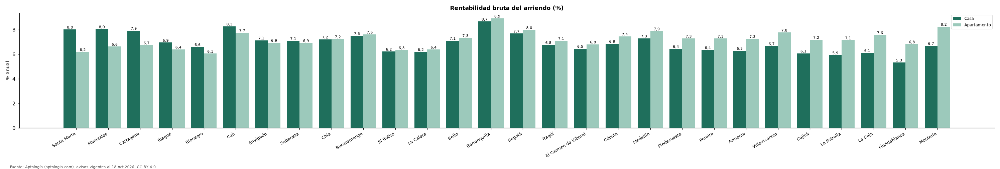

# Casa o apartamento para arrendar: cuál rinde más en las ciudades de Colombia (octubre 2026)

**En Colombia una casa comprada para arrendar rinde 8,1 % bruto anual y un apartamento 8,1 %; la casa rinde más en 8 de 28 ciudades con datos suficientes.** La mayor ventaja de la casa está en Santa Marta (8,0 % contra 6,2 %).

*Resumen: cruzamos arriendo y venta por m² de 267.048 casas y apartamentos.*

**Actualizado:** 18 de octubre de 2026 (datos del 18 de octubre de 2026) · **Próxima actualización:** mensual.

## Resumen

| Indicador | Valor |
|---|---|
| Casa (Colombia) | 8,1 % |
| Apartamento (Colombia) | 8,1 % |
| Ciudades donde rinde más la casa | 8 de 28 |

## Rentabilidad bruta por ciudad

| Ciudad | Casa | Apartamento | Diferencia (puntos) | Avisos (casa / apto.) |
|---|---|---|---|---|
| Santa Marta | 8,0 % | 6,2 % | +1,8 | 1.194 / 4.453 |
| Manizales | 8,0 % | 6,6 % | +1,4 | 2.441 / 3.070 |
| Cartagena | 7,9 % | 6,7 % | +1,2 | 1.575 / 7.782 |
| Ibagué | 6,9 % | 6,4 % | +0,6 | 638 / 1.466 |
| Rionegro | 6,6 % | 6,1 % | +0,5 | 3.459 / 6.202 |
| Cali | 8,3 % | 7,7 % | +0,5 | 6.070 / 10.864 |
| Envigado | 7,1 % | 6,9 % | +0,2 | 5.443 / 13.038 |
| Sabaneta | 7,1 % | 6,9 % | +0,2 | 640 / 8.243 |
| Chía | 7,2 % | 7,2 % | -0,0 | 4.695 / 1.996 |
| Bucaramanga | 7,5 % | 7,6 % | -0,1 | 1.163 / 2.855 |
| El Retiro | 6,2 % | 6,3 % | -0,1 | 1.462 / 1.159 |
| La Calera | 6,2 % | 6,4 % | -0,2 | 1.501 / 190 |
| Bello | 7,1 % | 7,3 % | -0,2 | 379 / 3.401 |
| Barranquilla | 8,7 % | 8,9 % | -0,2 | 4.286 / 11.226 |
| Bogotá | 7,7 % | 8,0 % | -0,3 | 20.202 / 44.219 |
| Itagüí | 6,8 % | 7,1 % | -0,3 | 320 / 2.920 |
| El Carmen de Viboral | 6,5 % | 6,8 % | -0,4 | 302 / 192 |
| Cúcuta | 6,9 % | 7,4 % | -0,6 | 1.157 / 859 |
| Medellín | 7,3 % | 7,9 % | -0,6 | 9.605 / 40.583 |
| Piedecuesta | 6,4 % | 7,3 % | -0,8 | 262 / 303 |
| Pereira | 6,4 % | 7,3 % | -0,9 | 4.683 / 5.906 |
| Armenia | 6,3 % | 7,3 % | -1,0 | 1.457 / 2.615 |
| Villavicencio | 6,7 % | 7,8 % | -1,1 | 587 / 421 |
| Cajicá | 6,1 % | 7,2 % | -1,1 | 2.890 / 1.902 |
| La Estrella | 5,9 % | 7,1 % | -1,2 | 174 / 1.050 |
| La Ceja | 6,1 % | 7,6 % | -1,5 | 872 / 666 |
| Floridablanca | 5,3 % | 6,8 % | -1,5 | 621 / 1.276 |
| Montería | 6,7 % | 8,2 % | -1,6 | 547 / 332 |

Rentabilidad bruta = canon mediano por m² × 12 ÷ precio mediano de venta por m², por tipo. Solo ciudades con 30 avisos o más en cada celda.

## Preguntas frecuentes

**¿Rinde más arrendar una casa o un apartamento en Colombia?**
En la mediana nacional, la casa 8,1 % y el apartamento 8,1 % bruto anual.

## Metodología

- **Fuente:** exportes nocturnos de la base de datos de Aptología (aptologia.com) del 18 de octubre de 2026: avisos vigentes de vivienda en portales inmobiliarios de 13 países, recogidos por Aptología y vistos en línea entre el 11 y el 18 de octubre de 2026. Corte: 18 de octubre de 2026.
- **Depuración:** se eliminan duplicados exactos (misma ciudad, zona, tipo, precio, moneda, área, habitaciones y baños) y los precios fuera del percentil 1–99 de cada país, operación, moneda y tipo; el precio por m² usa solo avisos con área declarada entre 12 y 2.000 m² y también se recorta al P1–P99.
- **Qué se mide:** precios pedidos (publicados), no precios de cierre. En arriendo, el canon mensual sin administración, gastos comunes ni condominio.
- **Muestra mínima:** cada cifra publicada se apoya en al menos 30 avisos; las celdas con menos se omiten.
- **Colombia:** Precios en pesos colombianos, sin conversión de moneda.
- **Limitaciones:** la cobertura depende de los portales que recorre Aptología en cada país y es mayor en las ciudades grandes y en los segmentos medio-alto y alto; el área es la que declara el aviso, sin verificar; los nombres de zona vienen de los portales.
- **Privacidad:** solo se publican agregados; no se publica ningún dato personal, enlace a avisos ni nombre de anunciante.
- **Datos abiertos:** [datos.csv](datos.csv), licencia CC BY 4.0.

## Cómo citar

Pinzón Pineda, D. M. (2026). *Casa o apartamento para arrendar: cuál rinde más en las ciudades de Colombia (octubre 2026)*. Aptología (aptologia.com). https://github.com/elbroker/aptologia-datos/tree/main/estudios/rentabilidad-arriendo-casa-vs-apartamento-colombia-2026. Datos: datos.csv, licencia CC BY 4.0.
