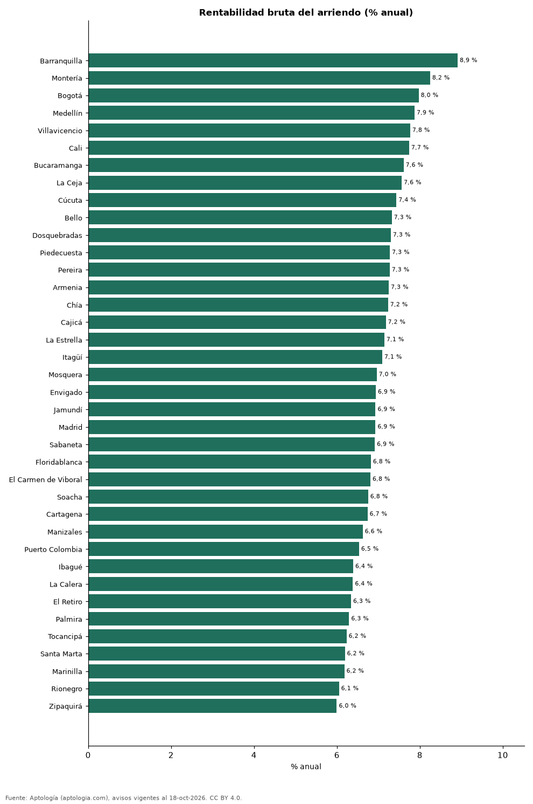

# Rentabilidad bruta del arriendo en 38 ciudades de Colombia: dónde rinde más comprar para arrendar (octubre 2026)

**Comprar un apartamento para arrendarlo rinde más en Barranquilla, con una rentabilidad bruta implícita de 8,9 % anual, y menos en Zipaquirá, con 6,0 %.** En Bogotá la rentabilidad bruta es 8,0 %; la mediana de las 38 ciudades, 6,9 %.

*Resumen: cruzamos arriendo y venta por m² de 184.855 apartamentos en 38 ciudades colombianas.*

**Actualizado:** 18 de octubre de 2026 (datos del 18 de octubre de 2026) · **Próxima actualización:** mensual.

## Resumen

| Indicador | Valor |
|---|---|
| Mayor | Barranquilla: 8,9 % |
| Menor | Zipaquirá: 6,0 % |
| Bogotá | 8,0 % |
| Mediana | 6,9 % |

## Rentabilidad por ciudad

| Ciudad | Rentabilidad bruta | Arriendo por m² al mes | Venta por m² | Avisos (arriendo / venta) |
|---|---|---|---|---|
| Barranquilla | 8,9 % | 33.654 pesos | 4.531.707 pesos | 3.694 / 7.532 |
| Montería | 8,2 % | 25.556 pesos | 3.718.519 pesos | 44 / 288 |
| Bogotá | 8,0 % | 48.246 pesos | 7.261.905 pesos | 12.954 / 31.265 |
| Medellín | 7,9 % | 49.206 pesos | 7.500.000 pesos | 20.068 / 20.515 |
| Villavicencio | 7,8 % | 27.212 pesos | 4.203.958 pesos | 74 / 347 |
| Cali | 7,7 % | 30.000 pesos | 4.650.000 pesos | 1.499 / 9.365 |
| Bucaramanga | 7,6 % | 29.588 pesos | 4.666.667 pesos | 416 / 2.439 |
| La Ceja | 7,6 % | 37.323 pesos | 5.922.147 pesos | 354 / 312 |
| Cúcuta | 7,4 % | 22.007 pesos | 3.551.857 pesos | 298 / 561 |
| Bello | 7,3 % | 33.333 pesos | 5.461.538 pesos | 1.082 / 2.319 |
| Dosquebradas | 7,3 % | 28.193 pesos | 4.634.146 pesos | 70 / 607 |
| Piedecuesta | 7,3 % | 22.222 pesos | 3.664.236 pesos | 57 / 246 |
| Pereira | 7,3 % | 33.333 pesos | 5.500.000 pesos | 1.530 / 4.376 |
| Armenia | 7,3 % | 32.222 pesos | 5.332.556 pesos | 337 / 2.278 |
| Chía | 7,2 % | 33.333 pesos | 5.529.412 pesos | 489 / 1.507 |
| Cajicá | 7,2 % | 33.929 pesos | 5.671.642 pesos | 385 / 1.517 |
| La Estrella | 7,1 % | 38.333 pesos | 6.438.356 pesos | 489 / 561 |
| Itagüí | 7,1 % | 40.000 pesos | 6.766.968 pesos | 908 / 2.012 |
| Mosquera | 7,0 % | 28.571 pesos | 4.926.471 pesos | 167 / 817 |
| Envigado | 6,9 % | 48.864 pesos | 8.452.381 pesos | 7.303 / 5.735 |
| Jamundí | 6,9 % | 20.690 pesos | 3.582.207 pesos | 107 / 466 |
| Madrid | 6,9 % | 20.833 pesos | 3.607.843 pesos | 259 / 475 |
| Sabaneta | 6,9 % | 41.026 pesos | 7.121.212 pesos | 3.868 / 4.375 |
| Floridablanca | 6,8 % | 29.412 pesos | 5.176.224 pesos | 357 / 919 |
| El Carmen de Viboral | 6,8 % | 25.391 pesos | 4.475.422 pesos | 102 / 90 |
| Soacha | 6,8 % | 19.098 pesos | 3.393.617 pesos | 128 / 566 |
| Cartagena | 6,7 % | 44.118 pesos | 7.857.143 pesos | 2.008 / 5.774 |
| Manizales | 6,6 % | 31.199 pesos | 5.653.956 pesos | 282 / 2.788 |
| Puerto Colombia | 6,5 % | 31.944 pesos | 5.867.102 pesos | 90 / 144 |
| Ibagué | 6,4 % | 22.581 pesos | 4.239.130 pesos | 249 / 1.217 |
| La Calera | 6,4 % | 31.034 pesos | 5.833.333 pesos | 51 / 139 |
| El Retiro | 6,3 % | 49.254 pesos | 9.321.839 pesos | 541 / 618 |
| Palmira | 6,3 % | 22.000 pesos | 4.194.668 pesos | 42 / 112 |
| Tocancipá | 6,2 % | 18.924 pesos | 3.644.068 pesos | 94 / 264 |
| Santa Marta | 6,2 % | 45.000 pesos | 8.720.930 pesos | 674 / 3.779 |
| Marinilla | 6,2 % | 29.091 pesos | 5.649.750 pesos | 107 / 164 |
| Rionegro | 6,1 % | 37.500 pesos | 7.437.500 pesos | 3.179 / 3.023 |
| Zipaquirá | 6,0 % | 21.818 pesos | 4.366.197 pesos | 168 / 819 |

Rentabilidad bruta = arriendo mediano por m² × 12 ÷ precio mediano de venta por m² (apartamentos).

## Preguntas frecuentes

**¿Dónde es más rentable comprar para arrendar en Colombia?**
En Barranquilla, con 8,9 % bruto anual según la oferta de octubre de 2026.

**¿Cuánto renta un apartamento en Bogotá?**
8,0 % bruto anual, antes de administración, predial, vacancia y mantenimiento.

## Metodología

- **Fuente:** exportes nocturnos de la base de datos de Aptología (aptologia.com) del 18 de octubre de 2026: avisos vigentes de vivienda en portales inmobiliarios de 13 países, recogidos por Aptología y vistos en línea entre el 11 y el 18 de octubre de 2026. Corte: 18 de octubre de 2026.
- **Depuración:** se eliminan duplicados exactos (misma ciudad, zona, tipo, precio, moneda, área, habitaciones y baños) y los precios fuera del percentil 1–99 de cada país, operación, moneda y tipo; el precio por m² usa solo avisos con área declarada entre 12 y 2.000 m² y también se recorta al P1–P99.
- **Qué se mide:** precios pedidos (publicados), no precios de cierre. En arriendo, el canon mensual sin administración, gastos comunes ni condominio.
- **Muestra mínima:** cada cifra publicada se apoya en al menos 30 avisos; las celdas con menos se omiten.
- **Colombia:** Precios en pesos colombianos, sin conversión de moneda. Los indicadores de amoblado, mascotas, conjunto cerrado, balcón y aviso directo del dueño solo existen en arriendo y vienen de los portales.
- **Rentabilidad bruta:** aproximación con medianas de dos ofertas distintas (arriendo y venta) de la misma ciudad.
- **Limitaciones:** la cobertura depende de los portales que recorre Aptología en cada país y es mayor en las ciudades grandes y en los segmentos medio-alto y alto; el área es la que declara el aviso, sin verificar; los nombres de zona vienen de los portales.
- **Privacidad:** solo se publican agregados; no se publica ningún dato personal, enlace a avisos ni nombre de anunciante.
- **Datos abiertos:** [datos.csv](datos.csv), licencia CC BY 4.0.

## Cómo citar

Pinzón Pineda, D. M. (2026). *Rentabilidad bruta del arriendo en 38 ciudades de Colombia: dónde rinde más comprar para arrendar (octubre 2026)*. Aptología (aptologia.com). https://github.com/elbroker/aptologia-datos/tree/main/estudios/rentabilidad-arriendo-ciudades-colombia-2026. Datos: datos.csv, licencia CC BY 4.0.
