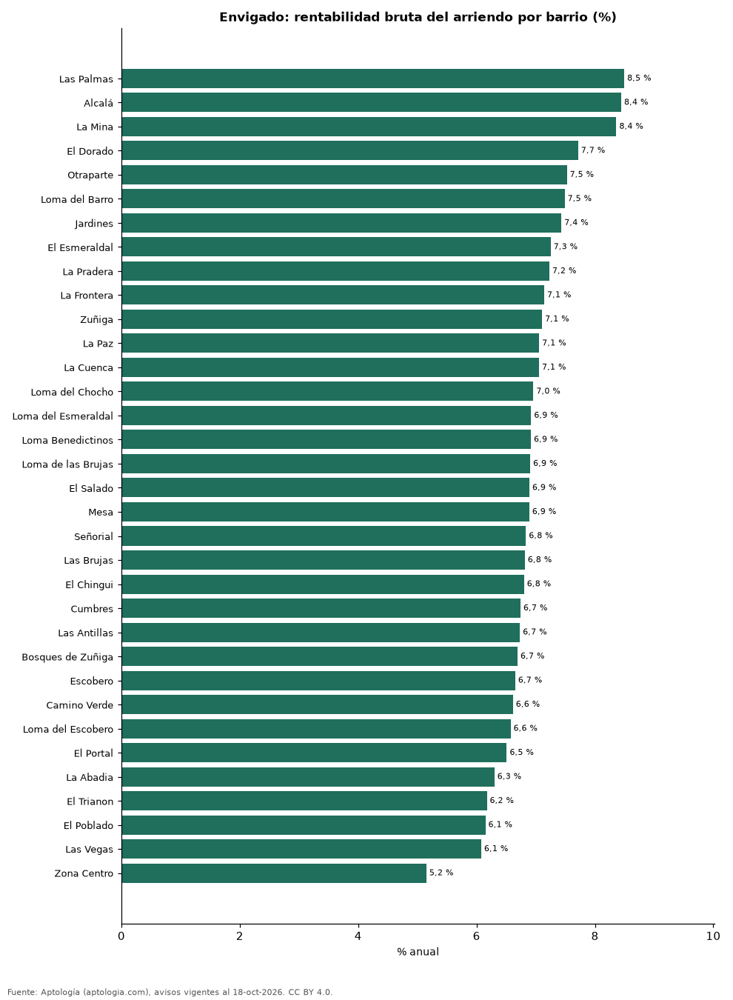

# Rentabilidad del arriendo en Envigado por barrio: dónde rinde más comprar para arrendar (octubre 2026)

**En Envigado, comprar un apartamento para arrendarlo rinde en el barrio típico 6,9 % bruto al año: el precio pedido equivale a 14,5 años de arriendo. El barrio con mayor rentabilidad bruta es Las Palmas (8,5 %) y el de menor, Zona Centro (5,2 %).** Para toda la ciudad, con las medianas por m², la rentabilidad bruta implícita es 6,9 %.

*Resumen: comparamos el precio por m² de 4.079 apartamentos en venta con el canon por m² de 4.892 en arriendo en 34 barrios de Envigado.*

**Actualizado:** 18 de octubre de 2026 (datos del 18 de octubre de 2026) · **Próxima actualización:** mensual.

## Resumen

| Indicador | Valor |
|---|---|
| Mayor rentabilidad | Las Palmas: 8,5 % |
| Menor rentabilidad | Zona Centro: 5,2 % |
| Barrio típico (mediana) | 6,9 % |
| Ciudad (medianas por m²) | 6,9 % |
| Barrios comparados | 34 |

## Rentabilidad bruta por barrio

| Barrio | Venta por m² (millones de pesos) | Arriendo por m² al mes (pesos) | Rentabilidad bruta | Años de arriendo | Avisos (venta / arriendo) |
|---|---|---|---|---|---|
| Las Palmas | 10,32 | 73.078 | 8,5 % | 11,8 | 47 / 46 |
| Alcalá | 5,33 | 37.500 | 8,4 % | 11,8 | 32 / 41 |
| La Mina | 5,74 | 40.000 | 8,4 % | 12,0 | 64 / 55 |
| El Dorado | 6,11 | 39.286 | 7,7 % | 13,0 | 62 / 47 |
| Otraparte | 7,87 | 49.359 | 7,5 % | 13,3 | 107 / 217 |
| Loma del Barro | 6,89 | 42.967 | 7,5 % | 13,4 | 73 / 58 |
| Jardines | 7,71 | 47.778 | 7,4 % | 13,5 | 36 / 72 |
| El Esmeraldal | 8,55 | 51.667 | 7,3 % | 13,8 | 136 / 161 |
| La Pradera | 8,30 | 50.000 | 7,2 % | 13,8 | 51 / 86 |
| La Frontera | 7,76 | 46.162 | 7,1 % | 14,0 | 50 / 48 |
| Zuñiga | 7,62 | 45.130 | 7,1 % | 14,1 | 197 / 218 |
| La Paz | 6,94 | 40.805 | 7,1 % | 14,2 | 59 / 39 |
| La Cuenca | 7,47 | 43.934 | 7,1 % | 14,2 | 86 / 78 |
| Loma del Chocho | 9,06 | 52.566 | 7,0 % | 14,4 | 157 / 216 |
| Loma del Esmeraldal | 9,05 | 52.212 | 6,9 % | 14,4 | 253 / 409 |
| Loma Benedictinos | 8,44 | 48.667 | 6,9 % | 14,5 | 113 / 223 |
| Loma de las Brujas | 8,92 | 51.351 | 6,9 % | 14,5 | 385 / 339 |
| El Salado | 8,12 | 46.667 | 6,9 % | 14,5 | 48 / 41 |
| Mesa | 7,52 | 43.182 | 6,9 % | 14,5 | 142 / 157 |
| Señorial | 7,88 | 44.888 | 6,8 % | 14,6 | 103 / 90 |
| Las Brujas | 8,80 | 50.000 | 6,8 % | 14,7 | 76 / 103 |
| El Chingui | 8,14 | 46.154 | 6,8 % | 14,7 | 117 / 87 |
| Cumbres | 8,83 | 49.587 | 6,7 % | 14,8 | 292 / 467 |
| Las Antillas | 7,54 | 42.308 | 6,7 % | 14,9 | 121 / 91 |
| Bosques de Zuñiga | 7,86 | 43.860 | 6,7 % | 14,9 | 50 / 41 |
| Escobero | 9,35 | 51.859 | 6,7 % | 15,0 | 144 / 194 |
| Camino Verde | 8,41 | 46.332 | 6,6 % | 15,1 | 333 / 336 |
| Loma del Escobero | 9,46 | 51.813 | 6,6 % | 15,2 | 193 / 348 |
| El Portal | 7,42 | 40.270 | 6,5 % | 15,4 | 109 / 86 |
| La Abadia | 8,85 | 46.470 | 6,3 % | 15,9 | 70 / 132 |
| El Trianon | 8,93 | 45.934 | 6,2 % | 16,2 | 116 / 90 |
| El Poblado | 9,09 | 46.583 | 6,1 % | 16,3 | 39 / 78 |
| Las Vegas | 10,22 | 51.765 | 6,1 % | 16,5 | 126 / 167 |
| Zona Centro | 8,55 | 36.735 | 5,2 % | 19,4 | 92 / 31 |

Ordenado de mayor a menor rentabilidad. Antes de administración, impuestos, vacancia y financiación.

## Preguntas frecuentes

**¿En qué barrio de Envigado rinde más comprar para arrendar?**
En Las Palmas, con 8,5 % bruto anual (11,8 años de arriendo), según avisos de octubre de 2026.

**¿Dónde rinde menos?**
En Zona Centro: 5,2 % bruto anual (19,4 años de arriendo).

**¿Cuánto renta un apartamento en Envigado?**
En el barrio típico, 6,9 % bruto al año.

## Metodología

- **Fuente:** exportes nocturnos de la base de datos de Aptología (aptologia.com) del 18 de octubre de 2026: avisos vigentes de vivienda en portales inmobiliarios de 13 países, recogidos por Aptología y vistos en línea entre el 11 y el 18 de octubre de 2026. Corte: 18 de octubre de 2026.
- **Depuración:** se eliminan duplicados exactos (misma ciudad, zona, tipo, precio, moneda, área, habitaciones y baños) y los precios fuera del percentil 1–99 de cada país, operación, moneda y tipo; el precio por m² usa solo avisos con área declarada entre 12 y 2.000 m² y también se recorta al P1–P99.
- **Qué se mide:** precios pedidos (publicados), no precios de cierre. En arriendo, el canon mensual sin administración, gastos comunes ni condominio.
- **Muestra mínima:** cada cifra publicada se apoya en al menos 30 avisos; las celdas con menos se omiten.
- **Colombia:** Precios en pesos colombianos, sin conversión de moneda.
- **Años de arriendo para pagar la vivienda:** precio de venta mediano ÷ (canon mensual mediano × 12), entre avisos del mismo tipo y celda; es la relación precio/arriendo (price-to-rent ratio) y equivale a 100 ÷ rentabilidad bruta. No incluye administración, impuestos, vacancia, financiación ni valorización: es una referencia para comparar comprar con arrendar, no una recomendación de inversión.
- **Rentabilidad por barrio:** canon mediano por m² × 12 ÷ precio de venta mediano por m² de apartamentos del mismo barrio; solo barrios con 30 avisos o más de venta y 30 o más de arriendo con área declarada. Usar el m² y no el precio total evita que el tamaño típico de cada barrio sesgue la comparación.
- **Limitaciones:** la cobertura depende de los portales que recorre Aptología en cada país y es mayor en las ciudades grandes y en los segmentos medio-alto y alto; el área es la que declara el aviso, sin verificar; los nombres de zona vienen de los portales.
- **Privacidad:** solo se publican agregados; no se publica ningún dato personal, enlace a avisos ni nombre de anunciante.
- **Datos abiertos:** [datos.csv](datos.csv), licencia CC BY 4.0.

## Cómo citar

Pinzón Pineda, D. M. (2026). *Rentabilidad del arriendo en Envigado por barrio: dónde rinde más comprar para arrendar (octubre 2026)*. Aptología (aptologia.com). https://github.com/elbroker/aptologia-datos/tree/main/estudios/rentabilidad-arriendo-envigado-por-barrio-2026. Datos: datos.csv, licencia CC BY 4.0.
