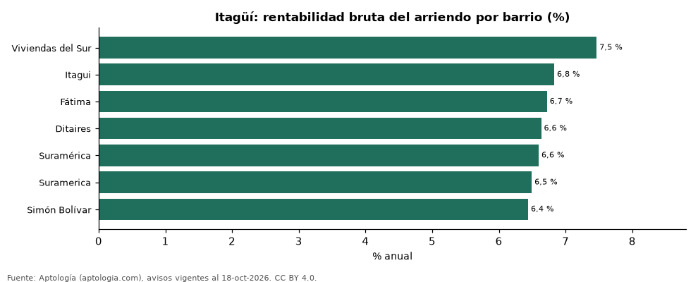

# Rentabilidad del arriendo en Itagüí por barrio: dónde rinde más comprar para arrendar (octubre 2026)

**En Itagüí, comprar un apartamento para arrendarlo rinde en el barrio típico 6,6 % bruto al año: el precio pedido equivale a 15,1 años de arriendo. El barrio con mayor rentabilidad bruta es Viviendas del Sur (7,5 %) y el de menor, Simón Bolívar (6,4 %).** Para toda la ciudad, con las medianas por m², la rentabilidad bruta implícita es 7,1 %.

*Resumen: comparamos el precio por m² de 1.062 apartamentos en venta con el canon por m² de 473 en arriendo en 7 barrios de Itagüí.*

**Actualizado:** 18 de octubre de 2026 (datos del 18 de octubre de 2026) · **Próxima actualización:** mensual.

## Resumen

| Indicador | Valor |
|---|---|
| Mayor rentabilidad | Viviendas del Sur: 7,5 % |
| Menor rentabilidad | Simón Bolívar: 6,4 % |
| Barrio típico (mediana) | 6,6 % |
| Ciudad (medianas por m²) | 7,1 % |
| Barrios comparados | 7 |

## Rentabilidad bruta por barrio

| Barrio | Venta por m² (millones de pesos) | Arriendo por m² al mes (pesos) | Rentabilidad bruta | Años de arriendo | Avisos (venta / arriendo) |
|---|---|---|---|---|---|
| Viviendas del Sur | 6,43 | 40.000 | 7,5 % | 13,4 | 135 / 70 |
| Itagui | 6,91 | 39.320 | 6,8 % | 14,6 | 111 / 62 |
| Fátima | 7,23 | 40.513 | 6,7 % | 14,9 | 84 / 48 |
| Ditaires | 6,97 | 38.516 | 6,6 % | 15,1 | 231 / 94 |
| Suramérica | 7,17 | 39.406 | 6,6 % | 15,2 | 194 / 118 |
| Suramerica | 7,31 | 39.569 | 6,5 % | 15,4 | 261 / 44 |
| Simón Bolívar | 8,52 | 45.714 | 6,4 % | 15,5 | 46 / 37 |

Ordenado de mayor a menor rentabilidad. Antes de administración, impuestos, vacancia y financiación.

## Preguntas frecuentes

**¿En qué barrio de Itagüí rinde más comprar para arrendar?**
En Viviendas del Sur, con 7,5 % bruto anual (13,4 años de arriendo), según avisos de octubre de 2026.

**¿Dónde rinde menos?**
En Simón Bolívar: 6,4 % bruto anual (15,5 años de arriendo).

**¿Cuánto renta un apartamento en Itagüí?**
En el barrio típico, 6,6 % bruto al año.

## Metodología

- **Fuente:** exportes nocturnos de la base de datos de Aptología (aptologia.com) del 18 de octubre de 2026: avisos vigentes de vivienda en portales inmobiliarios de 13 países, recogidos por Aptología y vistos en línea entre el 11 y el 18 de octubre de 2026. Corte: 18 de octubre de 2026.
- **Depuración:** se eliminan duplicados exactos (misma ciudad, zona, tipo, precio, moneda, área, habitaciones y baños) y los precios fuera del percentil 1–99 de cada país, operación, moneda y tipo; el precio por m² usa solo avisos con área declarada entre 12 y 2.000 m² y también se recorta al P1–P99.
- **Qué se mide:** precios pedidos (publicados), no precios de cierre. En arriendo, el canon mensual sin administración, gastos comunes ni condominio.
- **Muestra mínima:** cada cifra publicada se apoya en al menos 30 avisos; las celdas con menos se omiten.
- **Colombia:** Precios en pesos colombianos, sin conversión de moneda.
- **Años de arriendo para pagar la vivienda:** precio de venta mediano ÷ (canon mensual mediano × 12), entre avisos del mismo tipo y celda; es la relación precio/arriendo (price-to-rent ratio) y equivale a 100 ÷ rentabilidad bruta. No incluye administración, impuestos, vacancia, financiación ni valorización: es una referencia para comparar comprar con arrendar, no una recomendación de inversión.
- **Rentabilidad por barrio:** canon mediano por m² × 12 ÷ precio de venta mediano por m² de apartamentos del mismo barrio; solo barrios con 30 avisos o más de venta y 30 o más de arriendo con área declarada. Usar el m² y no el precio total evita que el tamaño típico de cada barrio sesgue la comparación.
- **Limitaciones:** la cobertura depende de los portales que recorre Aptología en cada país y es mayor en las ciudades grandes y en los segmentos medio-alto y alto; el área es la que declara el aviso, sin verificar; los nombres de zona vienen de los portales.
- **Privacidad:** solo se publican agregados; no se publica ningún dato personal, enlace a avisos ni nombre de anunciante.
- **Datos abiertos:** [datos.csv](datos.csv), licencia CC BY 4.0.

## Cómo citar

Pinzón Pineda, D. M. (2026). *Rentabilidad del arriendo en Itagüí por barrio: dónde rinde más comprar para arrendar (octubre 2026)*. Aptología (aptologia.com). https://github.com/elbroker/aptologia-datos/tree/main/estudios/rentabilidad-arriendo-itagui-por-barrio-2026. Datos: datos.csv, licencia CC BY 4.0.
