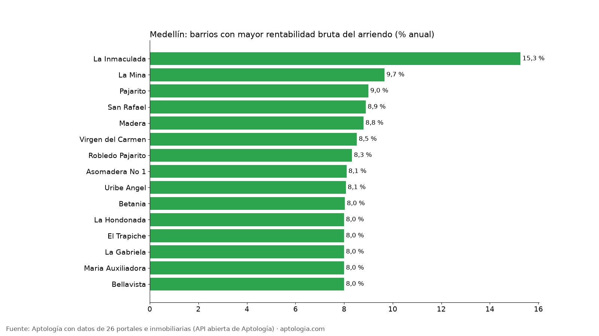
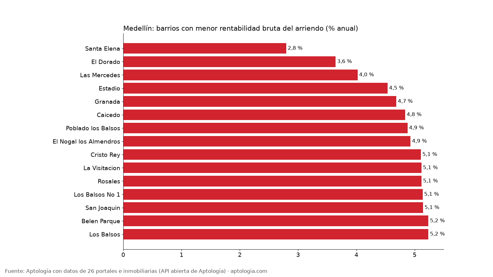

# Rentabilidad del arriendo en Medellín por barrio: dónde rinde más comprar para arrendar (octubre 2026)

**En Medellín, comprar un apartamento para arrendarlo rinde en el barrio típico 6,5 % bruto al año: el precio pedido equivale a 15,4 años de arriendo.** El barrio con mayor rentabilidad bruta es La Inmaculada (15,3 %) y el de menor Santa Elena (2,8 %), entre 229 barrios con 30 avisos o más de arriendo y de venta.

*Resumen: cruzamos el arriendo pedido y el precio de venta pedido de apartamentos en 229 barrios de Medellín con 30 avisos o más de cada uno.*

**Actualizado:** 18 de octubre de 2026 (datos del 5 de octubre de 2026) · **Próxima actualización:** mensual.

## Resumen

| Indicador | Valor |
|---|---|
| Rentabilidad bruta mediana entre barrios (todos los tamaños) | 6,5 % |
| Rentabilidad bruta mediana, 2 alcobas | 6,6 % |
| Años de arriendo para pagar el precio (mediana) | 15,4 |
| Barrios comparables | 229 |
| Barrios comparables en 2 alcobas | 121 |

## Barrios con mayor rentabilidad bruta

| Barrio | Rentabilidad bruta | Años de arriendo | Arriendo mediano | Precio de venta mediano | Avisos (arriendo / venta) |
|---|---|---|---|---|---|
| La Inmaculada | 15,3 % | 6,6 | $4.325.000 | $340 millones | 292 / 153 |
| La Mina | 9,7 % | 10,3 | $2.900.000 | $360 millones | 132 / 115 |
| Pajarito | 9,0 % | 11,1 | $1.800.000 | $240 millones | 213 / 102 |
| San Rafael | 8,9 % | 11,2 | $3.150.000 | $425 millones | 127 / 87 |
| Madera | 8,8 % | 11,4 | $2.175.000 | $296 millones | 34 / 48 |
| Virgen del Carmen | 8,5 % | 11,7 | $2.700.000 | $380 millones | 41 / 35 |
| Robledo Pajarito | 8,3 % | 12,0 | $1.825.000 | $263 millones | 48 / 53 |
| Asomadera No 1 | 8,1 % | 12,3 | $3.950.000 | $585 millones | 93 / 66 |
| Uribe Angel | 8,1 % | 12,4 | $3.700.000 | $550 millones | 101 / 39 |
| Betania | 8,0 % | 12,4 | $3.650.000 | $545 millones | 84 / 138 |
| La Hondonada | 8,0 % | 12,5 | $2.400.000 | $360 millones | 52 / 37 |
| El Trapiche | 8,0 % | 12,5 | $1.800.000 | $270 millones | 78 / 120 |
| La Gabriela | 8,0 % | 12,5 | $2.000.000 | $300 millones | 87 / 53 |
| Maria Auxiliadora | 8,0 % | 12,5 | $1.900.000 | $285 millones | 249 / 207 |
| Bellavista | 8,0 % | 12,5 | $1.800.000 | $270 millones | 38 / 69 |

Rentabilidades brutas por encima de 10 % suelen indicar que los apartamentos en arriendo y en venta de ese barrio son distintos (tamaño, estado o amoblado); tómalas como señal para revisar, no como dato de inversión.

## Barrios con menor rentabilidad bruta

| Barrio | Rentabilidad bruta | Años de arriendo | Arriendo mediano | Precio de venta mediano | Avisos (arriendo / venta) |
|---|---|---|---|---|---|
| Santa Elena | 2,8 % | 35,8 | $2.775.000 | $1,19 mil millones | 42 / 34 |
| El Dorado | 3,6 % | 27,5 | $1.700.000 | $560 millones | 307 / 120 |
| Las Mercedes | 4,0 % | 24,9 | $1.290.000 | $385 millones | 82 / 56 |
| Estadio | 4,5 % | 22,1 | $2.900.000 | $768 millones | 545 / 202 |
| Granada | 4,7 % | 21,3 | $2.050.000 | $525 millones | 66 / 32 |
| Caicedo | 4,8 % | 20,7 | $1.290.000 | $320 millones | 39 / 31 |
| Poblado los Balsos | 4,9 % | 20,5 | $6.300.000 | $1,55 mil millones | 46 / 52 |
| El Nogal los Almendros | 4,9 % | 20,3 | $2.875.000 | $700 millones | 108 / 47 |
| Cristo Rey | 5,1 % | 19,6 | $2.000.000 | $470 millones | 129 / 63 |
| La Visitacion | 5,1 % | 19,5 | $5.500.000 | $1,29 mil millones | 77 / 44 |
| Rosales | 5,1 % | 19,5 | $2.900.000 | $680 millones | 276 / 100 |
| Los Balsos No 1 | 5,1 % | 19,5 | $5.500.000 | $1,28 mil millones | 397 / 164 |
| San Joaquin | 5,1 % | 19,4 | $2.700.000 | $630 millones | 640 / 277 |
| Belen Parque | 5,2 % | 19,1 | $2.400.000 | $550 millones | 85 / 43 |
| Los Balsos | 5,2 % | 19,1 | $6.000.000 | $1,38 mil millones | 2.002 / 286 |

## Solo apartamentos de 2 alcobas (los 10 más rentables)

Comparar apartamentos del mismo tamaño acerca la cifra a la de un inmueble real.

| Barrio | Rentabilidad bruta 2 alcobas | Arriendo 2 alcobas | Venta 2 alcobas |
|---|---|---|---|
| La Inmaculada | 16,3 % | $4.000.000 | $295 millones |
| Pajarito | 11,1 % | $1.600.000 | $172 millones |
| El Trapiche | 9,5 % | $2.100.000 | $265 millones |
| Asomadera No 1 | 9,3 % | $3.775.000 | $489 millones |
| San Rafael | 8,9 % | $3.200.000 | $430 millones |
| Loma del Indio | 8,4 % | $3.700.000 | $530 millones |
| Calasanz | 8,1 % | $2.400.000 | $355 millones |
| Santa Rosa de Lima | 8,1 % | $2.400.000 | $358 millones |
| Las Acacias | 8,0 % | $3.100.000 | $465 millones |
| La Tablaza | 8,0 % | $1.700.000 | $256 millones |

**Cómo usarlo para decidir:** la rentabilidad bruta es un filtro inicial, no la ganancia: réstale administración, predial, vacancia (meses sin arrendar), comisión y mantenimiento, que juntos suelen comerse varios puntos. Un barrio con rentabilidad alta pero pocas ventas o mucha rotación puede ser más riesgoso. Valida siempre con el arriendo real de apartamentos iguales al que vas a comprar.

## Preguntas frecuentes

**¿Cuánto renta un apartamento arrendado en Medellín?**
En el barrio típico, 6,5 % bruto anual: 12 meses de arriendo pedido sobre el precio de venta pedido, antes de gastos e impuestos, con datos del 5 de octubre de 2026.

**¿En qué barrio de Medellín es más rentable comprar para arrendar?**
La Inmaculada, con 15,3 % bruto anual (arriendo mediano $4.325.000, venta mediana $340 millones).

**¿Cuántos años de arriendo cuesta un apartamento en Medellín?**
En la mediana de los barrios, 15,4 años de arriendo pedido.

## Metodología

- **Fuente:** API abierta de Aptología ([aptologia.com/datos-abiertos](https://www.aptologia.com/datos-abiertos)), que cada noche revisa los avisos vivos de 26 portales e inmobiliarias. Foto de los datos: 5 de octubre de 2026.
- **Qué se mide:** precio pedido de apartamentos (no casas ni habitaciones), sin administración. Son precios publicados, no cerrados.
- **Barrios:** etiquetas depuradas. Se excluyen nombres de localidad o comuna, textos de aviso, zonas genéricas, barrios de otro municipio y variantes del mismo nombre, para no contar dos veces el mismo barrio.
- **Rentabilidad bruta (calculada):** 12 × mediana del arriendo pedido ÷ mediana del precio de venta pedido del mismo barrio, en % anual. Años de arriendo = 100 ÷ rentabilidad. Solo barrios con 30 avisos o más de arriendo y de venta (20 o más en la versión de 2 alcobas).
- **No es la rentabilidad de un inmueble:** las medianas salen de avisos distintos; no descuenta administración, predial, vacancia, comisión, mantenimiento ni impuestos.
- **Limitaciones:** un mismo apartamento puede estar publicado en más de un portal, por lo que los conteos de avisos pueden incluir repetidos. Los barrios vienen tal como los escribe cada portal, después de la depuración.
- **Datos abiertos:** [datos.csv](datos.csv), licencia CC BY 4.0.

## Cómo citar

Pinzón Pineda, D. M. (2026). *Rentabilidad del arriendo en Medellín por barrio: dónde rinde más comprar para arrendar (octubre 2026)*. Aptología. https://www.aptologia.com/estudios/rentabilidad-arriendo-medellin-por-barrio-2026. Datos: datos.csv, licencia CC BY 4.0.
