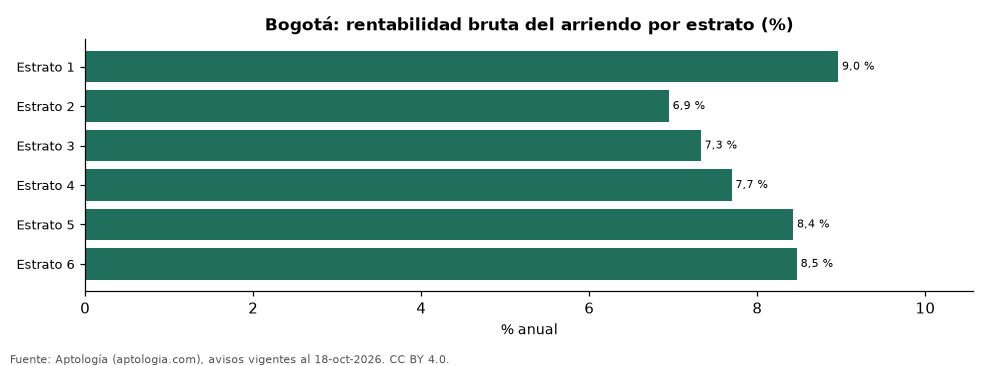

# Rentabilidad del arriendo en Bogotá por estrato: en cuál rinde más comprar para arrendar (octubre 2026)

**En Bogotá, comprar un apartamento para arrendarlo rinde más en estrato 1 (9,0 % bruto al año, 11,2 años de arriendo) y menos en estrato 2 (6,9 %).**

*Resumen: comparamos el precio por m² de 30.876 apartamentos en venta con el canon por m² de 12.793 en arriendo en Bogotá, estrato por estrato.*

**Actualizado:** 18 de octubre de 2026 (datos del 18 de octubre de 2026) · **Próxima actualización:** mensual.

## Resumen

| Indicador | Valor |
|---|---|
| Estrato 1 | 9,0 % |
| Estrato 2 | 6,9 % |
| Estrato 3 | 7,3 % |
| Estrato 4 | 7,7 % |
| Estrato 5 | 8,4 % |
| Estrato 6 | 8,5 % |

## Rentabilidad bruta por estrato

| Estrato | Venta por m² | Arriendo por m² al mes | Rentabilidad bruta | Años de arriendo | Avisos (venta / arriendo) |
|---|---|---|---|---|---|
| 1 | 6,25 millones de pesos | 46.667 pesos | 9,0 % | 11,2 | 190 / 55 |
| 2 | 4,32 millones de pesos | 25.000 pesos | 6,9 % | 14,4 | 1.233 / 399 |
| 3 | 5,62 millones de pesos | 34.286 pesos | 7,3 % | 13,7 | 5.647 / 2.916 |
| 4 | 7,23 millones de pesos | 46.341 pesos | 7,7 % | 13,0 | 6.732 / 3.149 |
| 5 | 7,56 millones de pesos | 53.046 pesos | 8,4 % | 11,9 | 5.364 / 1.786 |
| 6 | 8,40 millones de pesos | 59.272 pesos | 8,5 % | 11,8 | 11.710 / 4.488 |

Canon mediano por m² × 12 ÷ precio mediano por m²; antes de administración, impuestos, vacancia y financiación.

## Preguntas frecuentes

**¿En qué estrato rinde más arrendar en Bogotá?**
En estrato 1: 9,0 % bruto anual (octubre de 2026).

**¿Dónde rinde menos?**
En estrato 2: 6,9 %.

## Metodología

- **Fuente:** exportes nocturnos de la base de datos de Aptología (aptologia.com) del 18 de octubre de 2026: avisos vigentes de vivienda en portales inmobiliarios de 13 países, recogidos por Aptología y vistos en línea entre el 11 y el 18 de octubre de 2026. Corte: 18 de octubre de 2026.
- **Depuración:** se eliminan duplicados exactos (misma ciudad, zona, tipo, precio, moneda, área, habitaciones y baños) y los precios fuera del percentil 1–99 de cada país, operación, moneda y tipo; el precio por m² usa solo avisos con área declarada entre 12 y 2.000 m² y también se recorta al P1–P99.
- **Qué se mide:** precios pedidos (publicados), no precios de cierre. En arriendo, el canon mensual sin administración, gastos comunes ni condominio.
- **Muestra mínima:** cada cifra publicada se apoya en al menos 30 avisos; las celdas con menos se omiten.
- **Colombia:** Precios en pesos colombianos, sin conversión de moneda.
- **Rentabilidad por estrato:** canon mediano por m² × 12 ÷ precio de venta mediano por m² de apartamentos del mismo estrato; solo estratos con 30 avisos o más de venta y 30 o más de arriendo con área.
- **Cordura:** solo se publica si todas las rentabilidades están entre 1 % y 20 %.
- **Limitaciones:** la cobertura depende de los portales que recorre Aptología en cada país y es mayor en las ciudades grandes y en los segmentos medio-alto y alto; el área es la que declara el aviso, sin verificar; los nombres de zona vienen de los portales.
- **Privacidad:** solo se publican agregados; no se publica ningún dato personal, enlace a avisos ni nombre de anunciante.
- **Datos abiertos:** [datos.csv](datos.csv), licencia CC BY 4.0.

## Cómo citar

Pinzón Pineda, D. M. (2026). *Rentabilidad del arriendo en Bogotá por estrato: en cuál rinde más comprar para arrendar (octubre 2026)*. Aptología (aptologia.com). https://github.com/elbroker/aptologia-datos/tree/main/estudios/rentabilidad-arriendo-por-estrato-bogota-2026. Datos: datos.csv, licencia CC BY 4.0.
