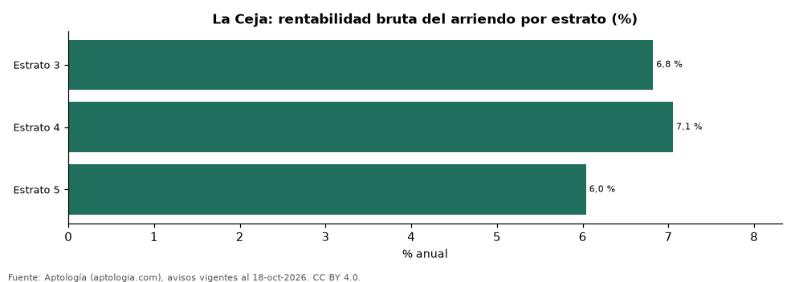

# Rentabilidad del arriendo en La Ceja por estrato: en cuál rinde más comprar para arrendar (octubre 2026)

**En La Ceja, comprar un apartamento para arrendarlo rinde más en estrato 4 (7,1 % bruto al año, 14,2 años de arriendo) y menos en estrato 5 (6,0 %).**

*Resumen: comparamos el precio por m² de 268 apartamentos en venta con el canon por m² de 324 en arriendo en La Ceja, estrato por estrato.*

**Actualizado:** 18 de octubre de 2026 (datos del 18 de octubre de 2026) · **Próxima actualización:** mensual.

## Resumen

| Indicador | Valor |
|---|---|
| Estrato 3 | 6,8 % |
| Estrato 4 | 7,1 % |
| Estrato 5 | 6,0 % |

## Rentabilidad bruta por estrato

| Estrato | Venta por m² | Arriendo por m² al mes | Rentabilidad bruta | Años de arriendo | Avisos (venta / arriendo) |
|---|---|---|---|---|---|
| 3 | 5,10 millones de pesos | 29.000 pesos | 6,8 % | 14,7 | 99 / 73 |
| 4 | 6,52 millones de pesos | 38.298 pesos | 7,1 % | 14,2 | 118 / 165 |
| 5 | 7,72 millones de pesos | 38.847 pesos | 6,0 % | 16,6 | 51 / 86 |

Canon mediano por m² × 12 ÷ precio mediano por m²; antes de administración, impuestos, vacancia y financiación.

## Preguntas frecuentes

**¿En qué estrato rinde más arrendar en La Ceja?**
En estrato 4: 7,1 % bruto anual (octubre de 2026).

**¿Dónde rinde menos?**
En estrato 5: 6,0 %.

## Metodología

- **Fuente:** exportes nocturnos de la base de datos de Aptología (aptologia.com) del 18 de octubre de 2026: avisos vigentes de vivienda en portales inmobiliarios de 13 países, recogidos por Aptología y vistos en línea entre el 11 y el 18 de octubre de 2026. Corte: 18 de octubre de 2026.
- **Depuración:** se eliminan duplicados exactos (misma ciudad, zona, tipo, precio, moneda, área, habitaciones y baños) y los precios fuera del percentil 1–99 de cada país, operación, moneda y tipo; el precio por m² usa solo avisos con área declarada entre 12 y 2.000 m² y también se recorta al P1–P99.
- **Qué se mide:** precios pedidos (publicados), no precios de cierre. En arriendo, el canon mensual sin administración, gastos comunes ni condominio.
- **Muestra mínima:** cada cifra publicada se apoya en al menos 30 avisos; las celdas con menos se omiten.
- **Colombia:** Precios en pesos colombianos, sin conversión de moneda.
- **Rentabilidad por estrato:** canon mediano por m² × 12 ÷ precio de venta mediano por m² de apartamentos del mismo estrato; solo estratos con 30 avisos o más de venta y 30 o más de arriendo con área.
- **Cordura:** solo se publica si todas las rentabilidades están entre 1 % y 20 %.
- **Limitaciones:** la cobertura depende de los portales que recorre Aptología en cada país y es mayor en las ciudades grandes y en los segmentos medio-alto y alto; el área es la que declara el aviso, sin verificar; los nombres de zona vienen de los portales.
- **Privacidad:** solo se publican agregados; no se publica ningún dato personal, enlace a avisos ni nombre de anunciante.
- **Datos abiertos:** [datos.csv](datos.csv), licencia CC BY 4.0.

## Cómo citar

Pinzón Pineda, D. M. (2026). *Rentabilidad del arriendo en La Ceja por estrato: en cuál rinde más comprar para arrendar (octubre 2026)*. Aptología (aptologia.com). https://github.com/elbroker/aptologia-datos/tree/main/estudios/rentabilidad-arriendo-por-estrato-la-ceja-2026. Datos: datos.csv, licencia CC BY 4.0.
