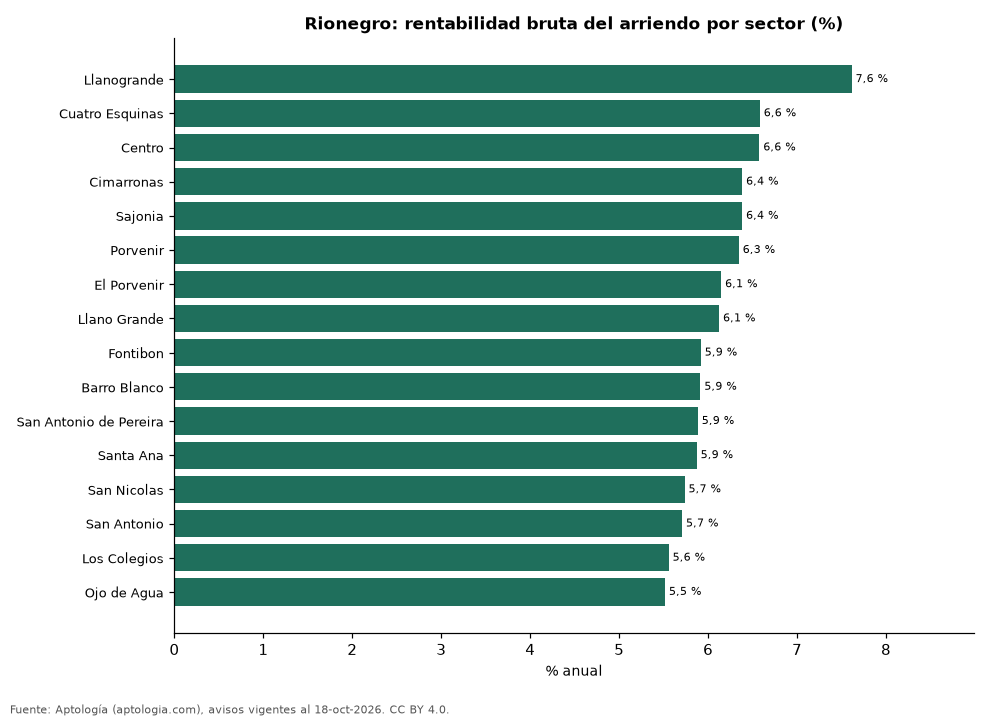

# Rentabilidad del arriendo en Rionegro por sector: dónde rinde más comprar para arrendar (octubre 2026)

**En Rionegro, comprar un apartamento para arrendarlo rinde en el sector típico 6,0 % bruto al año: el precio pedido equivale a 16,6 años de arriendo. El sector con mayor rentabilidad bruta es Llanogrande (7,6 %) y el de menor, Ojo de Agua (5,5 %).** Para toda la ciudad, con las medianas por m², la rentabilidad bruta implícita es 6,0 %.

*Resumen: comparamos el precio por m² de 2.000 apartamentos en venta con el canon por m² de 2.221 en arriendo en 16 sectores de Rionegro.*

**Actualizado:** 18 de octubre de 2026 (datos del 18 de octubre de 2026) · **Próxima actualización:** mensual.

## Resumen

| Indicador | Valor |
|---|---|
| Mayor rentabilidad | Llanogrande: 7,6 % |
| Menor rentabilidad | Ojo de Agua: 5,5 % |
| Sector típico (mediana) | 6,0 % |
| Ciudad (medianas por m²) | 6,0 % |
| Sectores comparados | 16 |

## Rentabilidad bruta por sector

| Sector | Venta por m² (millones de pesos) | Arriendo por m² al mes (pesos) | Rentabilidad bruta | Años de arriendo | Avisos (venta / arriendo) |
|---|---|---|---|---|---|
| Llanogrande | 11,11 | 70.482 | 7,6 % | 13,1 | 58 / 72 |
| Cuatro Esquinas | 5,74 | 31.481 | 6,6 % | 15,2 | 55 / 43 |
| Centro | 6,38 | 34.965 | 6,6 % | 15,2 | 104 / 153 |
| Cimarronas | 5,73 | 30.470 | 6,4 % | 15,7 | 51 / 80 |
| Sajonia | 10,59 | 56.336 | 6,4 % | 15,7 | 63 / 78 |
| Porvenir | 6,75 | 35.708 | 6,3 % | 15,8 | 30 / 34 |
| El Porvenir | 7,26 | 37.179 | 6,1 % | 16,3 | 415 / 469 |
| Llano Grande | 9,50 | 48.472 | 6,1 % | 16,3 | 177 / 218 |
| Fontibon | 6,01 | 29.630 | 5,9 % | 16,9 | 260 / 125 |
| Barro Blanco | 8,16 | 40.230 | 5,9 % | 16,9 | 223 / 203 |
| San Antonio de Pereira | 7,93 | 38.889 | 5,9 % | 17,0 | 201 / 147 |
| Santa Ana | 7,56 | 36.986 | 5,9 % | 17,0 | 92 / 141 |
| San Nicolas | 8,37 | 40.000 | 5,7 % | 17,4 | 31 / 54 |
| San Antonio | 7,97 | 37.879 | 5,7 % | 17,5 | 78 / 129 |
| Los Colegios | 7,68 | 35.566 | 5,6 % | 18,0 | 100 / 208 |
| Ojo de Agua | 7,87 | 36.184 | 5,5 % | 18,1 | 62 / 67 |

Ordenado de mayor a menor rentabilidad. Antes de administración, impuestos, vacancia y financiación.

## Preguntas frecuentes

**¿En qué sector de Rionegro rinde más comprar para arrendar?**
En Llanogrande, con 7,6 % bruto anual (13,1 años de arriendo), según avisos de octubre de 2026.

**¿Dónde rinde menos?**
En Ojo de Agua: 5,5 % bruto anual (18,1 años de arriendo).

**¿Cuánto renta un apartamento en Rionegro?**
En el sector típico, 6,0 % bruto al año.

## Metodología

- **Fuente:** exportes nocturnos de la base de datos de Aptología (aptologia.com) del 18 de octubre de 2026: avisos vigentes de vivienda en portales inmobiliarios de 13 países, recogidos por Aptología y vistos en línea entre el 11 y el 18 de octubre de 2026. Corte: 18 de octubre de 2026.
- **Depuración:** se eliminan duplicados exactos (misma ciudad, zona, tipo, precio, moneda, área, habitaciones y baños) y los precios fuera del percentil 1–99 de cada país, operación, moneda y tipo; el precio por m² usa solo avisos con área declarada entre 12 y 2.000 m² y también se recorta al P1–P99.
- **Qué se mide:** precios pedidos (publicados), no precios de cierre. En arriendo, el canon mensual sin administración, gastos comunes ni condominio.
- **Muestra mínima:** cada cifra publicada se apoya en al menos 30 avisos; las celdas con menos se omiten.
- **Colombia:** Precios en pesos colombianos, sin conversión de moneda.
- **Años de arriendo para pagar la vivienda:** precio de venta mediano ÷ (canon mensual mediano × 12), entre avisos del mismo tipo y celda; es la relación precio/arriendo (price-to-rent ratio) y equivale a 100 ÷ rentabilidad bruta. No incluye administración, impuestos, vacancia, financiación ni valorización: es una referencia para comparar comprar con arrendar, no una recomendación de inversión.
- **Rentabilidad por sector:** canon mediano por m² × 12 ÷ precio de venta mediano por m² de apartamentos del mismo sector; solo sectores con 30 avisos o más de venta y 30 o más de arriendo con área declarada. Usar el m² y no el precio total evita que el tamaño típico de cada sector sesgue la comparación.
- **Limitaciones:** la cobertura depende de los portales que recorre Aptología en cada país y es mayor en las ciudades grandes y en los segmentos medio-alto y alto; el área es la que declara el aviso, sin verificar; los nombres de zona vienen de los portales.
- **Privacidad:** solo se publican agregados; no se publica ningún dato personal, enlace a avisos ni nombre de anunciante.
- **Datos abiertos:** [datos.csv](datos.csv), licencia CC BY 4.0.

## Cómo citar

Pinzón Pineda, D. M. (2026). *Rentabilidad del arriendo en Rionegro por sector: dónde rinde más comprar para arrendar (octubre 2026)*. Aptología (aptologia.com). https://github.com/elbroker/aptologia-datos/tree/main/estudios/rentabilidad-arriendo-rionegro-por-sector-2026. Datos: datos.csv, licencia CC BY 4.0.
