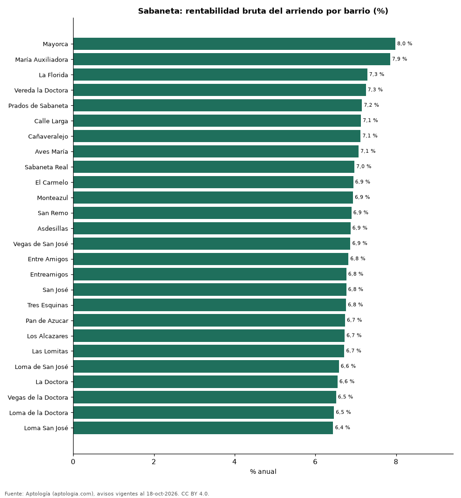

# Rentabilidad del arriendo en Sabaneta por barrio: dónde rinde más comprar para arrendar (octubre 2026)

**En Sabaneta, comprar un apartamento para arrendarlo rinde en el barrio típico 6,9 % bruto al año: el precio pedido equivale a 14,6 años de arriendo. El barrio con mayor rentabilidad bruta es Mayorca (8,0 %) y el de menor, Loma San José (6,4 %).** Para toda la ciudad, con las medianas por m², la rentabilidad bruta implícita es 6,9 %.

*Resumen: comparamos el precio por m² de 3.317 apartamentos en venta con el canon por m² de 2.780 en arriendo en 26 barrios de Sabaneta.*

**Actualizado:** 18 de octubre de 2026 (datos del 18 de octubre de 2026) · **Próxima actualización:** mensual.

## Resumen

| Indicador | Valor |
|---|---|
| Mayor rentabilidad | Mayorca: 8,0 % |
| Menor rentabilidad | Loma San José: 6,4 % |
| Barrio típico (mediana) | 6,9 % |
| Ciudad (medianas por m²) | 6,9 % |
| Barrios comparados | 26 |

## Rentabilidad bruta por barrio

| Barrio | Venta por m² (millones de pesos) | Arriendo por m² al mes (pesos) | Rentabilidad bruta | Años de arriendo | Avisos (venta / arriendo) |
|---|---|---|---|---|---|
| Mayorca | 6,58 | 43.750 | 8,0 % | 12,5 | 73 / 148 |
| María Auxiliadora | 5,50 | 36.000 | 7,9 % | 12,7 | 127 / 95 |
| La Florida | 6,79 | 41.250 | 7,3 % | 13,7 | 61 / 83 |
| Vereda la Doctora | 6,76 | 40.839 | 7,3 % | 13,8 | 33 / 42 |
| Prados de Sabaneta | 7,27 | 43.333 | 7,2 % | 14,0 | 56 / 129 |
| Calle Larga | 6,79 | 40.360 | 7,1 % | 14,0 | 132 / 100 |
| Cañaveralejo | 6,89 | 40.909 | 7,1 % | 14,0 | 98 / 97 |
| Aves María | 6,59 | 38.824 | 7,1 % | 14,1 | 312 / 215 |
| Sabaneta Real | 7,22 | 41.935 | 7,0 % | 14,4 | 81 / 43 |
| El Carmelo | 7,27 | 42.045 | 6,9 % | 14,4 | 52 / 35 |
| Monteazul | 7,47 | 43.160 | 6,9 % | 14,4 | 122 / 174 |
| San Remo | 7,43 | 42.683 | 6,9 % | 14,5 | 86 / 41 |
| Asdesillas | 7,45 | 42.647 | 6,9 % | 14,6 | 64 / 49 |
| Vegas de San José | 7,12 | 40.765 | 6,9 % | 14,6 | 32 / 40 |
| Entre Amigos | 6,91 | 39.263 | 6,8 % | 14,7 | 38 / 46 |
| Entreamigos | 7,09 | 40.000 | 6,8 % | 14,8 | 136 / 148 |
| San José | 7,09 | 40.000 | 6,8 % | 14,8 | 338 / 231 |
| Tres Esquinas | 7,48 | 42.143 | 6,8 % | 14,8 | 84 / 55 |
| Pan de Azucar | 7,49 | 42.063 | 6,7 % | 14,8 | 183 / 131 |
| Los Alcazares | 7,73 | 43.333 | 6,7 % | 14,9 | 45 / 45 |
| Las Lomitas | 7,10 | 39.759 | 6,7 % | 14,9 | 505 / 343 |
| Loma de San José | 7,34 | 40.254 | 6,6 % | 15,2 | 130 / 70 |
| La Doctora | 7,27 | 39.706 | 6,6 % | 15,3 | 302 / 169 |
| Vegas de la Doctora | 7,07 | 38.384 | 6,5 % | 15,4 | 67 / 107 |
| Loma de la Doctora | 7,43 | 40.000 | 6,5 % | 15,5 | 97 / 107 |
| Loma San José | 7,45 | 40.000 | 6,4 % | 15,5 | 63 / 37 |

Ordenado de mayor a menor rentabilidad. Antes de administración, impuestos, vacancia y financiación.

## Preguntas frecuentes

**¿En qué barrio de Sabaneta rinde más comprar para arrendar?**
En Mayorca, con 8,0 % bruto anual (12,5 años de arriendo), según avisos de octubre de 2026.

**¿Dónde rinde menos?**
En Loma San José: 6,4 % bruto anual (15,5 años de arriendo).

**¿Cuánto renta un apartamento en Sabaneta?**
En el barrio típico, 6,9 % bruto al año.

## Metodología

- **Fuente:** exportes nocturnos de la base de datos de Aptología (aptologia.com) del 18 de octubre de 2026: avisos vigentes de vivienda en portales inmobiliarios de 13 países, recogidos por Aptología y vistos en línea entre el 11 y el 18 de octubre de 2026. Corte: 18 de octubre de 2026.
- **Depuración:** se eliminan duplicados exactos (misma ciudad, zona, tipo, precio, moneda, área, habitaciones y baños) y los precios fuera del percentil 1–99 de cada país, operación, moneda y tipo; el precio por m² usa solo avisos con área declarada entre 12 y 2.000 m² y también se recorta al P1–P99.
- **Qué se mide:** precios pedidos (publicados), no precios de cierre. En arriendo, el canon mensual sin administración, gastos comunes ni condominio.
- **Muestra mínima:** cada cifra publicada se apoya en al menos 30 avisos; las celdas con menos se omiten.
- **Colombia:** Precios en pesos colombianos, sin conversión de moneda.
- **Años de arriendo para pagar la vivienda:** precio de venta mediano ÷ (canon mensual mediano × 12), entre avisos del mismo tipo y celda; es la relación precio/arriendo (price-to-rent ratio) y equivale a 100 ÷ rentabilidad bruta. No incluye administración, impuestos, vacancia, financiación ni valorización: es una referencia para comparar comprar con arrendar, no una recomendación de inversión.
- **Rentabilidad por barrio:** canon mediano por m² × 12 ÷ precio de venta mediano por m² de apartamentos del mismo barrio; solo barrios con 30 avisos o más de venta y 30 o más de arriendo con área declarada. Usar el m² y no el precio total evita que el tamaño típico de cada barrio sesgue la comparación.
- **Limitaciones:** la cobertura depende de los portales que recorre Aptología en cada país y es mayor en las ciudades grandes y en los segmentos medio-alto y alto; el área es la que declara el aviso, sin verificar; los nombres de zona vienen de los portales.
- **Privacidad:** solo se publican agregados; no se publica ningún dato personal, enlace a avisos ni nombre de anunciante.
- **Datos abiertos:** [datos.csv](datos.csv), licencia CC BY 4.0.

## Cómo citar

Pinzón Pineda, D. M. (2026). *Rentabilidad del arriendo en Sabaneta por barrio: dónde rinde más comprar para arrendar (octubre 2026)*. Aptología (aptologia.com). https://github.com/elbroker/aptologia-datos/tree/main/estudios/rentabilidad-arriendo-sabaneta-por-barrio-2026. Datos: datos.csv, licencia CC BY 4.0.
