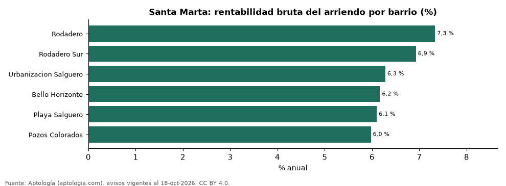

# Rentabilidad del arriendo en Santa Marta por barrio: dónde rinde más comprar para arrendar (octubre 2026)

**En Santa Marta, comprar un apartamento para arrendarlo rinde en el barrio típico 6,2 % bruto al año: el precio pedido equivale a 16,1 años de arriendo. El barrio con mayor rentabilidad bruta es Rodadero (7,3 %) y el de menor, Pozos Colorados (6,0 %).** Para toda la ciudad, con las medianas por m², la rentabilidad bruta implícita es 6,2 %.

*Resumen: comparamos el precio por m² de 2.044 apartamentos en venta con el canon por m² de 330 en arriendo en 6 barrios de Santa Marta.*

**Actualizado:** 18 de octubre de 2026 (datos del 18 de octubre de 2026) · **Próxima actualización:** mensual.

## Resumen

| Indicador | Valor |
|---|---|
| Mayor rentabilidad | Rodadero: 7,3 % |
| Menor rentabilidad | Pozos Colorados: 6,0 % |
| Barrio típico (mediana) | 6,2 % |
| Ciudad (medianas por m²) | 6,2 % |
| Barrios comparados | 6 |

## Rentabilidad bruta por barrio

| Barrio | Venta por m² (millones de pesos) | Arriendo por m² al mes (pesos) | Rentabilidad bruta | Años de arriendo | Avisos (venta / arriendo) |
|---|---|---|---|---|---|
| Rodadero | 5,95 | 36.364 | 7,3 % | 13,6 | 405 / 48 |
| Rodadero Sur | 7,59 | 43.820 | 6,9 % | 14,4 | 252 / 49 |
| Urbanizacion Salguero | 9,62 | 50.325 | 6,3 % | 15,9 | 157 / 34 |
| Bello Horizonte | 10,67 | 54.861 | 6,2 % | 16,2 | 439 / 71 |
| Playa Salguero | 9,84 | 50.000 | 6,1 % | 16,4 | 293 / 39 |
| Pozos Colorados | 10,50 | 52.273 | 6,0 % | 16,7 | 498 / 89 |

Ordenado de mayor a menor rentabilidad. Antes de administración, impuestos, vacancia y financiación.

## Preguntas frecuentes

**¿En qué barrio de Santa Marta rinde más comprar para arrendar?**
En Rodadero, con 7,3 % bruto anual (13,6 años de arriendo), según avisos de octubre de 2026.

**¿Dónde rinde menos?**
En Pozos Colorados: 6,0 % bruto anual (16,7 años de arriendo).

**¿Cuánto renta un apartamento en Santa Marta?**
En el barrio típico, 6,2 % bruto al año.

## Metodología

- **Fuente:** exportes nocturnos de la base de datos de Aptología (aptologia.com) del 18 de octubre de 2026: avisos vigentes de vivienda en portales inmobiliarios de 13 países, recogidos por Aptología y vistos en línea entre el 11 y el 18 de octubre de 2026. Corte: 18 de octubre de 2026.
- **Depuración:** se eliminan duplicados exactos (misma ciudad, zona, tipo, precio, moneda, área, habitaciones y baños) y los precios fuera del percentil 1–99 de cada país, operación, moneda y tipo; el precio por m² usa solo avisos con área declarada entre 12 y 2.000 m² y también se recorta al P1–P99.
- **Qué se mide:** precios pedidos (publicados), no precios de cierre. En arriendo, el canon mensual sin administración, gastos comunes ni condominio.
- **Muestra mínima:** cada cifra publicada se apoya en al menos 30 avisos; las celdas con menos se omiten.
- **Colombia:** Precios en pesos colombianos, sin conversión de moneda.
- **Años de arriendo para pagar la vivienda:** precio de venta mediano ÷ (canon mensual mediano × 12), entre avisos del mismo tipo y celda; es la relación precio/arriendo (price-to-rent ratio) y equivale a 100 ÷ rentabilidad bruta. No incluye administración, impuestos, vacancia, financiación ni valorización: es una referencia para comparar comprar con arrendar, no una recomendación de inversión.
- **Rentabilidad por barrio:** canon mediano por m² × 12 ÷ precio de venta mediano por m² de apartamentos del mismo barrio; solo barrios con 30 avisos o más de venta y 30 o más de arriendo con área declarada. Usar el m² y no el precio total evita que el tamaño típico de cada barrio sesgue la comparación.
- **Limitaciones:** la cobertura depende de los portales que recorre Aptología en cada país y es mayor en las ciudades grandes y en los segmentos medio-alto y alto; el área es la que declara el aviso, sin verificar; los nombres de zona vienen de los portales.
- **Privacidad:** solo se publican agregados; no se publica ningún dato personal, enlace a avisos ni nombre de anunciante.
- **Datos abiertos:** [datos.csv](datos.csv), licencia CC BY 4.0.

## Cómo citar

Pinzón Pineda, D. M. (2026). *Rentabilidad del arriendo en Santa Marta por barrio: dónde rinde más comprar para arrendar (octubre 2026)*. Aptología (aptologia.com). https://github.com/elbroker/aptologia-datos/tree/main/estudios/rentabilidad-arriendo-santa-marta-por-barrio-2026. Datos: datos.csv, licencia CC BY 4.0.
