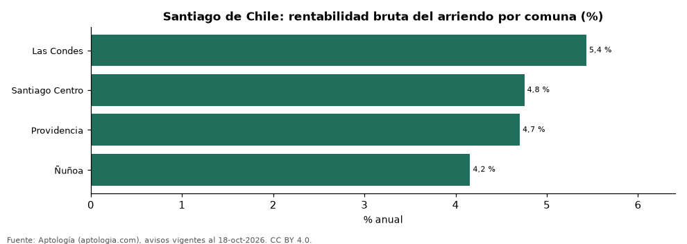

# Rentabilidad del arriendo en Santiago de Chile por comuna: dónde rinde más comprar para arrendar (octubre 2026)

**En Santiago de Chile, comprar un apartamento para arrendarlo rinde en la comuna típica 4,7 % bruto al año: el precio pedido equivale a 21,1 años de arriendo. La comuna con mayor rentabilidad bruta es Las Condes (5,4 %) y la de menor, Ñuñoa (4,2 %).** Para toda la ciudad, con las medianas por m², la rentabilidad bruta implícita es 3,6 %.

*Resumen: comparamos el precio por m² de 5.715 apartamentos en venta con el canon por m² de 2.257 en arriendo en 4 comunas de Santiago de Chile.*

**Actualizado:** 18 de octubre de 2026 (datos del 18 de octubre de 2026) · **Próxima actualización:** mensual.

## Resumen

| Indicador | Valor |
|---|---|
| Mayor rentabilidad | Las Condes: 5,4 % |
| Menor rentabilidad | Ñuñoa: 4,2 % |
| Comuna típica (mediana) | 4,7 % |
| Ciudad (medianas por m²) | 3,6 % |
| Comunas comparadas | 4 |

## Rentabilidad bruta por comuna

| Comuna | Venta por m² (UF) | Arriendo por m² al mes (pesos chilenos) | Rentabilidad bruta | Años de arriendo | Avisos (venta / arriendo) |
|---|---|---|---|---|---|
| Las Condes | 88 | 16.333 | 5,4 % | 18,4 | 2.062 / 247 |
| Santiago Centro | 56 | 9.091 | 4,8 % | 21,0 | 2.007 / 1.280 |
| Providencia | 87 | 14.048 | 4,7 % | 21,3 | 1.485 / 310 |
| Ñuñoa | 83 | 11.778 | 4,2 % | 24,0 | 161 / 420 |

Ordenado de mayor a menor rentabilidad. Antes de administración, impuestos, vacancia y financiación.

## Preguntas frecuentes

**¿En qué comuna de Santiago de Chile rinde más comprar para arrendar?**
En Las Condes, con 5,4 % bruto anual (18,4 años de arriendo), según avisos de octubre de 2026.

**¿Dónde rinde menos?**
En Ñuñoa: 4,2 % bruto anual (24,0 años de arriendo).

**¿Cuánto renta un apartamento en Santiago de Chile?**
En la comuna típica, 4,7 % bruto al año.

## Metodología

- **Fuente:** exportes nocturnos de la base de datos de Aptología (aptologia.com) del 18 de octubre de 2026: avisos vigentes de vivienda en portales inmobiliarios de 13 países, recogidos por Aptología y vistos en línea entre el 11 y el 18 de octubre de 2026. Corte: 18 de octubre de 2026.
- **Depuración:** se eliminan duplicados exactos (misma ciudad, zona, tipo, precio, moneda, área, habitaciones y baños) y los precios fuera del percentil 1–99 de cada país, operación, moneda y tipo; el precio por m² usa solo avisos con área declarada entre 12 y 2.000 m² y también se recorta al P1–P99.
- **Qué se mide:** precios pedidos (publicados), no precios de cierre. En arriendo, el canon mensual sin administración, gastos comunes ni condominio.
- **Muestra mínima:** cada cifra publicada se apoya en al menos 30 avisos; las celdas con menos se omiten.
- **Monedas:** nunca se mezclan avisos de monedas distintas sin convertirlos. Conversión a dólares con la tasa de mercado de ExchangeRate-API (open.er-api.com, actualización del 18 Oct 2026): 1 USD = 3.182,80 COP, 1 USD = 18,47 M.N, 1 USD = 5,09 BRL, 1 USD = 3,44 PEN, 1 USD = 982,44 CLP, 1 USD = 1.514,57 ARS, 1 USD = 40,20 UYU, 1 USD = 5.705,37 PYG, 1 USD = 61,27 DOP, 1 USD = 0,89 EUR, 1 USD = 11,72 BOB; la UF chilena a 41.178,64 CLP (mindicador,cl. 18-oct-2026). Los avisos publicados en dólares se usan tal cual.
- **Monedas:** en cada ciudad y operación se usa solo la moneda mayoritaria de los avisos (los avisos en otra moneda se excluyen) y la mediana se convierte a dólares con la tasa citada; nunca se promedian avisos de monedas distintas.
- **Años de arriendo para pagar la vivienda:** precio de venta mediano ÷ (canon mensual mediano × 12), entre avisos del mismo tipo y celda; es la relación precio/arriendo (price-to-rent ratio) y equivale a 100 ÷ rentabilidad bruta. No incluye administración, impuestos, vacancia, financiación ni valorización: es una referencia para comparar comprar con arrendar, no una recomendación de inversión.
- **Rentabilidad por comuna:** canon mediano por m² × 12 ÷ precio de venta mediano por m² de apartamentos del mismo comuna; solo comunas con 30 avisos o más de venta y 30 o más de arriendo con área declarada. Usar el m² y no el precio total evita que el tamaño típico de cada comuna sesgue la comparación.
- **Monedas distintas:** la venta se publica sobre todo en UF y el arriendo en pesos chilenos; cada mediana se calcula en su propia moneda y solo después se convierte a dólares con la tasa citada, así que la rentabilidad depende de esa tasa.
- **Limitaciones:** la cobertura depende de los portales que recorre Aptología en cada país y es mayor en las ciudades grandes y en los segmentos medio-alto y alto; el área es la que declara el aviso, sin verificar; los nombres de zona vienen de los portales.
- **Privacidad:** solo se publican agregados; no se publica ningún dato personal, enlace a avisos ni nombre de anunciante.
- **Datos abiertos:** [datos.csv](datos.csv), licencia CC BY 4.0.

## Cómo citar

Pinzón Pineda, D. M. (2026). *Rentabilidad del arriendo en Santiago de Chile por comuna: dónde rinde más comprar para arrendar (octubre 2026)*. Aptología (aptologia.com). https://github.com/elbroker/aptologia-datos/tree/main/estudios/rentabilidad-arriendo-santiago-de-chile-por-comuna-2026. Datos: datos.csv, licencia CC BY 4.0.
