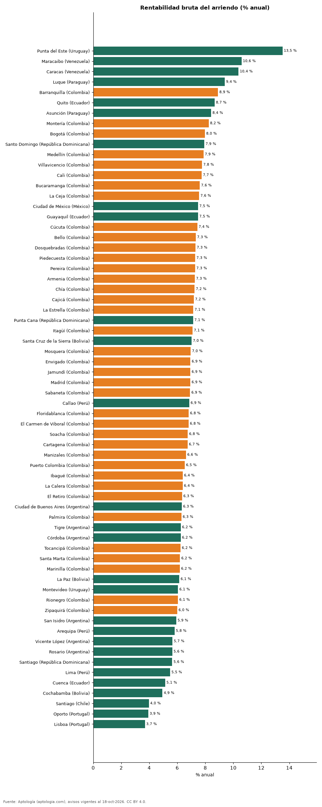

# Rentabilidad bruta del arriendo en 66 ciudades de Latinoamérica y Portugal: dónde rinde más comprar para arrendar (octubre 2026)

**Comprar un apartamento para arrendarlo rinde más en Punta del Este (Uruguay): una rentabilidad bruta de 13,5 % anual, frente a 3,7 % en Lisboa (Portugal), la más baja.** En Bogotá la rentabilidad bruta implícita es 8,0 %; la mediana de las 66 ciudades, 6,9 %.

*Resumen: cruzamos el arriendo y el precio de venta por m² de 288.487 apartamentos en 66 ciudades.*

**Actualizado:** 18 de octubre de 2026 (datos del 18 de octubre de 2026) · **Próxima actualización:** mensual.

## Resumen

| Indicador | Valor |
|---|---|
| Mayor rentabilidad bruta | Punta del Este: 13,5 % |
| Menor | Lisboa: 3,7 % |
| Bogotá | 8,0 % |
| Mediana de las ciudades | 6,9 % |

## Rentabilidad por ciudad

| País | Ciudad | Rentabilidad bruta | Arriendo USD/m²/mes | Venta USD/m² | Avisos (arriendo / venta) |
|---|---|---|---|---|---|
| Uruguay | Punta del Este | 13,5 % | 40,6 | 3.604 | 1.964 / 4.562 |
| Venezuela | Maracaibo | 10,6 % | 6,7 | 758 | 38 / 62 |
| Venezuela | Caracas | 10,4 % | 12,1 | 1.400 | 326 / 1.464 |
| Paraguay | Luque | 9,4 % | 11,0 | 1.410 | 47 / 74 |
| Colombia | Barranquilla | 8,9 % | 10,6 | 1.424 | 3.694 / 7.532 |
| Ecuador | Quito | 8,7 % | 7,2 | 1.000 | 1.167 / 2.240 |
| Paraguay | Asunción | 8,4 % | 12,9 | 1.843 | 3.560 / 4.612 |
| Colombia | Montería | 8,2 % | 8,0 | 1.168 | 44 / 288 |
| Colombia | Bogotá | 8,0 % | 15,2 | 2.282 | 12.954 / 31.265 |
| República Dominicana | Santo Domingo | 7,9 % | 11,7 | 1.769 | 3.410 / 7.645 |
| Colombia | Medellín | 7,9 % | 15,5 | 2.356 | 20.068 / 20.515 |
| Colombia | Villavicencio | 7,8 % | 8,5 | 1.321 | 74 / 347 |
| Colombia | Cali | 7,7 % | 9,4 | 1.461 | 1.499 / 9.365 |
| Colombia | Bucaramanga | 7,6 % | 9,3 | 1.466 | 416 / 2.439 |
| Colombia | La Ceja | 7,6 % | 11,7 | 1.861 | 354 / 312 |
| México | Ciudad de México | 7,5 % | 18,1 | 2.894 | 4.782 / 7.519 |
| Ecuador | Guayaquil | 7,5 % | 8,5 | 1.364 | 1.231 / 915 |
| Colombia | Cúcuta | 7,4 % | 6,9 | 1.116 | 298 / 561 |
| Colombia | Bello | 7,3 % | 10,5 | 1.716 | 1.082 / 2.319 |
| Colombia | Dosquebradas | 7,3 % | 8,9 | 1.456 | 70 / 607 |
| Colombia | Piedecuesta | 7,3 % | 7,0 | 1.151 | 57 / 246 |
| Colombia | Pereira | 7,3 % | 10,5 | 1.728 | 1.530 / 4.376 |
| Colombia | Armenia | 7,3 % | 10,1 | 1.675 | 337 / 2.278 |
| Colombia | Chía | 7,2 % | 10,5 | 1.737 | 489 / 1.507 |
| Colombia | Cajicá | 7,2 % | 10,7 | 1.782 | 385 / 1.517 |
| Colombia | La Estrella | 7,1 % | 12,0 | 2.023 | 489 / 561 |
| República Dominicana | Punta Cana | 7,1 % | 15,0 | 2.525 | 93 / 442 |
| Colombia | Itagüí | 7,1 % | 12,6 | 2.126 | 908 / 2.012 |
| Bolivia | Santa Cruz de la Sierra | 7,0 % | 7,3 | 1.241 | 947 / 1.679 |
| Colombia | Mosquera | 7,0 % | 9,0 | 1.548 | 167 / 817 |
| Colombia | Envigado | 6,9 % | 15,4 | 2.656 | 7.303 / 5.735 |
| Colombia | Jamundí | 6,9 % | 6,5 | 1.125 | 107 / 466 |
| Colombia | Madrid | 6,9 % | 6,5 | 1.134 | 259 / 475 |
| Colombia | Sabaneta | 6,9 % | 12,9 | 2.237 | 3.868 / 4.375 |
| Perú | Callao | 6,9 % | 6,5 | 1.146 | 31 / 121 |
| Colombia | Floridablanca | 6,8 % | 9,2 | 1.626 | 357 / 919 |
| Colombia | El Carmen de Viboral | 6,8 % | 8,0 | 1.406 | 102 / 90 |
| Colombia | Soacha | 6,8 % | 6,0 | 1.066 | 128 / 566 |
| Colombia | Cartagena | 6,7 % | 13,9 | 2.469 | 2.008 / 5.774 |
| Colombia | Manizales | 6,6 % | 9,8 | 1.776 | 282 / 2.788 |
| Colombia | Puerto Colombia | 6,5 % | 10,0 | 1.843 | 90 / 144 |
| Colombia | Ibagué | 6,4 % | 7,1 | 1.332 | 249 / 1.217 |
| Colombia | La Calera | 6,4 % | 9,8 | 1.833 | 51 / 139 |
| Colombia | El Retiro | 6,3 % | 15,5 | 2.929 | 541 / 618 |
| Argentina | Ciudad de Buenos Aires | 6,3 % | 13,5 | 2.558 | 4.316 / 8.128 |
| Colombia | Palmira | 6,3 % | 6,9 | 1.318 | 42 / 112 |
| Argentina | Tigre | 6,2 % | 16,0 | 3.080 | 151 / 121 |
| Argentina | Córdoba | 6,2 % | 9,4 | 1.813 | 216 / 188 |
| Colombia | Tocancipá | 6,2 % | 5,9 | 1.145 | 94 / 264 |
| Colombia | Santa Marta | 6,2 % | 14,1 | 2.740 | 674 / 3.779 |
| Colombia | Marinilla | 6,2 % | 9,1 | 1.775 | 107 / 164 |
| Bolivia | La Paz | 6,1 % | 5,6 | 1.099 | 298 / 462 |
| Uruguay | Montevideo | 6,1 % | 15,3 | 3.040 | 3.702 / 4.466 |
| Colombia | Rionegro | 6,1 % | 11,8 | 2.337 | 3.179 / 3.023 |
| Colombia | Zipaquirá | 6,0 % | 6,9 | 1.372 | 168 / 819 |
| Argentina | San Isidro | 5,9 % | 15,0 | 3.032 | 148 / 181 |
| Perú | Arequipa | 5,8 % | 5,8 | 1.207 | 46 / 583 |
| Argentina | Vicente López | 5,7 % | 17,0 | 3.600 | 168 / 157 |
| Argentina | Rosario | 5,6 % | 8,9 | 1.895 | 129 / 33 |
| República Dominicana | Santiago | 5,6 % | 6,8 | 1.442 | 116 / 594 |
| Perú | Lima | 5,5 % | 10,0 | 2.185 | 4.134 / 9.331 |
| Ecuador | Cuenca | 5,1 % | 5,3 | 1.238 | 176 / 331 |
| Bolivia | Cochabamba | 4,9 % | 4,0 | 971 | 91 / 366 |
| Chile | Santiago | 4,0 % | 10,6 | 3.189 | 7.098 / 6.247 |
| Portugal | Oporto | 3,9 % | 19,1 | 5.820 | 78 / 607 |
| Portugal | Lisboa | 3,7 % | 25,8 | 8.383 | 491 / 1.548 |

Rentabilidad bruta = arriendo mediano por m² × 12 ÷ precio de venta mediano por m², ambos de apartamentos de la misma ciudad.

## Preguntas frecuentes

**¿En qué ciudad de Latinoamérica rinde más comprar para arrendar?**
En Punta del Este (Uruguay), con una rentabilidad bruta implícita de 13,5 % anual.

**¿Cuánto renta un apartamento en arriendo en Bogotá?**
La rentabilidad bruta implícita es 8,0 % anual, antes de administración, impuestos, vacancia y mantenimiento.

**¿Qué es la rentabilidad bruta?**
El arriendo de un año dividido por el precio de compra, sin descontar gastos. La neta suele ser 1 a 3 puntos menor.

## Metodología

- **Fuente:** exportes nocturnos de la base de datos de Aptología (aptologia.com) del 18 de octubre de 2026: avisos vigentes de vivienda en portales inmobiliarios de 13 países, recogidos por Aptología y vistos en línea entre el 11 y el 18 de octubre de 2026. Corte: 18 de octubre de 2026.
- **Depuración:** se eliminan duplicados exactos (misma ciudad, zona, tipo, precio, moneda, área, habitaciones y baños) y los precios fuera del percentil 1–99 de cada país, operación, moneda y tipo; el precio por m² usa solo avisos con área declarada entre 12 y 2.000 m² y también se recorta al P1–P99.
- **Qué se mide:** precios pedidos (publicados), no precios de cierre. En arriendo, el canon mensual sin administración, gastos comunes ni condominio.
- **Muestra mínima:** cada cifra publicada se apoya en al menos 30 avisos; las celdas con menos se omiten.
- **Monedas:** nunca se mezclan avisos de monedas distintas sin convertirlos. Conversión a dólares con la tasa de mercado de ExchangeRate-API (open.er-api.com, actualización del 18 Oct 2026): 1 USD = 3.182,80 COP, 1 USD = 18,47 M.N, 1 USD = 5,09 BRL, 1 USD = 3,44 PEN, 1 USD = 982,44 CLP, 1 USD = 1.514,57 ARS, 1 USD = 40,20 UYU, 1 USD = 5.705,37 PYG, 1 USD = 61,27 DOP, 1 USD = 0,89 EUR, 1 USD = 11,72 BOB; la UF chilena a 41.178,64 CLP (mindicador,cl. 18-oct-2026). Los avisos publicados en dólares se usan tal cual.
- **Rentabilidad bruta:** arriendo mediano por m² × 12 / precio mediano de venta por m² (apartamentos), por ciudad. Compara medianas de dos ofertas distintas: es una aproximación, no la rentabilidad de un inmueble concreto. En Argentina los arriendos suelen publicarse en pesos y las ventas en dólares; la conversión usa la tasa oficial citada.
- **Limitaciones:** la cobertura depende de los portales que recorre Aptología en cada país y es mayor en las ciudades grandes y en los segmentos medio-alto y alto; el área es la que declara el aviso, sin verificar; los nombres de zona vienen de los portales.
- **Privacidad:** solo se publican agregados; no se publica ningún dato personal, enlace a avisos ni nombre de anunciante.
- **Datos abiertos:** [datos.csv](datos.csv), licencia CC BY 4.0.

## Cómo citar

Pinzón Pineda, D. M. (2026). *Rentabilidad bruta del arriendo en 66 ciudades de Latinoamérica y Portugal: dónde rinde más comprar para arrendar (octubre 2026)*. Aptología (aptologia.com). https://github.com/elbroker/aptologia-datos/tree/main/estudios/rentabilidad-bruta-alquiler-ciudades-latinoamerica-2026. Datos: datos.csv, licencia CC BY 4.0.
