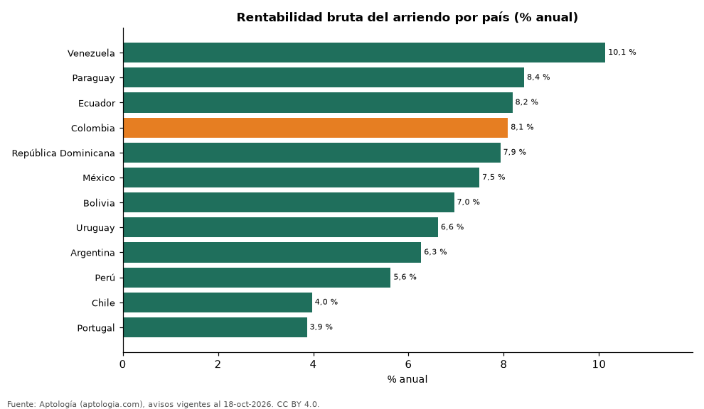

# Rentabilidad bruta del arriendo por país: 12 países de Latinoamérica y Portugal (octubre 2026)

**Entre 12 países, el arriendo rinde más frente al precio de compra en Venezuela (10,1 % bruto anual) y menos en Portugal (3,9 %).** Colombia está en 8,1 %.

*Resumen: cruzamos arriendo y venta por m² de 292.831 apartamentos.*

**Actualizado:** 18 de octubre de 2026 (datos del 18 de octubre de 2026) · **Próxima actualización:** mensual.

## Resumen

| Indicador | Valor |
|---|---|
| Mayor | Venezuela: 10,1 % |
| Menor | Portugal: 3,9 % |
| Colombia | 8,1 % |
| Países | 12 |

## Rentabilidad por país

| País | Rentabilidad bruta | Arriendo USD/m²/mes | Venta USD/m² | Avisos (arriendo / venta) |
|---|---|---|---|---|
| Venezuela | 10,1 % | 11,6 | 1.375 | 370 / 1.527 |
| Paraguay | 8,4 % | 12,8 | 1.828 | 3.690 / 4.717 |
| Ecuador | 8,2 % | 7,5 | 1.100 | 2.574 / 3.486 |
| Colombia | 8,1 % | 13,7 | 2.027 | 64.543 / 120.352 |
| República Dominicana | 7,9 % | 11,7 | 1.765 | 3.619 / 8.681 |
| México | 7,5 % | 18,1 | 2.893 | 8.683 / 7.524 |
| Bolivia | 7,0 % | 6,7 | 1.150 | 1.336 / 2.507 |
| Uruguay | 6,6 % | 18,1 | 3.286 | 5.694 / 9.184 |
| Argentina | 6,3 % | 13,4 | 2.568 | 5.128 / 8.808 |
| Perú | 5,6 % | 10,0 | 2.133 | 4.211 / 10.035 |
| Chile | 4,0 % | 10,6 | 3.189 | 7.098 / 6.247 |
| Portugal | 3,9 % | 24,3 | 7.545 | 576 / 2.241 |

Agrega todas las ciudades del país con avisos; las ciudades grandes pesan más.

## Preguntas frecuentes

**¿Qué país de Latinoamérica tiene la mayor rentabilidad de arriendo?**
Venezuela, con 10,1 % bruto anual en apartamentos según Aptología (octubre de 2026).

**¿Cuál es la rentabilidad del arriendo en Colombia?**
8,1 % bruto anual: arriendo de USD 13,7 por m² al mes frente a USD 2.027 por m² de venta.

## Metodología

- **Fuente:** exportes nocturnos de la base de datos de Aptología (aptologia.com) del 18 de octubre de 2026: avisos vigentes de vivienda en portales inmobiliarios de 13 países, recogidos por Aptología y vistos en línea entre el 11 y el 18 de octubre de 2026. Corte: 18 de octubre de 2026.
- **Depuración:** se eliminan duplicados exactos (misma ciudad, zona, tipo, precio, moneda, área, habitaciones y baños) y los precios fuera del percentil 1–99 de cada país, operación, moneda y tipo; el precio por m² usa solo avisos con área declarada entre 12 y 2.000 m² y también se recorta al P1–P99.
- **Qué se mide:** precios pedidos (publicados), no precios de cierre. En arriendo, el canon mensual sin administración, gastos comunes ni condominio.
- **Muestra mínima:** cada cifra publicada se apoya en al menos 30 avisos; las celdas con menos se omiten.
- **Monedas:** nunca se mezclan avisos de monedas distintas sin convertirlos. Conversión a dólares con la tasa de mercado de ExchangeRate-API (open.er-api.com, actualización del 18 Oct 2026): 1 USD = 3.182,80 COP, 1 USD = 18,47 M.N, 1 USD = 5,09 BRL, 1 USD = 3,44 PEN, 1 USD = 982,44 CLP, 1 USD = 1.514,57 ARS, 1 USD = 40,20 UYU, 1 USD = 5.705,37 PYG, 1 USD = 61,27 DOP, 1 USD = 0,89 EUR, 1 USD = 11,72 BOB; la UF chilena a 41.178,64 CLP (mindicador,cl. 18-oct-2026). Los avisos publicados en dólares se usan tal cual.
- **Rentabilidad bruta:** arriendo mediano por m² × 12 / precio mediano de venta por m² de apartamentos del país. Aproximación con medianas de ofertas distintas.
- **Limitaciones:** la cobertura depende de los portales que recorre Aptología en cada país y es mayor en las ciudades grandes y en los segmentos medio-alto y alto; el área es la que declara el aviso, sin verificar; los nombres de zona vienen de los portales.
- **Privacidad:** solo se publican agregados; no se publica ningún dato personal, enlace a avisos ni nombre de anunciante.
- **Datos abiertos:** [datos.csv](datos.csv), licencia CC BY 4.0.

## Cómo citar

Pinzón Pineda, D. M. (2026). *Rentabilidad bruta del arriendo por país: 12 países de Latinoamérica y Portugal (octubre 2026)*. Aptología (aptologia.com). https://github.com/elbroker/aptologia-datos/tree/main/estudios/rentabilidad-bruta-alquiler-por-pais-latinoamerica-2026. Datos: datos.csv, licencia CC BY 4.0.
