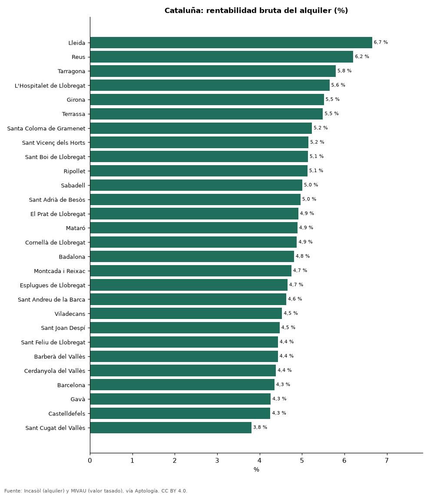

# Rentabilidad bruta del alquiler en 28 municipios de Cataluña con datos oficiales (2026)

**Con datos oficiales, la rentabilidad bruta del alquiler más alta de 28 municipios catalanes está en Lleida: 6,7 % anual (7,59 € por m² al mes frente a 1.369 € por m² de valor tasado); la más baja, en Sant Cugat del Vallès, con 3,8 %.** En Barcelona es 4,3 %: el metro cuadrado vale 23,0 años de alquiler.

*Resumen: cruzamos el alquiler medio por m² de las fianzas de Incasòl con el valor tasado por m² del MIVAU (2026-T2) en 28 municipios con 30 tasaciones o más.*

**Actualizado:** 18 de octubre de 2026 (datos oficiales de Incasòl y MIVAU incluidos en los exportes del 18 de octubre de 2026) · **Próxima actualización:** mensual.

## Resumen

| Indicador | Valor |
|---|---|
| Mayor rentabilidad | Lleida: 6,7 % |
| Menor rentabilidad | Sant Cugat del Vallès: 3,8 % |
| Barcelona | 4,3 % |

## Municipios de mayor a menor rentabilidad bruta

| Municipio | Alquiler €/m² al mes | Valor tasado €/m² | Rentabilidad bruta | Años de alquiler | Año del alquiler |
|---|---|---|---|---|---|
| Lleida | 7,59 | 1.369 | 6,7 % | 15,0 | 2024 |
| Reus | 8,24 | 1.592 | 6,2 % | 16,1 | 2024 |
| Tarragona | 8,94 | 1.851 | 5,8 % | 17,3 | 2024 |
| L'Hospitalet de Llobregat | 14,56 | 3.094 | 5,6 % | 17,7 | 2024 |
| Girona | 10,64 | 2.316 | 5,5 % | 18,1 | 2024 |
| Terrassa | 10,40 | 2.272 | 5,5 % | 18,2 | 2024 |
| Santa Coloma de Gramenet | 11,28 | 2.586 | 5,2 % | 19,1 | 2024 |
| Sant Vicenç dels Horts | 10,52 | 2.450 | 5,2 % | 19,4 | 2024 |
| Sant Boi de Llobregat | 11,99 | 2.801 | 5,1 % | 19,5 | 2024 |
| Ripollet | 10,46 | 2.448 | 5,1 % | 19,5 | 2024 |
| Sabadell | 10,00 | 2.397 | 5,0 % | 20,0 | 2024 |
| Sant Adrià de Besòs | 11,44 | 2.766 | 5,0 % | 20,1 | 2024 |
| El Prat de Llobregat | 12,31 | 3.008 | 4,9 % | 20,4 | 2024 |
| Mataró | 10,39 | 2.549 | 4,9 % | 20,4 | 2024 |
| Cornellà de Llobregat | 12,77 | 3.142 | 4,9 % | 20,5 | 2024 |
| Badalona | 11,32 | 2.824 | 4,8 % | 20,8 | 2024 |
| Montcada i Reixac | 9,91 | 2.505 | 4,7 % | 21,1 | 2024 |
| Esplugues de Llobregat | 14,44 | 3.722 | 4,7 % | 21,5 | 2024 |
| Sant Andreu de la Barca | 10,10 | 2.619 | 4,6 % | 21,6 | 2024 |
| Viladecans | 11,77 | 3.119 | 4,5 % | 22,1 | 2024 |
| Sant Joan Despí | 13,81 | 3.707 | 4,5 % | 22,4 | 2024 |
| Sant Feliu de Llobregat | 12,30 | 3.330 | 4,4 % | 22,6 | 2024 |
| Barberà del Vallès | 9,90 | 2.682 | 4,4 % | 22,6 | 2024 |
| Cerdanyola del Vallès | 10,83 | 2.964 | 4,4 % | 22,8 | 2024 |
| Barcelona | 16,67 | 4.602 | 4,3 % | 23,0 | 2025 |
| Gavà | 12,30 | 3.465 | 4,3 % | 23,5 | 2024 |
| Castelldefels | 15,37 | 4.337 | 4,3 % | 23,5 | 2024 |
| Sant Cugat del Vallès | 15,91 | 5.017 | 3,8 % | 26,3 | 2024 |

Rentabilidad bruta = alquiler por m² × 12 ÷ valor tasado por m². El alquiler es de contratos (Incasòl, año indicado) y el valor es tasado (MIVAU); no son precios pedidos.

## Preguntas frecuentes

**¿Dónde rinde más alquilar un piso en Cataluña?**
En Lleida: 6,7 % bruto anual según datos oficiales.

**¿Cuánto renta un piso en Barcelona?**
4,3 % bruto anual: 16,67 €/m² al mes frente a 4.602 €/m² de valor tasado.

## Metodología

- **Fuentes:** alquiler medio por m² de las fianzas depositadas en Incasòl (Generalitat de Catalunya) y valor tasado medio por m² de vivienda libre del MIVAU (2026-T2), tal como aparecen en los exportes de Aptología del 18 de octubre de 2026.
- **Cálculo:** rentabilidad bruta = alquiler €/m² × 12 ÷ valor tasado €/m²; años de alquiler = 100 ÷ rentabilidad. Antes de impuestos, comunidad, vacancia y gastos.
- **Muestra:** municipios con alquiler por m² publicado y 30 tasaciones o más.
- **Limitaciones:** los años del alquiler (2024 o 2025) y de la tasación (2026) no coinciden; el valor tasado puede diferir del precio de mercado.
- **Datos abiertos:** [datos.csv](datos.csv), licencia CC BY 4.0.

## Cómo citar

Pinzón Pineda, D. M. (2026). *Rentabilidad bruta del alquiler en 28 municipios de Cataluña con datos oficiales (2026)*. Aptología (aptologia.com). https://github.com/elbroker/aptologia-datos/tree/main/estudios/rentabilidad-bruta-del-alquiler-municipios-cataluna-2026. Datos: datos.csv, licencia CC BY 4.0.
