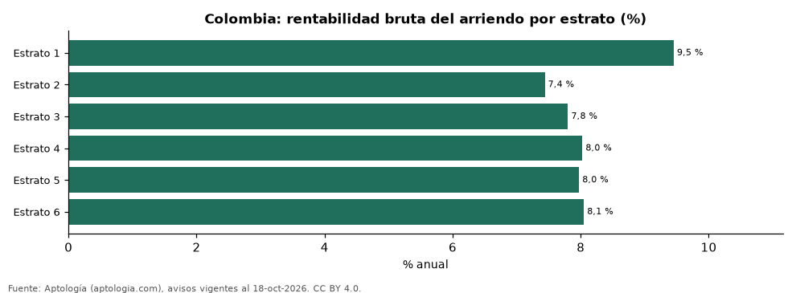

# Rentabilidad del arriendo por estrato en Colombia: en qué estrato rinde más comprar para arrendar (octubre 2026)

**En Colombia, comprar un apartamento para arrendarlo rinde más en estrato 1 (9,5 % bruto anual) y menos en estrato 2 (7,4 %).** En estrato 6 es 8,1 % y en estrato 3, 7,8 %.

*Resumen: cruzamos arriendo y venta por m² de 181.464 apartamentos con estrato declarado.*

**Actualizado:** 18 de octubre de 2026 (datos del 18 de octubre de 2026) · **Próxima actualización:** mensual.

## Resumen

| Indicador | Valor |
|---|---|
| Estrato 1 | 9,5 % |
| Estrato 2 | 7,4 % |
| Estrato 3 | 7,8 % |
| Estrato 4 | 8,0 % |
| Estrato 5 | 8,0 % |
| Estrato 6 | 8,1 % |

## Rentabilidad bruta por estrato

| Lugar | Estrato 1 | Estrato 2 | Estrato 3 | Estrato 4 | Estrato 5 | Estrato 6 |
|---|---|---|---|---|---|---|
| Colombia | 9,5 % | 7,4 % | 7,8 % | 8,0 % | 8,0 % | 8,1 % |
| Bogotá | 9,0 % | 6,9 % | 7,3 % | 7,7 % | 8,4 % | 8,5 % |
| Medellín | — | 8,1 % | 7,9 % | 7,4 % | 7,6 % | 7,7 % |
| Cali | — | — | 7,5 % | 7,6 % | 9,0 % | 8,1 % |
| Barranquilla | — | 7,1 % | 8,2 % | 8,3 % | 9,7 % | 9,2 % |

Rentabilidad bruta = arriendo mediano por m² × 12 ÷ precio mediano de venta por m², en cada estrato.

## Preguntas frecuentes

**¿En qué estrato es más rentable invertir en vivienda para arrendar?**
En estrato 1, con 9,5 % bruto anual en la mediana nacional.

## Metodología

- **Fuente:** exportes nocturnos de la base de datos de Aptología (aptologia.com) del 18 de octubre de 2026: avisos vigentes de vivienda en portales inmobiliarios de 13 países, recogidos por Aptología y vistos en línea entre el 11 y el 18 de octubre de 2026. Corte: 18 de octubre de 2026.
- **Depuración:** se eliminan duplicados exactos (misma ciudad, zona, tipo, precio, moneda, área, habitaciones y baños) y los precios fuera del percentil 1–99 de cada país, operación, moneda y tipo; el precio por m² usa solo avisos con área declarada entre 12 y 2.000 m² y también se recorta al P1–P99.
- **Qué se mide:** precios pedidos (publicados), no precios de cierre. En arriendo, el canon mensual sin administración, gastos comunes ni condominio.
- **Muestra mínima:** cada cifra publicada se apoya en al menos 30 avisos; las celdas con menos se omiten.
- **Colombia:** Precios en pesos colombianos, sin conversión de moneda.
- **Limitaciones:** la cobertura depende de los portales que recorre Aptología en cada país y es mayor en las ciudades grandes y en los segmentos medio-alto y alto; el área es la que declara el aviso, sin verificar; los nombres de zona vienen de los portales.
- **Privacidad:** solo se publican agregados; no se publica ningún dato personal, enlace a avisos ni nombre de anunciante.
- **Datos abiertos:** [datos.csv](datos.csv), licencia CC BY 4.0.

## Cómo citar

Pinzón Pineda, D. M. (2026). *Rentabilidad del arriendo por estrato en Colombia: en qué estrato rinde más comprar para arrendar (octubre 2026)*. Aptología (aptologia.com). https://github.com/elbroker/aptologia-datos/tree/main/estudios/rentabilidad-del-arriendo-por-estrato-colombia-2026. Datos: datos.csv, licencia CC BY 4.0.
