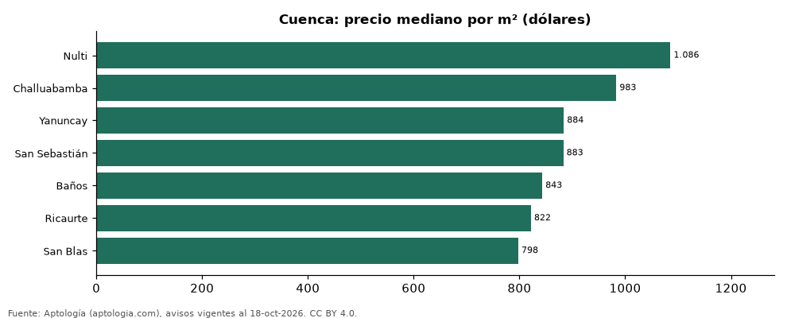

# Sectores más caros y más baratos de Cuenca para comprar casa: ranking por m² (octubre 2026)

**En Cuenca, el sector con el m² más caro para comprar casa es Nulti (USD 1.086/m²) y el más barato San Blas (USD 798/m²), 1,4 veces menos.** Comparamos 7 sectores con al menos 30 avisos con área.

*Resumen: analizamos 246 casas en venta con área declarada en 7 sectores de Cuenca.*

**Actualizado:** 18 de octubre de 2026 (datos del 18 de octubre de 2026) · **Próxima actualización:** mensual.

## Resumen

| Indicador | Valor |
|---|---|
| Más caro por m² | Nulti: USD 1.086 |
| Más barato por m² | San Blas: USD 798 |
| Diferencia | 1,4 veces |
| Sectores | 7 |

## Ranking de sectores por precio del m²

| Sector | Por m² (mediana) | Precio (mediana) | Área mediana (m²) | Avisos con área |
|---|---|---|---|---|
| Nulti | USD 1.086 | USD 385.000 | 350 | 33 |
| Challuabamba | USD 983 | USD 295.000 | 320 | 33 |
| Yanuncay | USD 884 | USD 284.000 | 256 | 37 |
| San Sebastián | USD 883 | USD 205.000 | 280 | 38 |
| Baños | USD 843 | USD 157.000 | 195 | 38 |
| Ricaurte | USD 822 | USD 138.000 | 170 | 34 |
| San Blas | USD 798 | USD 480.000 | 534 | 33 |

Medianas; solo sectores con 30 avisos o más con área declarada.

## Preguntas frecuentes

**¿Cuál es el sector más caro de Cuenca para comprar?**
Nulti, con USD 1.086 por m² en la mediana (octubre de 2026).

**¿Y el más barato?**
San Blas, con USD 798 por m².

## Metodología

- **Fuente:** exportes nocturnos de la base de datos de Aptología (aptologia.com) del 18 de octubre de 2026: avisos vigentes de vivienda en portales inmobiliarios de 13 países, recogidos por Aptología y vistos en línea entre el 11 y el 18 de octubre de 2026. Corte: 18 de octubre de 2026.
- **Depuración:** se eliminan duplicados exactos (misma ciudad, zona, tipo, precio, moneda, área, habitaciones y baños) y los precios fuera del percentil 1–99 de cada país, operación, moneda y tipo; el precio por m² usa solo avisos con área declarada entre 12 y 2.000 m² y también se recorta al P1–P99.
- **Qué se mide:** precios pedidos (publicados), no precios de cierre. En arriendo, el canon mensual sin administración, gastos comunes ni condominio.
- **Muestra mínima:** cada cifra publicada se apoya en al menos 30 avisos; las celdas con menos se omiten.
- **Monedas:** nunca se mezclan avisos de monedas distintas sin convertirlos. Conversión a dólares con la tasa de mercado de ExchangeRate-API (open.er-api.com, actualización del 18 Oct 2026): 1 USD = 3.182,80 COP, 1 USD = 18,47 M.N, 1 USD = 5,09 BRL, 1 USD = 3,44 PEN, 1 USD = 982,44 CLP, 1 USD = 1.514,57 ARS, 1 USD = 40,20 UYU, 1 USD = 5.705,37 PYG, 1 USD = 61,27 DOP, 1 USD = 0,89 EUR, 1 USD = 11,72 BOB; la UF chilena a 41.178,64 CLP (mindicador,cl. 18-oct-2026). Los avisos publicados en dólares se usan tal cual.
- **Monedas:** en cada ciudad y operación se usa solo la moneda mayoritaria de los avisos (los avisos en otra moneda se excluyen) y la mediana se convierte a dólares con la tasa citada; nunca se promedian avisos de monedas distintas.
- **Limitaciones:** la cobertura depende de los portales que recorre Aptología en cada país y es mayor en las ciudades grandes y en los segmentos medio-alto y alto; el área es la que declara el aviso, sin verificar; los nombres de zona vienen de los portales.
- **Privacidad:** solo se publican agregados; no se publica ningún dato personal, enlace a avisos ni nombre de anunciante.
- **Datos abiertos:** [datos.csv](datos.csv), licencia CC BY 4.0.

## Cómo citar

Pinzón Pineda, D. M. (2026). *Sectores más caros y más baratos de Cuenca para comprar casa: ranking por m² (octubre 2026)*. Aptología (aptologia.com). https://github.com/elbroker/aptologia-datos/tree/main/estudios/sectores-con-casas-mas-caras-y-baratas-cuenca-venta-m2-2026. Datos: datos.csv, licencia CC BY 4.0.
