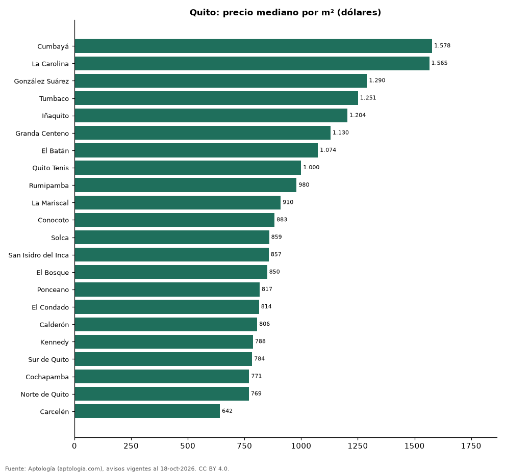

# Sectores más caros y más baratos de Quito para comprar departamento: ranking por m² (octubre 2026)

**En Quito, el sector con el m² más caro para comprar departamento es Cumbayá (USD 1.578/m²) y el más barato Carcelén (USD 642/m²), 2,5 veces menos.** Comparamos 22 sectores con al menos 30 avisos con área.

*Resumen: analizamos 1.830 departamentos en venta con área declarada en 22 sectores de Quito.*

**Actualizado:** 18 de octubre de 2026 (datos del 18 de octubre de 2026) · **Próxima actualización:** mensual.

## Resumen

| Indicador | Valor |
|---|---|
| Más caro por m² | Cumbayá: USD 1.578 |
| Más barato por m² | Carcelén: USD 642 |
| Diferencia | 2,5 veces |
| Sectores | 22 |

## Ranking de sectores por precio del m²

| Sector | Por m² (mediana) | Precio (mediana) | Área mediana (m²) | Avisos con área |
|---|---|---|---|---|
| Cumbayá | USD 1.578 | USD 196.927 | 140 | 223 |
| La Carolina | USD 1.565 | USD 195.000 | 119 | 153 |
| González Suárez | USD 1.290 | USD 220.000 | 170 | 129 |
| Tumbaco | USD 1.251 | USD 150.900 | 118 | 95 |
| Iñaquito | USD 1.204 | USD 176.500 | 137 | 194 |
| Granda Centeno | USD 1.130 | USD 159.000 | 147 | 41 |
| El Batán | USD 1.074 | USD 151.730 | 151 | 69 |
| Quito Tenis | USD 1.000 | USD 225.000 | 240 | 147 |
| Rumipamba | USD 980 | USD 137.450 | 135 | 42 |
| La Mariscal | USD 910 | USD 110.000 | 124 | 34 |
| Conocoto | USD 883 | USD 79.000 | 92 | 69 |
| Solca | USD 859 | USD 105.000 | 120 | 37 |
| San Isidro del Inca | USD 857 | USD 85.000 | 102 | 49 |
| El Bosque | USD 850 | USD 210.000 | 281 | 61 |
| Ponceano | USD 817 | USD 95.000 | 109 | 100 |
| El Condado | USD 814 | USD 120.000 | 124 | 101 |
| Calderón | USD 806 | USD 75.000 | 88 | 35 |
| Kennedy | USD 788 | USD 89.200 | 105 | 70 |
| Sur de Quito | USD 784 | USD 70.750 | 101 | 48 |
| Cochapamba | USD 771 | USD 93.000 | 116 | 35 |
| Norte de Quito | USD 769 | USD 164.000 | 160 | 50 |
| Carcelén | USD 642 | USD 78.000 | 112 | 48 |

Medianas; solo sectores con 30 avisos o más con área declarada.

## Preguntas frecuentes

**¿Cuál es el sector más caro de Quito para comprar?**
Cumbayá, con USD 1.578 por m² en la mediana (octubre de 2026).

**¿Y el más barato?**
Carcelén, con USD 642 por m².

## Metodología

- **Fuente:** exportes nocturnos de la base de datos de Aptología (aptologia.com) del 18 de octubre de 2026: avisos vigentes de vivienda en portales inmobiliarios de 13 países, recogidos por Aptología y vistos en línea entre el 11 y el 18 de octubre de 2026. Corte: 18 de octubre de 2026.
- **Depuración:** se eliminan duplicados exactos (misma ciudad, zona, tipo, precio, moneda, área, habitaciones y baños) y los precios fuera del percentil 1–99 de cada país, operación, moneda y tipo; el precio por m² usa solo avisos con área declarada entre 12 y 2.000 m² y también se recorta al P1–P99.
- **Qué se mide:** precios pedidos (publicados), no precios de cierre. En arriendo, el canon mensual sin administración, gastos comunes ni condominio.
- **Muestra mínima:** cada cifra publicada se apoya en al menos 30 avisos; las celdas con menos se omiten.
- **Monedas:** nunca se mezclan avisos de monedas distintas sin convertirlos. Conversión a dólares con la tasa de mercado de ExchangeRate-API (open.er-api.com, actualización del 18 Oct 2026): 1 USD = 3.182,80 COP, 1 USD = 18,47 M.N, 1 USD = 5,09 BRL, 1 USD = 3,44 PEN, 1 USD = 982,44 CLP, 1 USD = 1.514,57 ARS, 1 USD = 40,20 UYU, 1 USD = 5.705,37 PYG, 1 USD = 61,27 DOP, 1 USD = 0,89 EUR, 1 USD = 11,72 BOB; la UF chilena a 41.178,64 CLP (mindicador,cl. 18-oct-2026). Los avisos publicados en dólares se usan tal cual.
- **Monedas:** en cada ciudad y operación se usa solo la moneda mayoritaria de los avisos (los avisos en otra moneda se excluyen) y la mediana se convierte a dólares con la tasa citada; nunca se promedian avisos de monedas distintas.
- **Limitaciones:** la cobertura depende de los portales que recorre Aptología en cada país y es mayor en las ciudades grandes y en los segmentos medio-alto y alto; el área es la que declara el aviso, sin verificar; los nombres de zona vienen de los portales.
- **Privacidad:** solo se publican agregados; no se publica ningún dato personal, enlace a avisos ni nombre de anunciante.
- **Datos abiertos:** [datos.csv](datos.csv), licencia CC BY 4.0.

## Cómo citar

Pinzón Pineda, D. M. (2026). *Sectores más caros y más baratos de Quito para comprar departamento: ranking por m² (octubre 2026)*. Aptología (aptologia.com). https://github.com/elbroker/aptologia-datos/tree/main/estudios/sectores-mas-caros-y-baratos-quito-venta-m2-2026. Datos: datos.csv, licencia CC BY 4.0.
