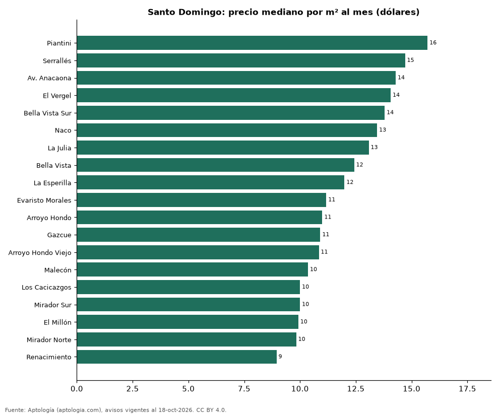

# Sectores más caros y más baratos de Santo Domingo para alquilar apartamento: ranking por m² (octubre 2026)

**En Santo Domingo, el sector con el m² más caro para alquilar apartamento es Piantini (USD 15,7/m² al mes) y el más barato Renacimiento (USD 8,9/m² al mes), 1,8 veces menos.** Comparamos 19 sectores con al menos 30 avisos con área.

*Resumen: analizamos 2.021 apartamentos en alquiler con área declarada en 19 sectores de Santo Domingo.*

**Actualizado:** 18 de octubre de 2026 (datos del 18 de octubre de 2026) · **Próxima actualización:** mensual.

## Resumen

| Indicador | Valor |
|---|---|
| Más caro por m² | Piantini: USD 15,7 |
| Más barato por m² | Renacimiento: USD 8,9 |
| Diferencia | 1,8 veces |
| Sectores | 19 |

## Ranking de sectores por precio del m²

| Sector | Por m² (mediana) | Canon (mediana) | Área mediana (m²) | Avisos con área |
|---|---|---|---|---|
| Piantini | USD 15,7 | USD 1.600 | 110 | 485 |
| Serrallés | USD 14,7 | USD 1.200 | 80 | 51 |
| Av. Anacaona | USD 14,3 | USD 4.200 | 264 | 31 |
| El Vergel | USD 14,1 | USD 950 | 65 | 33 |
| Bella Vista Sur | USD 13,8 | USD 1.500 | 125 | 75 |
| Naco | USD 13,5 | USD 1.400 | 116 | 348 |
| La Julia | USD 13,1 | USD 1.200 | 112 | 30 |
| Bella Vista | USD 12,4 | USD 1.400 | 120 | 276 |
| La Esperilla | USD 12,0 | USD 1.550 | 120 | 70 |
| Evaristo Morales | USD 11,2 | USD 1.150 | 105 | 177 |
| Arroyo Hondo | USD 11,0 | USD 1.300 | 120 | 31 |
| Gazcue | USD 10,9 | USD 1.000 | 100 | 61 |
| Arroyo Hondo Viejo | USD 10,8 | USD 1.288 | 120 | 32 |
| Malecón | USD 10,4 | USD 2.000 | 214 | 36 |
| Los Cacicazgos | USD 10,0 | USD 1.650 | 190 | 52 |
| Mirador Sur | USD 10,0 | USD 1.300 | 143 | 41 |
| El Millón | USD 9,9 | USD 1.100 | 124 | 71 |
| Mirador Norte | USD 9,8 | USD 1.100 | 120 | 33 |
| Renacimiento | USD 8,9 | USD 1.200 | 140 | 88 |

Medianas; solo sectores con 30 avisos o más con área declarada.

## Preguntas frecuentes

**¿Cuál es el sector más caro de Santo Domingo para alquilar?**
Piantini, con USD 15,7 por m² al mes en la mediana (octubre de 2026).

**¿Y el más barato?**
Renacimiento, con USD 8,9 por m² al mes.

## Metodología

- **Fuente:** exportes nocturnos de la base de datos de Aptología (aptologia.com) del 18 de octubre de 2026: avisos vigentes de vivienda en portales inmobiliarios de 13 países, recogidos por Aptología y vistos en línea entre el 11 y el 18 de octubre de 2026. Corte: 18 de octubre de 2026.
- **Depuración:** se eliminan duplicados exactos (misma ciudad, zona, tipo, precio, moneda, área, habitaciones y baños) y los precios fuera del percentil 1–99 de cada país, operación, moneda y tipo; el precio por m² usa solo avisos con área declarada entre 12 y 2.000 m² y también se recorta al P1–P99.
- **Qué se mide:** precios pedidos (publicados), no precios de cierre. En arriendo, el canon mensual sin administración, gastos comunes ni condominio.
- **Muestra mínima:** cada cifra publicada se apoya en al menos 30 avisos; las celdas con menos se omiten.
- **Monedas:** nunca se mezclan avisos de monedas distintas sin convertirlos. Conversión a dólares con la tasa de mercado de ExchangeRate-API (open.er-api.com, actualización del 18 Oct 2026): 1 USD = 3.182,80 COP, 1 USD = 18,47 M.N, 1 USD = 5,09 BRL, 1 USD = 3,44 PEN, 1 USD = 982,44 CLP, 1 USD = 1.514,57 ARS, 1 USD = 40,20 UYU, 1 USD = 5.705,37 PYG, 1 USD = 61,27 DOP, 1 USD = 0,89 EUR, 1 USD = 11,72 BOB; la UF chilena a 41.178,64 CLP (mindicador,cl. 18-oct-2026). Los avisos publicados en dólares se usan tal cual.
- **Monedas:** en cada ciudad y operación se usa solo la moneda mayoritaria de los avisos (los avisos en otra moneda se excluyen) y la mediana se convierte a dólares con la tasa citada; nunca se promedian avisos de monedas distintas.
- **Limitaciones:** la cobertura depende de los portales que recorre Aptología en cada país y es mayor en las ciudades grandes y en los segmentos medio-alto y alto; el área es la que declara el aviso, sin verificar; los nombres de zona vienen de los portales.
- **Privacidad:** solo se publican agregados; no se publica ningún dato personal, enlace a avisos ni nombre de anunciante.
- **Datos abiertos:** [datos.csv](datos.csv), licencia CC BY 4.0.

## Cómo citar

Pinzón Pineda, D. M. (2026). *Sectores más caros y más baratos de Santo Domingo para alquilar apartamento: ranking por m² (octubre 2026)*. Aptología (aptologia.com). https://github.com/elbroker/aptologia-datos/tree/main/estudios/sectores-mas-caros-y-baratos-santo-domingo-alquiler-m2-2026. Datos: datos.csv, licencia CC BY 4.0.
