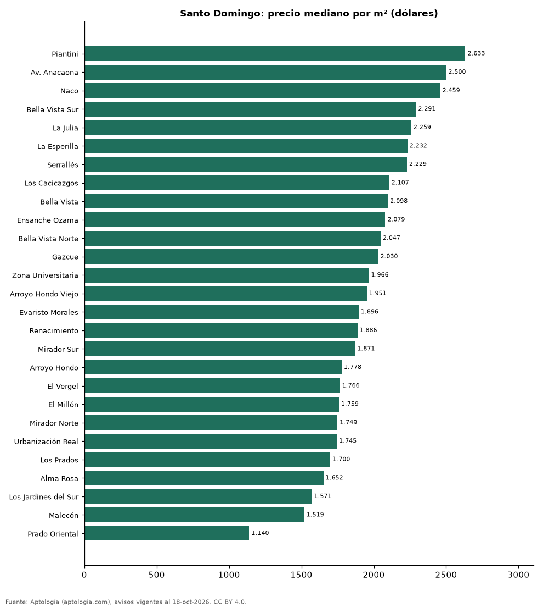

# Sectores más caros y más baratos de Santo Domingo para comprar apartamento: ranking por m² (octubre 2026)

**En Santo Domingo, el sector con el m² más caro para comprar apartamento es Piantini (USD 2.633/m²) y el más barato Prado Oriental (USD 1.140/m²), 2,3 veces menos.** Comparamos 27 sectores con al menos 30 avisos con área.

*Resumen: analizamos 4.441 apartamentos en venta con área declarada en 27 sectores de Santo Domingo.*

**Actualizado:** 18 de octubre de 2026 (datos del 18 de octubre de 2026) · **Próxima actualización:** mensual.

## Resumen

| Indicador | Valor |
|---|---|
| Más caro por m² | Piantini: USD 2.633 |
| Más barato por m² | Prado Oriental: USD 1.140 |
| Diferencia | 2,3 veces |
| Sectores | 27 |

## Ranking de sectores por precio del m²

| Sector | Por m² (mediana) | Precio (mediana) | Área mediana (m²) | Avisos con área |
|---|---|---|---|---|
| Piantini | USD 2.633 | USD 340.000 | 141 | 587 |
| Av. Anacaona | USD 2.500 | USD 1.130.000 | 415 | 67 |
| Naco | USD 2.459 | USD 285.000 | 131 | 817 |
| Bella Vista Sur | USD 2.291 | USD 295.000 | 145 | 98 |
| La Julia | USD 2.259 | USD 246.450 | 129 | 72 |
| La Esperilla | USD 2.232 | USD 285.000 | 132 | 220 |
| Serrallés | USD 2.229 | USD 271.000 | 143 | 86 |
| Los Cacicazgos | USD 2.107 | USD 439.000 | 215 | 112 |
| Bella Vista | USD 2.098 | USD 265.000 | 140 | 400 |
| Ensanche Ozama | USD 2.079 | USD 143.325 | 70 | 89 |
| Bella Vista Norte | USD 2.047 | USD 205.000 | 109 | 47 |
| Gazcue | USD 2.030 | USD 202.745 | 110 | 111 |
| Zona Universitaria | USD 1.966 | USD 184.000 | 88 | 50 |
| Arroyo Hondo Viejo | USD 1.951 | USD 196.250 | 110 | 62 |
| Evaristo Morales | USD 1.896 | USD 226.312 | 123 | 348 |
| Renacimiento | USD 1.886 | USD 265.000 | 145 | 309 |
| Mirador Sur | USD 1.871 | USD 280.000 | 161 | 87 |
| Arroyo Hondo | USD 1.778 | USD 188.500 | 110 | 136 |
| El Vergel | USD 1.766 | USD 208.500 | 121 | 36 |
| El Millón | USD 1.759 | USD 215.000 | 130 | 234 |
| Mirador Norte | USD 1.749 | USD 232.500 | 147 | 100 |
| Urbanización Real | USD 1.745 | USD 270.000 | 157 | 51 |
| Los Prados | USD 1.700 | USD 207.000 | 120 | 65 |
| Alma Rosa | USD 1.652 | USD 220.000 | 136 | 108 |
| Los Jardines del Sur | USD 1.571 | USD 185.000 | 123 | 41 |
| Malecón | USD 1.519 | USD 345.000 | 200 | 61 |
| Prado Oriental | USD 1.140 | USD 136.000 | 117 | 47 |

Medianas; solo sectores con 30 avisos o más con área declarada.

## Preguntas frecuentes

**¿Cuál es el sector más caro de Santo Domingo para comprar?**
Piantini, con USD 2.633 por m² en la mediana (octubre de 2026).

**¿Y el más barato?**
Prado Oriental, con USD 1.140 por m².

## Metodología

- **Fuente:** exportes nocturnos de la base de datos de Aptología (aptologia.com) del 18 de octubre de 2026: avisos vigentes de vivienda en portales inmobiliarios de 13 países, recogidos por Aptología y vistos en línea entre el 11 y el 18 de octubre de 2026. Corte: 18 de octubre de 2026.
- **Depuración:** se eliminan duplicados exactos (misma ciudad, zona, tipo, precio, moneda, área, habitaciones y baños) y los precios fuera del percentil 1–99 de cada país, operación, moneda y tipo; el precio por m² usa solo avisos con área declarada entre 12 y 2.000 m² y también se recorta al P1–P99.
- **Qué se mide:** precios pedidos (publicados), no precios de cierre. En arriendo, el canon mensual sin administración, gastos comunes ni condominio.
- **Muestra mínima:** cada cifra publicada se apoya en al menos 30 avisos; las celdas con menos se omiten.
- **Monedas:** nunca se mezclan avisos de monedas distintas sin convertirlos. Conversión a dólares con la tasa de mercado de ExchangeRate-API (open.er-api.com, actualización del 18 Oct 2026): 1 USD = 3.182,80 COP, 1 USD = 18,47 M.N, 1 USD = 5,09 BRL, 1 USD = 3,44 PEN, 1 USD = 982,44 CLP, 1 USD = 1.514,57 ARS, 1 USD = 40,20 UYU, 1 USD = 5.705,37 PYG, 1 USD = 61,27 DOP, 1 USD = 0,89 EUR, 1 USD = 11,72 BOB; la UF chilena a 41.178,64 CLP (mindicador,cl. 18-oct-2026). Los avisos publicados en dólares se usan tal cual.
- **Monedas:** en cada ciudad y operación se usa solo la moneda mayoritaria de los avisos (los avisos en otra moneda se excluyen) y la mediana se convierte a dólares con la tasa citada; nunca se promedian avisos de monedas distintas.
- **Limitaciones:** la cobertura depende de los portales que recorre Aptología en cada país y es mayor en las ciudades grandes y en los segmentos medio-alto y alto; el área es la que declara el aviso, sin verificar; los nombres de zona vienen de los portales.
- **Privacidad:** solo se publican agregados; no se publica ningún dato personal, enlace a avisos ni nombre de anunciante.
- **Datos abiertos:** [datos.csv](datos.csv), licencia CC BY 4.0.

## Cómo citar

Pinzón Pineda, D. M. (2026). *Sectores más caros y más baratos de Santo Domingo para comprar apartamento: ranking por m² (octubre 2026)*. Aptología (aptologia.com). https://github.com/elbroker/aptologia-datos/tree/main/estudios/sectores-mas-caros-y-baratos-santo-domingo-venta-m2-2026. Datos: datos.csv, licencia CC BY 4.0.
