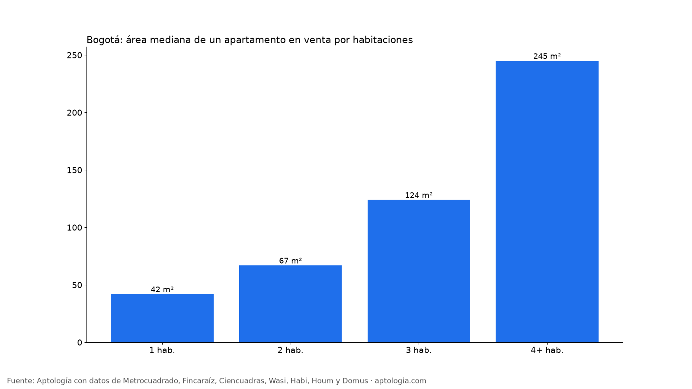
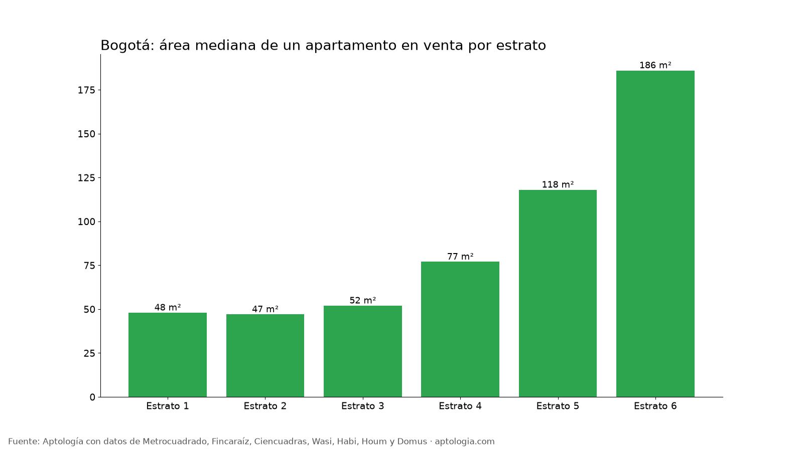

# Cuántos metros tiene un apartamento en Bogotá: área por habitaciones, estrato y localidad (octubre 2026)

**Un apartamento en venta en Bogotá tiene en la mediana 98 m², y uno en arriendo 70 m².** Un 2 habitaciones en venta mide 67 m² y un 3 habitaciones 124 m²; el 16,9 % de los apartamentos en venta tiene menos de 50 m².

*Resumen: analizamos el área de 51.743 apartamentos únicos en venta y en arriendo en Bogotá.*

**Actualizado:** 18 de octubre de 2026 (datos del 18 de octubre de 2026) · **Próxima actualización:** mensual.

## Área mediana por número de habitaciones

| Habitaciones | Venta | Arriendo |
|---|---|---|
| 1 | 42 m² | 41 m² |
| 2 | 67 m² | 62 m² |
| 3 | 124 m² | 130 m² |
| 4 o más | 245 m² | 283 m² |

## Por estrato

| Estrato | Venta | Arriendo |
|---|---|---|
| 1 | 48 m² | — |
| 2 | 47 m² | 47 m² |
| 3 | 52 m² | 45 m² |
| 4 | 77 m² | 57 m² |
| 5 | 118 m² | 82 m² |
| 6 | 186 m² | 152 m² |

## Por localidad (80 avisos o más)

| Localidad | Venta | Arriendo |
|---|---|---|
| Chapinero | 187 m² | 140 m² |
| Usaquén | 123 m² | 84 m² |
| Suba | 92 m² | 60 m² |
| Barrios Unidos | 87 m² | 57 m² |
| Teusaquillo | 86 m² | 52 m² |
| Engativá | 61 m² | 55 m² |
| Antonio Nariño | 60 m² | 52 m² |
| Fontibón | 60 m² | 48 m² |
| Santa Fe | 59 m² | 45 m² |
| Puente Aranda | 55 m² | 50 m² |
| La Candelaria | 54 m² | 40 m² |
| Kennedy | 53 m² | 50 m² |
| San Cristóbal | 50 m² | — |
| Rafael Uribe Uribe | 50 m² | — |
| Usme | 49 m² | 50 m² |
| Ciudad Bolívar | 48 m² | 43 m² |
| Bosa | 46 m² | 45 m² |
| Los Mártires | 41 m² | 40 m² |

**Cómo usarlo para decidir:** compara el área del aviso con la mediana de su número de habitaciones: un 2 habitaciones muy por debajo de la mediana tendrá espacios estrechos. Verifica si el área anunciada es construida o privada; la privada suele ser menor.

## Preguntas frecuentes

**¿Cuántos metros tiene un apartamento en Bogotá?**
La mediana es 98 m² en venta y 70 m² en arriendo (datos del 18 de octubre de 2026).

**¿Cuántos metros tiene un apartamento de 2 habitaciones en Bogotá?**
En venta, 67 m² en la mediana; en arriendo, 62 m².

**¿Los apartamentos en Bogotá son cada vez más pequeños?**
En la oferta actual, el 16,9 % de los apartamentos en venta tiene menos de 50 m²; los de estrato bajo y los apartaestudios concentran los tamaños pequeños.

## Metodología

- **Fuente:** avisos vivos de vivienda recogidos por la ingesta de Aptología en Metrocuadrado, Fincaraíz, Ciencuadras, Wasi, Habi, Houm y Domus, del 11 al 18 de octubre de 2026. Corte: 18 de octubre de 2026.
- **Depuración:** un mismo inmueble publicado varias veces se cuenta una sola vez (agrupación por portal y, entre portales, por precio, área, habitaciones y coordenadas). Se descartan precios y áreas fuera de rango y, en arriendo, se resta la administración cuando el portal la incluye en el canon.
- **Qué se mide:** precios pedidos (publicados), no precios de cierre.
- **Área:** la informada en el aviso (construida o privada según el portal), entre 15 y 1.500 m². Solo grupos con 80 avisos o más por estrato y localidad.
- **Limitaciones:** son precios pedidos en portales, que pueden diferir del valor final de arriendo o venta. La cobertura es mayor en el norte de Bogotá y en estratos 4 a 6, porque ahí se concentra la oferta publicada. Los barrios y la localidad vienen de lo que escribe cada portal; cuando falta la localidad se asigna por los avisos vecinos más cercanos.
- **Datos abiertos:** [datos.csv](datos.csv), licencia CC BY 4.0.

## Cómo citar

Pinzón Pineda, D. M. (2026). *Cuántos metros tiene un apartamento en Bogotá: área por habitaciones, estrato y localidad (octubre 2026)*. Aptología. https://www.aptologia.com/estudios/tamano-de-los-apartamentos-bogota-2026. Datos: datos.csv, licencia CC BY 4.0.
