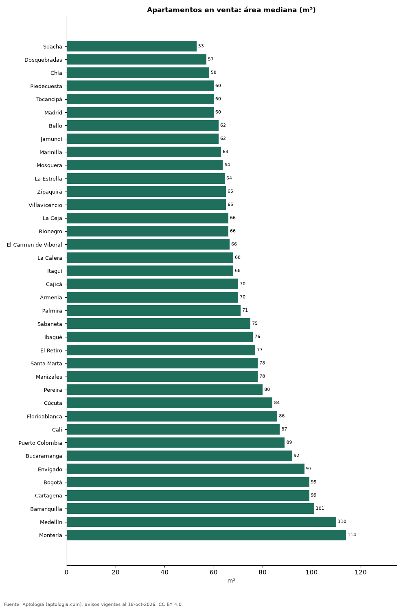

# Qué tan grandes son los apartamentos en las ciudades de Colombia: área mediana en venta y arriendo en 38 ciudades (octubre 2026)

**El apartamento mediano en venta mide 53 m² en Soacha, el más pequeño de 38 ciudades colombianas, y 114 m² en Montería, el más grande.** En Bogotá mide 99 m² y el 16,1 % de la oferta tiene menos de 50 m². En todo el país, la mediana es 87 m² en venta y 80 m² en arriendo.

*Resumen: medimos el área declarada de 188.671 apartamentos en venta y arriendo en 38 ciudades.*

**Actualizado:** 18 de octubre de 2026 (datos del 18 de octubre de 2026) · **Próxima actualización:** mensual.

## Resumen

| Indicador | Valor |
|---|---|
| Más pequeños | Soacha: 53 m² |
| Más grandes | Montería: 114 m² |
| Bogotá | 99 m² |
| Colombia (venta) | 87 m² |
| Colombia (arriendo) | 80 m² |

## Área de los apartamentos por ciudad

| Ciudad | Área mediana en venta (m²) | Menos de 50 m² | Más de 100 m² | Área mediana en arriendo (m²) | Avisos en venta |
|---|---|---|---|---|---|
| Soacha | 53 | 33,2 % | 0,5 % | 50 | 570 |
| Dosquebradas | 57 | 20,4 % | 3,6 % | 58 | 612 |
| Chía | 58 | 21,9 % | 11,1 % | 53 | 1.509 |
| Piedecuesta | 60 | 6,6 % | 1,6 % | 65 | 258 |
| Tocancipá | 60 | 7,9 % | 0,0 % | 59 | 265 |
| Madrid | 60 | 8,2 % | 1,7 % | 58 | 477 |
| Bello | 62 | 7,4 % | 5,5 % | 60 | 2.335 |
| Jamundí | 62 | 5,5 % | 10,3 % | 60 | 474 |
| Marinilla | 63 | 9,7 % | 1,2 % | 63 | 165 |
| Mosquera | 64 | 16,3 % | 3,7 % | 52 | 817 |
| La Estrella | 64 | 6,9 % | 4,8 % | 65 | 562 |
| Zipaquirá | 65 | 5,2 % | 5,1 % | 60 | 822 |
| Villavicencio | 65 | 6,3 % | 21,8 % | 57 | 363 |
| La Ceja | 66 | 11,9 % | 8,0 % | 69 | 312 |
| Rionegro | 66 | 7,6 % | 12,5 % | 68 | 3.043 |
| El Carmen de Viboral | 66 | 6,7 % | 8,9 % | 57 | 90 |
| La Calera | 68 | 13,5 % | 15,6 % | 78 | 141 |
| Itagüí | 68 | 2,1 % | 7,7 % | 68 | 2.016 |
| Cajicá | 70 | 6,4 % | 11,9 % | 64 | 1.521 |
| Armenia | 70 | 11,7 % | 22,4 % | 70 | 2.317 |
| Palmira | 71 | 7,3 % | 14,5 % | 55 | 124 |
| Sabaneta | 75 | 2,0 % | 15,0 % | 75 | 4.380 |
| Ibagué | 76 | 7,2 % | 25,1 % | 62 | 1.260 |
| El Retiro | 77 | 3,9 % | 20,5 % | 84 | 619 |
| Santa Marta | 78 | 21,3 % | 30,0 % | 73 | 3.915 |
| Manizales | 78 | 9,9 % | 27,4 % | 64 | 2.820 |
| Pereira | 80 | 6,8 % | 30,6 % | 85 | 4.445 |
| Cúcuta | 84 | 8,7 % | 37,1 % | 71 | 665 |
| Floridablanca | 86 | 1,7 % | 23,6 % | 81 | 938 |
| Cali | 87 | 3,4 % | 40,6 % | 69 | 9.485 |
| Puerto Colombia | 89 | 2,0 % | 38,8 % | 76 | 147 |
| Bucaramanga | 92 | 3,2 % | 41,2 % | 80 | 2.502 |
| Envigado | 97 | 0,4 % | 45,0 % | 90 | 5.772 |
| Bogotá | 99 | 16,1 % | 49,1 % | 70 | 31.808 |
| Cartagena | 99 | 4,9 % | 48,3 % | 86 | 6.104 |
| Barranquilla | 101 | 2,8 % | 50,4 % | 82 | 7.890 |
| Medellín | 110 | 5,0 % | 55,9 % | 95 | 20.913 |
| Montería | 114 | 0,9 % | 63,9 % | 92 | 330 |

Área declarada en el aviso (entre 12 y 2.000 m²); medianas.

## Preguntas frecuentes

**¿Cuánto mide un apartamento promedio en Colombia?**
La mediana de la oferta en venta es 87 m² y la de arriendo 80 m² (octubre de 2026).

**¿Qué tan grandes son los apartamentos en Bogotá?**
La mediana en venta es 99 m²; el 16,1 % tiene menos de 50 m².

## Metodología

- **Fuente:** exportes nocturnos de la base de datos de Aptología (aptologia.com) del 18 de octubre de 2026: avisos vigentes de vivienda en portales inmobiliarios de 13 países, recogidos por Aptología y vistos en línea entre el 11 y el 18 de octubre de 2026. Corte: 18 de octubre de 2026.
- **Depuración:** se eliminan duplicados exactos (misma ciudad, zona, tipo, precio, moneda, área, habitaciones y baños) y los precios fuera del percentil 1–99 de cada país, operación, moneda y tipo; el precio por m² usa solo avisos con área declarada entre 12 y 2.000 m² y también se recorta al P1–P99.
- **Qué se mide:** precios pedidos (publicados), no precios de cierre. En arriendo, el canon mensual sin administración, gastos comunes ni condominio.
- **Muestra mínima:** cada cifra publicada se apoya en al menos 30 avisos; las celdas con menos se omiten.
- **Colombia:** Precios en pesos colombianos, sin conversión de moneda.
- **Limitaciones:** la cobertura depende de los portales que recorre Aptología en cada país y es mayor en las ciudades grandes y en los segmentos medio-alto y alto; el área es la que declara el aviso, sin verificar; los nombres de zona vienen de los portales.
- **Privacidad:** solo se publican agregados; no se publica ningún dato personal, enlace a avisos ni nombre de anunciante.
- **Datos abiertos:** [datos.csv](datos.csv), licencia CC BY 4.0.

## Cómo citar

Pinzón Pineda, D. M. (2026). *Qué tan grandes son los apartamentos en las ciudades de Colombia: área mediana en venta y arriendo en 38 ciudades (octubre 2026)*. Aptología (aptologia.com). https://github.com/elbroker/aptologia-datos/tree/main/estudios/tamano-de-los-apartamentos-ciudades-colombia-2026. Datos: datos.csv, licencia CC BY 4.0.
