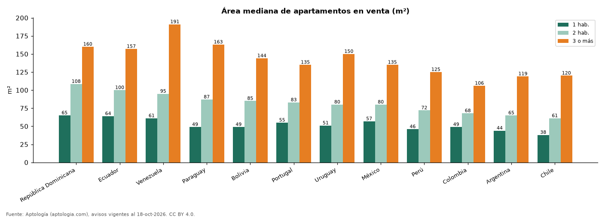

# Cuántos metros cuadrados tiene un apartamento en Latinoamérica: área mediana por número de habitaciones y país (octubre 2026)

**Un apartamento de 2 habitaciones en venta tiene en la mediana 108 m² en República Dominicana y solo 61 m² en Chile.** En Colombia, uno de 2 habitaciones tiene 68 m² y uno de 3 o más, 106 m².

*Resumen: medimos el área declarada de 187.195 apartamentos en venta en 12 países.*

**Actualizado:** 18 de octubre de 2026 (datos del 18 de octubre de 2026) · **Próxima actualización:** mensual.

## Resumen

| Indicador | Valor |
|---|---|
| 2 hab. más amplio | República Dominicana: 108 m² |
| 2 hab. más pequeño | Chile: 61 m² |
| Colombia, 2 hab. | 68 m² |

## Área mediana por país y habitaciones

| País | 1 hab. | 2 hab. | 3 o más |
|---|---|---|---|
| República Dominicana | 65 m² | 108 m² | 160 m² |
| Ecuador | 64 m² | 100 m² | 157 m² |
| Venezuela | 61 m² | 95 m² | 191 m² |
| Paraguay | 49 m² | 87 m² | 163 m² |
| Bolivia | 49 m² | 85 m² | 144 m² |
| Portugal | 55 m² | 83 m² | 135 m² |
| Uruguay | 51 m² | 80 m² | 150 m² |
| México | 57 m² | 80 m² | 135 m² |
| Perú | 46 m² | 72 m² | 125 m² |
| Colombia | 49 m² | 68 m² | 106 m² |
| Argentina | 44 m² | 65 m² | 119 m² |
| Chile | 38 m² | 61 m² | 120 m² |

## Preguntas frecuentes

**¿Cuántos m² tiene un apartamento de 2 habitaciones en Colombia?**
La mediana de la oferta en venta es 68 m².

**¿En qué país son más grandes los apartamentos?**
Para 2 habitaciones, en República Dominicana, con 108 m² en la mediana.

## Metodología

- **Fuente:** exportes nocturnos de la base de datos de Aptología (aptologia.com) del 18 de octubre de 2026: avisos vigentes de vivienda en portales inmobiliarios de 13 países, recogidos por Aptología y vistos en línea entre el 11 y el 18 de octubre de 2026. Corte: 18 de octubre de 2026.
- **Depuración:** se eliminan duplicados exactos (misma ciudad, zona, tipo, precio, moneda, área, habitaciones y baños) y los precios fuera del percentil 1–99 de cada país, operación, moneda y tipo; el precio por m² usa solo avisos con área declarada entre 12 y 2.000 m² y también se recorta al P1–P99.
- **Qué se mide:** precios pedidos (publicados), no precios de cierre. En arriendo, el canon mensual sin administración, gastos comunes ni condominio.
- **Muestra mínima:** cada cifra publicada se apoya en al menos 30 avisos; las celdas con menos se omiten.
- **Limitaciones:** la cobertura depende de los portales que recorre Aptología en cada país y es mayor en las ciudades grandes y en los segmentos medio-alto y alto; el área es la que declara el aviso, sin verificar; los nombres de zona vienen de los portales.
- **Privacidad:** solo se publican agregados; no se publica ningún dato personal, enlace a avisos ni nombre de anunciante.
- **Datos abiertos:** [datos.csv](datos.csv), licencia CC BY 4.0.

## Cómo citar

Pinzón Pineda, D. M. (2026). *Cuántos metros cuadrados tiene un apartamento en Latinoamérica: área mediana por número de habitaciones y país (octubre 2026)*. Aptología (aptologia.com). https://github.com/elbroker/aptologia-datos/tree/main/estudios/tamano-de-los-apartamentos-por-pais-latinoamerica-2026. Datos: datos.csv, licencia CC BY 4.0.
