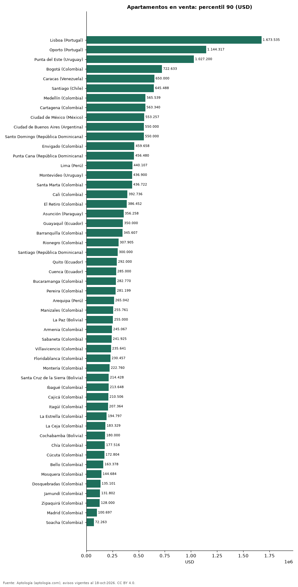

# Desde cuánto un apartamento está en el 10 % más caro: umbral de lujo en 51 ciudades de Latinoamérica y Portugal (octubre 2026)

**Para estar en el 10 % más caro de la oferta, un apartamento en venta tiene que pedir al menos USD 1.673.535 en Lisboa (Portugal), el umbral más alto de 51 ciudades; en Soacha (Colombia) basta con USD 72.263.** Donde el lujo más se separa del mercado típico es Ciudad de Buenos Aires (Argentina): el umbral es 3,3 veces la mediana.

*Resumen: calculamos el percentil 90 del precio de 186.421 apartamentos en venta en 51 ciudades con 300 avisos o más.*

**Actualizado:** 18 de octubre de 2026 (datos del 18 de octubre de 2026) · **Próxima actualización:** mensual.

## Resumen

| Indicador | Valor |
|---|---|
| Umbral más alto | Lisboa (Portugal): USD 1.673.535 |
| Umbral más bajo | Soacha (Colombia): USD 72.263 |
| Mayor distancia a la mediana | Ciudad de Buenos Aires (Argentina): 3,3× |

## Umbral del 10 % más caro por ciudad

| Ciudad | Umbral del 10 % más caro (P90) | Mediana | P90 ÷ mediana | Avisos |
|---|---|---|---|---|
| Lisboa (Portugal) | USD 1.673.535 | USD 741.895 | 2,3 | 1.583 |
| Oporto (Portugal) | USD 1.144.317 | USD 477.735 | 2,4 | 625 |
| Punta del Este (Uruguay) | USD 1.027.200 | USD 360.000 | 2,9 | 5.198 |
| Bogotá (Colombia) | USD 722.633 | USD 235.641 | 3,1 | 31.911 |
| Caracas (Venezuela) | USD 650.000 | USD 240.000 | 2,7 | 1.503 |
| Santiago (Chile) | USD 645.488 | USD 291.308 | 2,2 | 7.959 |
| Medellín (Colombia) | USD 565.539 | USD 263.918 | 2,1 | 20.940 |
| Cartagena (Colombia) | USD 563.340 | USD 251.351 | 2,2 | 6.126 |
| Ciudad de México (México) | USD 553.257 | USD 270.234 | 2,0 | 7.877 |
| Ciudad de Buenos Aires (Argentina) | USD 550.000 | USD 165.000 | 3,3 | 8.308 |
| Santo Domingo (República Dominicana) | USD 550.000 | USD 240.000 | 2,3 | 6.757 |
| Envigado (Colombia) | USD 459.658 | USD 257.635 | 1,8 | 5.788 |
| Punta Cana (República Dominicana) | USD 456.480 | USD 210.000 | 2,2 | 469 |
| Lima (Perú) | USD 440.107 | USD 180.933 | 2,4 | 6.265 |
| Montevideo (Uruguay) | USD 436.900 | USD 185.000 | 2,4 | 4.642 |
| Santa Marta (Colombia) | USD 436.722 | USD 188.513 | 2,3 | 3.920 |
| Cali (Colombia) | USD 392.736 | USD 135.101 | 2,9 | 9.505 |
| El Retiro (Colombia) | USD 386.452 | USD 229.358 | 1,7 | 621 |
| Asunción (Paraguay) | USD 356.258 | USD 140.000 | 2,5 | 5.833 |
| Guayaquil (Ecuador) | USD 350.000 | USD 165.000 | 2,1 | 978 |
| Barranquilla (Colombia) | USD 345.607 | USD 141.385 | 2,4 | 7.903 |
| Rionegro (Colombia) | USD 307.905 | USD 163.378 | 1,9 | 3.052 |
| Santiago (República Dominicana) | USD 300.000 | USD 178.000 | 1,7 | 550 |
| Quito (Ecuador) | USD 292.000 | USD 145.000 | 2,0 | 2.337 |
| Cuenca (Ecuador) | USD 285.000 | USD 137.250 | 2,1 | 398 |
| Bucaramanga (Colombia) | USD 282.770 | USD 135.101 | 2,1 | 2.509 |
| Pereira (Colombia) | USD 281.199 | USD 136.672 | 2,1 | 4.450 |
| Arequipa (Perú) | USD 265.042 | USD 145.931 | 1,8 | 524 |
| Manizales (Colombia) | USD 255.761 | USD 141.385 | 1,8 | 2.824 |
| La Paz (Bolivia) | USD 255.000 | USD 130.000 | 2,0 | 481 |
| Armenia (Colombia) | USD 245.067 | USD 119.392 | 2,1 | 2.320 |
| Sabaneta (Colombia) | USD 241.925 | USD 172.804 | 1,4 | 4.393 |
| Villavicencio (Colombia) | USD 235.641 | USD 87.973 | 2,7 | 364 |
| Floridablanca (Colombia) | USD 230.457 | USD 138.243 | 1,7 | 939 |
| Montería (Colombia) | USD 222.760 | USD 122.533 | 1,8 | 332 |
| Santa Cruz de la Sierra (Bolivia) | USD 214.428 | USD 100.000 | 2,1 | 1.868 |
| Ibagué (Colombia) | USD 213.648 | USD 103.682 | 2,1 | 1.260 |
| Cajicá (Colombia) | USD 210.506 | USD 122.533 | 1,7 | 1.526 |
| Itagüí (Colombia) | USD 207.364 | USD 147.669 | 1,4 | 2.019 |
| La Estrella (Colombia) | USD 194.797 | USD 141.385 | 1,4 | 565 |
| La Ceja (Colombia) | USD 183.329 | USD 131.959 | 1,4 | 314 |
| Cochabamba (Bolivia) | USD 180.000 | USD 88.250 | 2,0 | 374 |
| Chía (Colombia) | USD 177.516 | USD 105.253 | 1,7 | 1.512 |
| Cúcuta (Colombia) | USD 172.804 | USD 87.973 | 2,0 | 666 |
| Bello (Colombia) | USD 163.378 | USD 106.824 | 1,5 | 2.347 |
| Mosquera (Colombia) | USD 144.684 | USD 100.540 | 1,4 | 819 |
| Dosquebradas (Colombia) | USD 135.101 | USD 81.689 | 1,7 | 614 |
| Jamundí (Colombia) | USD 131.802 | USD 65.980 | 2,0 | 476 |
| Zipaquirá (Colombia) | USD 128.000 | USD 86.402 | 1,5 | 825 |
| Madrid (Colombia) | USD 100.697 | USD 65.980 | 1,5 | 480 |
| Soacha (Colombia) | USD 72.263 | USD 53.412 | 1,4 | 572 |

P90 = percentil 90 del precio pedido, en la moneda mayoritaria de cada ciudad convertida a dólares.

## Preguntas frecuentes

**¿Desde qué precio un apartamento es de lujo en Latinoamérica?**
Depende de la ciudad: el 10 % más caro empieza en USD 1.673.535 en Lisboa (Portugal) y en USD 72.263 en Soacha (Colombia).

**¿Y en Bogotá?**
Desde USD 722.633.

## Metodología

- **Fuente:** exportes nocturnos de la base de datos de Aptología (aptologia.com) del 18 de octubre de 2026: avisos vigentes de vivienda en portales inmobiliarios de 13 países, recogidos por Aptología y vistos en línea entre el 11 y el 18 de octubre de 2026. Corte: 18 de octubre de 2026.
- **Depuración:** se eliminan duplicados exactos (misma ciudad, zona, tipo, precio, moneda, área, habitaciones y baños) y los precios fuera del percentil 1–99 de cada país, operación, moneda y tipo; el precio por m² usa solo avisos con área declarada entre 12 y 2.000 m² y también se recorta al P1–P99.
- **Qué se mide:** precios pedidos (publicados), no precios de cierre. En arriendo, el canon mensual sin administración, gastos comunes ni condominio.
- **Muestra mínima:** cada cifra publicada se apoya en al menos 30 avisos; las celdas con menos se omiten.
- **Monedas:** nunca se mezclan avisos de monedas distintas sin convertirlos. Conversión a dólares con la tasa de mercado de ExchangeRate-API (open.er-api.com, actualización del 18 Oct 2026): 1 USD = 3.182,80 COP, 1 USD = 18,47 M.N, 1 USD = 5,09 BRL, 1 USD = 3,44 PEN, 1 USD = 982,44 CLP, 1 USD = 1.514,57 ARS, 1 USD = 40,20 UYU, 1 USD = 5.705,37 PYG, 1 USD = 61,27 DOP, 1 USD = 0,89 EUR, 1 USD = 11,72 BOB; la UF chilena a 41.178,64 CLP (mindicador,cl. 18-oct-2026). Los avisos publicados en dólares se usan tal cual.
- **Monedas:** en cada ciudad y operación se usa solo la moneda mayoritaria de los avisos (los avisos en otra moneda se excluyen) y la mediana se convierte a dólares con la tasa citada; nunca se promedian avisos de monedas distintas.
- **Limitaciones:** la cobertura depende de los portales que recorre Aptología en cada país y es mayor en las ciudades grandes y en los segmentos medio-alto y alto; el área es la que declara el aviso, sin verificar; los nombres de zona vienen de los portales.
- **Privacidad:** solo se publican agregados; no se publica ningún dato personal, enlace a avisos ni nombre de anunciante.
- **Datos abiertos:** [datos.csv](datos.csv), licencia CC BY 4.0.

## Cómo citar

Pinzón Pineda, D. M. (2026). *Desde cuánto un apartamento está en el 10 % más caro: umbral de lujo en 51 ciudades de Latinoamérica y Portugal (octubre 2026)*. Aptología (aptologia.com). https://github.com/elbroker/aptologia-datos/tree/main/estudios/umbral-del-apartamento-de-lujo-ciudades-latinoamerica-2026. Datos: datos.csv, licencia CC BY 4.0.
