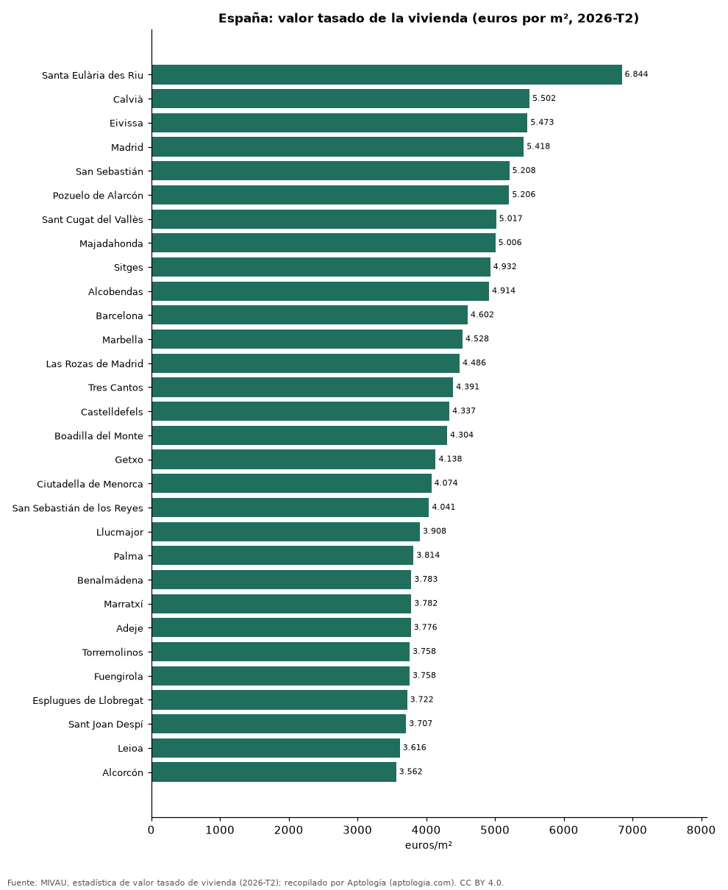

# Precio del metro cuadrado de la vivienda en 306 municipios de España según el valor tasado oficial (segundo trimestre de 2026)

**El metro cuadrado de vivienda libre más caro de España en el segundo trimestre de 2026 se tasó en Santa Eulària des Riu (Illes Balears), con 6.844 euros, y el más barato de 306 municipios en Villarrobledo (Albacete), con 666 euros.** Madrid marca 5.418 euros por m² y Barcelona 4.602 euros. En la mediana de 113 municipios, la vivienda nueva se tasa un 16,3 % por encima de la usada.

*Resumen: ordenamos 306 municipios con 30 tasaciones o más en el segundo trimestre de 2026.*

**Actualizado:** 18 de octubre de 2026 (datos del segundo trimestre de 2026) · **Próxima actualización:** mensual.

## Resumen

| Indicador | Valor |
|---|---|
| Más caro | Santa Eulària des Riu: 6.844 euros/m² |
| Más barato | Villarrobledo: 666 euros/m² |
| Madrid | 5.418 euros/m² |
| Prima de la vivienda nueva (mediana) | 16,3 % |

## Los 40 municipios más caros

| Municipio | Provincia | Euros por m² | Vivienda nueva | Usada | Tasaciones |
|---|---|---|---|---|---|
| Santa Eulària des Riu | Illes Balears | 6.844 | 7.590 | 6.800 | 123 |
| Calvià | Illes Balears | 5.502 | 6.606 | 5.453 | 191 |
| Eivissa | Illes Balears | 5.473 | 6.291 | 5.435 | 121 |
| Madrid | Madrid | 5.418 | 6.205 | 5.395 | 11.686 |
| San Sebastián | Gipuzkoa | 5.208 | 6.237 | 5.186 | 424 |
| Pozuelo de Alarcón | Madrid | 5.206 | 5.402 | 5.196 | 324 |
| Sant Cugat del Vallès | Barcelona | 5.017 | 5.678 | 4.988 | 328 |
| Majadahonda | Madrid | 5.006 | 4.784 | 5.014 | 193 |
| Sitges | Barcelona | 4.932 | — | 4.924 | 151 |
| Alcobendas | Madrid | 4.914 | 5.523 | 4.883 | 322 |
| Barcelona | Barcelona | 4.602 | 5.110 | 4.595 | 5.519 |
| Marbella | Málaga | 4.528 | 5.955 | 4.476 | 748 |
| Las Rozas de Madrid | Madrid | 4.486 | — | 4.469 | 348 |
| Tres Cantos | Madrid | 4.391 | 4.362 | 4.396 | 152 |
| Castelldefels | Barcelona | 4.337 | — | 4.327 | 264 |
| Boadilla del Monte | Madrid | 4.304 | 4.050 | 4.347 | 296 |
| Getxo | Bizkaia | 4.138 | — | 4.125 | 206 |
| Ciutadella de Menorca | Illes Balears | 4.074 | — | 4.077 | 105 |
| San Sebastián de los Reyes | Madrid | 4.041 | — | 4.036 | 262 |
| Llucmajor | Illes Balears | 3.908 | — | 3.900 | 130 |
| Palma | Illes Balears | 3.814 | 4.411 | 3.792 | 1.274 |
| Benalmádena | Málaga | 3.783 | 3.906 | 3.779 | 402 |
| Marratxí | Illes Balears | 3.782 | — | 3.768 | 113 |
| Adeje | Santa Cruz de Tenerife | 3.776 | — | 3.774 | 199 |
| Torremolinos | Málaga | 3.758 | 4.248 | 3.736 | 326 |
| Fuengirola | Málaga | 3.758 | 4.547 | 3.711 | 423 |
| Esplugues de Llobregat | Barcelona | 3.722 | — | 3.713 | 172 |
| Sant Joan Despí | Barcelona | 3.707 | — | 3.689 | 119 |
| Leioa | Bizkaia | 3.616 | — | 3.598 | 89 |
| Alcorcón | Madrid | 3.562 | — | 3.563 | 405 |
| Bilbao | Bizkaia | 3.529 | 3.870 | 3.524 | 956 |
| Villaviciosa de Odón | Madrid | 3.524 | 4.117 | 3.469 | 114 |
| Rivas-Vaciamadrid | Madrid | 3.521 | — | 3.512 | 238 |
| Estepona | Málaga | 3.518 | 4.046 | 3.452 | 470 |
| Xàbia | Alicante | 3.507 | 3.942 | 3.489 | 170 |
| Rincón de la Victoria | Málaga | 3.506 | — | 3.498 | 201 |
| Gavà | Barcelona | 3.465 | — | 3.455 | 193 |
| Mijas | Málaga | 3.365 | 3.761 | 3.339 | 675 |
| Sant Feliu de Llobregat | Barcelona | 3.330 | — | 3.317 | 156 |
| Málaga | Málaga | 3.320 | 4.140 | 3.283 | 1.722 |

Valor tasado medio por m² de la vivienda libre (MIVAU), 2026-T2.

## Los 15 municipios más baratos

| Municipio | Provincia | Euros por m² | Tasaciones |
|---|---|---|---|
| Villarrobledo | Albacete | 666 | 55 |
| Puertollano | Ciudad Real | 686 | 124 |
| Tomelloso | Ciudad Real | 767 | 160 |
| Hellín | Albacete | 780 | 68 |
| Villanueva de la Serena | Badajoz | 802 | 75 |
| Almansa | Albacete | 803 | 96 |
| Andújar | Jaén | 819 | 119 |
| Jumilla | Murcia | 829 | 77 |
| Valdepeñas | Ciudad Real | 864 | 94 |
| Yecla | Murcia | 882 | 123 |
| Linares | Jaén | 889 | 232 |
| Caravaca de la Cruz | Murcia | 903 | 100 |
| Ponferrada | León | 923 | 188 |
| Almendralejo | Badajoz | 933 | 125 |
| Cieza | Murcia | 954 | 98 |

## Preguntas frecuentes

**¿Cuál es el municipio con la vivienda más cara de España?**
Santa Eulària des Riu, con un valor tasado de 6.844 euros por m² en el segundo trimestre de 2026.

**¿Cuánto más cara es la vivienda nueva que la usada en España?**
En la mediana de 113 municipios, un 16,3 % más por m² tasado.

## Metodología

- **Fuente:** MIVAU, estadística de valor tasado de vivienda (2026-T2). Las tablas oficiales se tomaron de los exportes nocturnos de Aptología del 18 de octubre de 2026 (es_alquiler_municipio, es_alquiler_barrio, es_compra_municipio), que las recopilan sin modificarlas.
- **Estadístico:** valor tasado medio por m² de vivienda libre, total, nueva y usada.
- **Qué se mide:** rentas de contratos registrados (fianzas) o valores de tasación oficiales, no precios pedidos en portales.
- **Muestra mínima:** solo se publican filas con 30 contratos o tasaciones o más.
- **Limitaciones:** cada fuente usa su propia metodología (media en Cataluña, mediana en la Comunitat Valenciana), por lo que no deben compararse entre sí sin cautela.
- **Datos abiertos:** [datos.csv](datos.csv), licencia CC BY 4.0.

## Cómo citar

Pinzón Pineda, D. M. (2026). *Precio del metro cuadrado de la vivienda en 306 municipios de España según el valor tasado oficial (segundo trimestre de 2026)*. Aptología (aptologia.com). https://github.com/elbroker/aptologia-datos/tree/main/estudios/valor-tasado-vivienda-m2-municipios-espana-2026. Datos: datos.csv, licencia CC BY 4.0.
