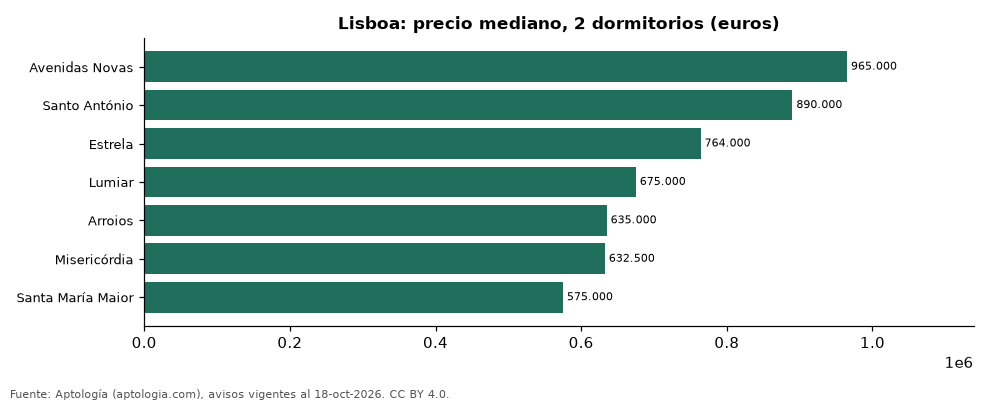

# Dónde cuesta más y menos comprar un apartamento de 2 dormitorios en Lisboa: ranking de freguesias (octubre 2026)

**En Lisboa, un apartamento de 2 dormitorios cuesta 965.000 euros (USD 1.084.740) en la mediana en Avenidas Novas, la freguesia más cara, y 575.000 euros (USD 646.348) en Santa María Maior, la más barata: 1,7 veces menos.** Comparamos 7 freguesias con al menos 30 avisos de 2 dormitorios.

*Resumen: analizamos 301 apartamentos en venta de 2 dormitorios en 7 freguesias de Lisboa.*

**Actualizado:** 18 de octubre de 2026 (datos del 18 de octubre de 2026) · **Próxima actualización:** mensual.

## Resumen

| Indicador | Valor |
|---|---|
| Más caro | Avenidas Novas: 965.000 euros (USD 1.084.740) |
| Más barato | Santa María Maior: 575.000 euros (USD 646.348) |
| Diferencia | 1,7 veces |
| Freguesias | 7 |

## Precio de un apartamento de 2 dormitorios por freguesia

| Freguesia | Precio (mediana) | Rango típico (P25–P75) | Área mediana (m²) | Avisos |
|---|---|---|---|---|
| Avenidas Novas | 965.000 euros (USD 1.084.740) | 833.750 euros (USD 937.204) – 1.273.750 euros (USD 1.431.801) | 100 | 30 |
| Santo António | 890.000 euros (USD 1.000.434) | 672.500 euros (USD 755.946) – 1.137.500 euros (USD 1.278.644) | 86 | 35 |
| Estrela | 764.000 euros (USD 858.799) | 580.000 euros (USD 651.968) – 935.000 euros (USD 1.051.018) | 88 | 46 |
| Lumiar | 675.000 euros (USD 758.756) | 625.000 euros (USD 702.552) – 749.000 euros (USD 841.938) | 95 | 41 |
| Arroios | 635.000 euros (USD 713.793) | 408.750 euros (USD 459.469) – 750.000 euros (USD 843.062) | 80 | 43 |
| Misericórdia | 632.500 euros (USD 710.983) | 497.770 euros (USD 559.535) – 807.500 euros (USD 907.697) | 77 | 52 |
| Santa María Maior | 575.000 euros (USD 646.348) | 445.500 euros (USD 500.779) – 885.000 euros (USD 994.813) | 88 | 54 |

Medianas del precio pedido; solo freguesias con 30 avisos o más.

## Preguntas frecuentes

**¿Cuánto cuesta comprar un apartamento de 2 dormitorios en Avenidas Novas?**
965.000 euros (USD 1.084.740) en la mediana (octubre de 2026); la mitad central entre 833.750 euros (USD 937.204) y 1.273.750 euros (USD 1.431.801).

**¿Dónde es más barato comprar un apartamento de 2 dormitorios en Lisboa?**
En Santa María Maior: 575.000 euros (USD 646.348) en la mediana.

## Metodología

- **Fuente:** exportes nocturnos de la base de datos de Aptología (aptologia.com) del 18 de octubre de 2026: avisos vigentes de vivienda en portales inmobiliarios de 13 países, recogidos por Aptología y vistos en línea entre el 11 y el 18 de octubre de 2026. Corte: 18 de octubre de 2026.
- **Depuración:** se eliminan duplicados exactos (misma ciudad, zona, tipo, precio, moneda, área, habitaciones y baños) y los precios fuera del percentil 1–99 de cada país, operación, moneda y tipo; el precio por m² usa solo avisos con área declarada entre 12 y 2.000 m² y también se recorta al P1–P99.
- **Qué se mide:** precios pedidos (publicados), no precios de cierre. En arriendo, el canon mensual sin administración, gastos comunes ni condominio.
- **Muestra mínima:** cada cifra publicada se apoya en al menos 30 avisos; las celdas con menos se omiten.
- **Monedas:** nunca se mezclan avisos de monedas distintas sin convertirlos. Conversión a dólares con la tasa de mercado de ExchangeRate-API (open.er-api.com, actualización del 18 Oct 2026): 1 USD = 3.182,80 COP, 1 USD = 18,47 M.N, 1 USD = 5,09 BRL, 1 USD = 3,44 PEN, 1 USD = 982,44 CLP, 1 USD = 1.514,57 ARS, 1 USD = 40,20 UYU, 1 USD = 5.705,37 PYG, 1 USD = 61,27 DOP, 1 USD = 0,89 EUR, 1 USD = 11,72 BOB; la UF chilena a 41.178,64 CLP (mindicador,cl. 18-oct-2026). Los avisos publicados en dólares se usan tal cual.
- **Monedas:** en cada ciudad y operación se usa solo la moneda mayoritaria de los avisos (los avisos en otra moneda se excluyen) y la mediana se convierte a dólares con la tasa citada; nunca se promedian avisos de monedas distintas.
- **Limitaciones:** la cobertura depende de los portales que recorre Aptología en cada país y es mayor en las ciudades grandes y en los segmentos medio-alto y alto; el área es la que declara el aviso, sin verificar; los nombres de zona vienen de los portales.
- **Privacidad:** solo se publican agregados; no se publica ningún dato personal, enlace a avisos ni nombre de anunciante.
- **Datos abiertos:** [datos.csv](datos.csv), licencia CC BY 4.0.

## Cómo citar

Pinzón Pineda, D. M. (2026). *Dónde cuesta más y menos comprar un apartamento de 2 dormitorios en Lisboa: ranking de freguesias (octubre 2026)*. Aptología (aptologia.com). https://github.com/elbroker/aptologia-datos/tree/main/estudios/venta-apartamentos-de-2-dormitorios-por-freguesia-lisboa-2026. Datos: datos.csv, licencia CC BY 4.0.
