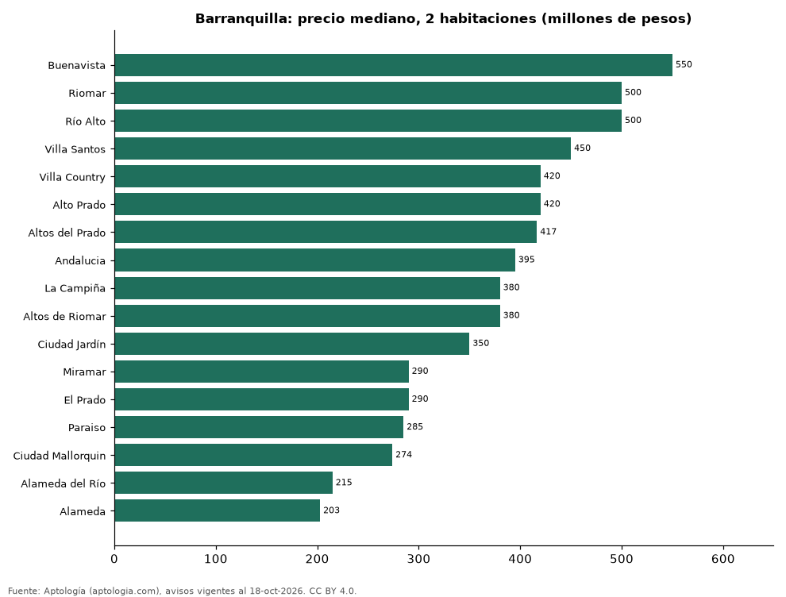

# Dónde cuesta más y menos comprar un apartamento de 2 habitaciones en Barranquilla: ranking de barrios (octubre 2026)

**En Barranquilla, un apartamento de 2 habitaciones cuesta 550 millones de pesos en la mediana en Buenavista, el barrio más caro, y 203 millones de pesos en Alameda, el más barato: 2,7 veces menos.** Comparamos 17 barrios con al menos 30 avisos de 2 habitaciones.

*Resumen: analizamos 1.069 apartamentos en venta de 2 habitaciones en 17 barrios de Barranquilla.*

**Actualizado:** 18 de octubre de 2026 (datos del 18 de octubre de 2026) · **Próxima actualización:** mensual.

## Resumen

| Indicador | Valor |
|---|---|
| Más caro | Buenavista: 550 millones de pesos |
| Más barato | Alameda: 203 millones de pesos |
| Diferencia | 2,7 veces |
| Barrios | 17 |

## Precio de un apartamento de 2 habitaciones por barrio

| Barrio | Precio (mediana) | Rango típico (P25–P75) | Área mediana (m²) | Avisos |
|---|---|---|---|---|
| Buenavista | 550 millones de pesos | 460 millones de pesos – 650 millones de pesos | 79 | 40 |
| Riomar | 500 millones de pesos | 425 millones de pesos – 650 millones de pesos | 92 | 68 |
| Río Alto | 500 millones de pesos | 465 millones de pesos – 565 millones de pesos | 75 | 57 |
| Villa Santos | 450 millones de pesos | 360 millones de pesos – 520 millones de pesos | 87 | 97 |
| Villa Country | 420 millones de pesos | 360 millones de pesos – 1.375 millones de pesos | 99 | 44 |
| Alto Prado | 420 millones de pesos | 370 millones de pesos – 650 millones de pesos | 100 | 49 |
| Altos del Prado | 417 millones de pesos | 368 millones de pesos – 530 millones de pesos | 92 | 52 |
| Andalucia | 395 millones de pesos | 315 millones de pesos – 485 millones de pesos | 100 | 37 |
| La Campiña | 380 millones de pesos | 350 millones de pesos – 450 millones de pesos | 85 | 31 |
| Altos de Riomar | 380 millones de pesos | 310 millones de pesos – 480 millones de pesos | 83 | 57 |
| Ciudad Jardín | 350 millones de pesos | 305 millones de pesos – 380 millones de pesos | 80 | 43 |
| Miramar | 290 millones de pesos | 244 millones de pesos – 310 millones de pesos | 55 | 52 |
| El Prado | 290 millones de pesos | 252 millones de pesos – 378 millones de pesos | 83 | 42 |
| Paraiso | 285 millones de pesos | 270 millones de pesos – 300 millones de pesos | 58 | 70 |
| Ciudad Mallorquin | 274 millones de pesos | 258 millones de pesos – 300 millones de pesos | 57 | 99 |
| Alameda del Río | 215 millones de pesos | 195 millones de pesos – 242 millones de pesos | 53 | 187 |
| Alameda | 203 millones de pesos | 190 millones de pesos – 220 millones de pesos | 56 | 44 |

Medianas del precio pedido; solo barrios con 30 avisos o más.

## Preguntas frecuentes

**¿Cuánto cuesta comprar un apartamento de 2 habitaciones en Buenavista?**
550 millones de pesos en la mediana (octubre de 2026); la mitad central entre 460 millones de pesos y 650 millones de pesos.

**¿Dónde es más barato comprar un apartamento de 2 habitaciones en Barranquilla?**
En Alameda: 203 millones de pesos en la mediana.

## Metodología

- **Fuente:** exportes nocturnos de la base de datos de Aptología (aptologia.com) del 18 de octubre de 2026: avisos vigentes de vivienda en portales inmobiliarios de 13 países, recogidos por Aptología y vistos en línea entre el 11 y el 18 de octubre de 2026. Corte: 18 de octubre de 2026.
- **Depuración:** se eliminan duplicados exactos (misma ciudad, zona, tipo, precio, moneda, área, habitaciones y baños) y los precios fuera del percentil 1–99 de cada país, operación, moneda y tipo; el precio por m² usa solo avisos con área declarada entre 12 y 2.000 m² y también se recorta al P1–P99.
- **Qué se mide:** precios pedidos (publicados), no precios de cierre. En arriendo, el canon mensual sin administración, gastos comunes ni condominio.
- **Muestra mínima:** cada cifra publicada se apoya en al menos 30 avisos; las celdas con menos se omiten.
- **Colombia:** Precios en pesos colombianos, sin conversión de moneda.
- **Limitaciones:** la cobertura depende de los portales que recorre Aptología en cada país y es mayor en las ciudades grandes y en los segmentos medio-alto y alto; el área es la que declara el aviso, sin verificar; los nombres de zona vienen de los portales.
- **Privacidad:** solo se publican agregados; no se publica ningún dato personal, enlace a avisos ni nombre de anunciante.
- **Datos abiertos:** [datos.csv](datos.csv), licencia CC BY 4.0.

## Cómo citar

Pinzón Pineda, D. M. (2026). *Dónde cuesta más y menos comprar un apartamento de 2 habitaciones en Barranquilla: ranking de barrios (octubre 2026)*. Aptología (aptologia.com). https://github.com/elbroker/aptologia-datos/tree/main/estudios/venta-apartamentos-de-2-habitaciones-por-barrio-barranquilla-2026. Datos: datos.csv, licencia CC BY 4.0.
