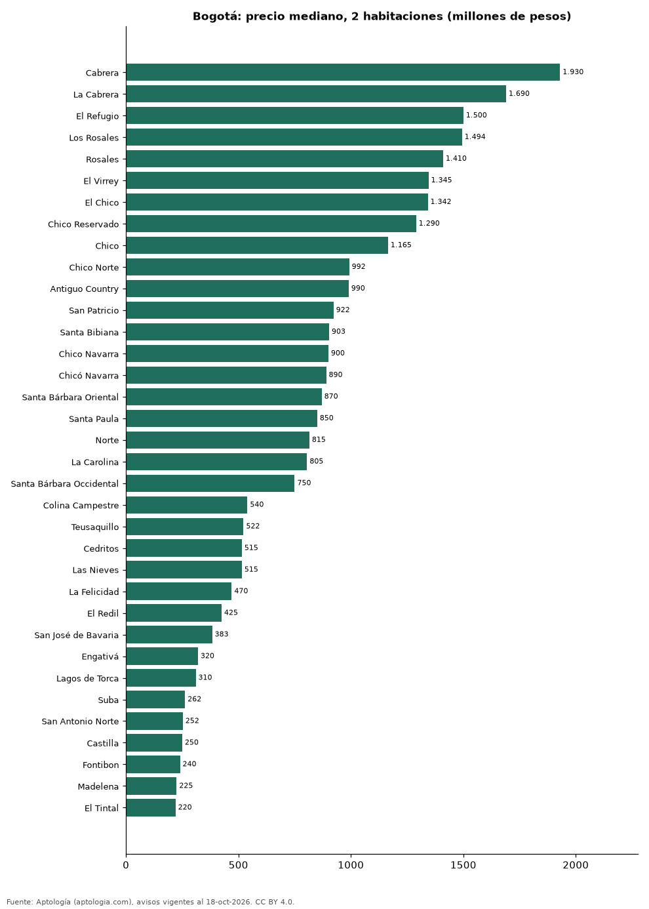

# Dónde cuesta más y menos comprar un apartamento de 2 habitaciones en Bogotá: ranking de barrios (octubre 2026)

**En Bogotá, un apartamento de 2 habitaciones cuesta 1.930 millones de pesos en la mediana en Cabrera, el barrio más caro, y 220 millones de pesos en El Tintal, el más barato: 8,8 veces menos.** Comparamos 48 barrios con al menos 30 avisos de 2 habitaciones.

*Resumen: analizamos 3.499 apartamentos en venta de 2 habitaciones en 48 barrios de Bogotá.*

**Actualizado:** 18 de octubre de 2026 (datos del 18 de octubre de 2026) · **Próxima actualización:** mensual.

## Resumen

| Indicador | Valor |
|---|---|
| Más caro | Cabrera: 1.930 millones de pesos |
| Más barato | El Tintal: 220 millones de pesos |
| Diferencia | 8,8 veces |
| Barrios | 48 |

## Precio de un apartamento de 2 habitaciones por barrio

| Barrio | Precio (mediana) | Rango típico (P25–P75) | Área mediana (m²) | Avisos |
|---|---|---|---|---|
| Cabrera | 1.930 millones de pesos | 1.540 millones de pesos – 2.700 millones de pesos | 146 | 35 |
| La Cabrera | 1.690 millones de pesos | 1.396 millones de pesos – 2.300 millones de pesos | 132 | 61 |
| El Refugio | 1.500 millones de pesos | 1.295 millones de pesos – 1.900 millones de pesos | 165 | 35 |
| Los Rosales | 1.494 millones de pesos | 1.100 millones de pesos – 1.900 millones de pesos | 145 | 131 |
| Rosales | 1.410 millones de pesos | 1.100 millones de pesos – 1.800 millones de pesos | 150 | 93 |
| El Virrey | 1.345 millones de pesos | 1.112 millones de pesos – 1.758 millones de pesos | 108 | 42 |
| El Chico | 1.342 millones de pesos | 972 millones de pesos – 1.545 millones de pesos | 106 | 46 |
| Chico Reservado | 1.290 millones de pesos | 995 millones de pesos – 1.500 millones de pesos | 121 | 79 |
| Chico | 1.165 millones de pesos | 832 millones de pesos – 1.494 millones de pesos | 104 | 186 |
| Chico Norte | 992 millones de pesos | 784 millones de pesos – 1.393 millones de pesos | 96 | 206 |
| Antiguo Country | 990 millones de pesos | 725 millones de pesos – 1.200 millones de pesos | 80 | 33 |
| San Patricio | 922 millones de pesos | 762 millones de pesos – 1.238 millones de pesos | 97 | 120 |
| Santa Bibiana | 903 millones de pesos | 759 millones de pesos – 1.120 millones de pesos | 83 | 41 |
| Chico Navarra | 900 millones de pesos | 790 millones de pesos – 1.100 millones de pesos | 97 | 82 |
| Chicó Navarra | 890 millones de pesos | 760 millones de pesos – 1.220 millones de pesos | 94 | 42 |
| Santa Bárbara Oriental | 870 millones de pesos | 765 millones de pesos – 1.393 millones de pesos | 84 | 35 |
| Santa Paula | 850 millones de pesos | 739 millones de pesos – 1.101 millones de pesos | 94 | 100 |
| Norte | 815 millones de pesos | 584 millones de pesos – 1.515 millones de pesos | 112 | 35 |
| La Carolina | 805 millones de pesos | 665 millones de pesos – 1.212 millones de pesos | 106 | 40 |
| Santa Bárbara Occidental | 750 millones de pesos | 640 millones de pesos – 950 millones de pesos | 87 | 73 |
| Rincon del Chico | 750 millones de pesos | 651 millones de pesos – 900 millones de pesos | 92 | 33 |
| Santa Bárbara | 750 millones de pesos | 600 millones de pesos – 960 millones de pesos | 89 | 221 |
| Chapinero Alto | 730 millones de pesos | 585 millones de pesos – 1.085 millones de pesos | 84 | 107 |
| Bella Suiza | 729 millones de pesos | 550 millones de pesos – 852 millones de pesos | 84 | 122 |
| La Calleja | 722 millones de pesos | 570 millones de pesos – 860 millones de pesos | 87 | 46 |
| Centro Internacional | 700 millones de pesos | 594 millones de pesos – 785 millones de pesos | 72 | 31 |
| Santa Bárbara Central | 650 millones de pesos | 549 millones de pesos – 795 millones de pesos | 88 | 105 |
| Quinta Paredes | 648 millones de pesos | 500 millones de pesos – 892 millones de pesos | 69 | 41 |
| Pasadena | 630 millones de pesos | 550 millones de pesos – 750 millones de pesos | 82 | 53 |
| Usaquen | 628 millones de pesos | 468 millones de pesos – 844 millones de pesos | 70 | 40 |
| Chapinero | 620 millones de pesos | 502 millones de pesos – 938 millones de pesos | 79 | 138 |
| La Castellana | 612 millones de pesos | 572 millones de pesos – 711 millones de pesos | 76 | 30 |
| Puente Largo | 567 millones de pesos | 459 millones de pesos – 829 millones de pesos | 88 | 30 |
| Colina Campestre | 540 millones de pesos | 415 millones de pesos – 720 millones de pesos | 62 | 69 |
| Teusaquillo | 522 millones de pesos | 430 millones de pesos – 640 millones de pesos | 62 | 31 |
| Cedritos | 515 millones de pesos | 425 millones de pesos – 650 millones de pesos | 73 | 232 |
| Las Nieves | 515 millones de pesos | 329 millones de pesos – 625 millones de pesos | 65 | 37 |
| La Felicidad | 470 millones de pesos | 306 millones de pesos – 535 millones de pesos | 56 | 34 |
| El Redil | 425 millones de pesos | 280 millones de pesos – 500 millones de pesos | 54 | 32 |
| San José de Bavaria | 383 millones de pesos | 330 millones de pesos – 557 millones de pesos | 52 | 34 |
| Engativá | 320 millones de pesos | 235 millones de pesos – 380 millones de pesos | 52 | 37 |
| Lagos de Torca | 310 millones de pesos | 262 millones de pesos – 539 millones de pesos | 46 | 103 |
| Suba | 262 millones de pesos | 236 millones de pesos – 353 millones de pesos | 44 | 46 |
| San Antonio Norte | 252 millones de pesos | 230 millones de pesos – 302 millones de pesos | 44 | 32 |
| Castilla | 250 millones de pesos | 235 millones de pesos – 266 millones de pesos | 42 | 49 |
| Fontibon | 240 millones de pesos | 215 millones de pesos – 299 millones de pesos | 45 | 144 |
| Madelena | 225 millones de pesos | 215 millones de pesos – 240 millones de pesos | 42 | 64 |
| El Tintal | 220 millones de pesos | 190 millones de pesos – 262 millones de pesos | 41 | 43 |

Medianas del precio pedido; solo barrios con 30 avisos o más.

## Preguntas frecuentes

**¿Cuánto cuesta comprar un apartamento de 2 habitaciones en Cabrera?**
1.930 millones de pesos en la mediana (octubre de 2026); la mitad central entre 1.540 millones de pesos y 2.700 millones de pesos.

**¿Dónde es más barato comprar un apartamento de 2 habitaciones en Bogotá?**
En El Tintal: 220 millones de pesos en la mediana.

## Metodología

- **Fuente:** exportes nocturnos de la base de datos de Aptología (aptologia.com) del 18 de octubre de 2026: avisos vigentes de vivienda en portales inmobiliarios de 13 países, recogidos por Aptología y vistos en línea entre el 11 y el 18 de octubre de 2026. Corte: 18 de octubre de 2026.
- **Depuración:** se eliminan duplicados exactos (misma ciudad, zona, tipo, precio, moneda, área, habitaciones y baños) y los precios fuera del percentil 1–99 de cada país, operación, moneda y tipo; el precio por m² usa solo avisos con área declarada entre 12 y 2.000 m² y también se recorta al P1–P99.
- **Qué se mide:** precios pedidos (publicados), no precios de cierre. En arriendo, el canon mensual sin administración, gastos comunes ni condominio.
- **Muestra mínima:** cada cifra publicada se apoya en al menos 30 avisos; las celdas con menos se omiten.
- **Colombia:** Precios en pesos colombianos, sin conversión de moneda.
- **Limitaciones:** la cobertura depende de los portales que recorre Aptología en cada país y es mayor en las ciudades grandes y en los segmentos medio-alto y alto; el área es la que declara el aviso, sin verificar; los nombres de zona vienen de los portales.
- **Privacidad:** solo se publican agregados; no se publica ningún dato personal, enlace a avisos ni nombre de anunciante.
- **Datos abiertos:** [datos.csv](datos.csv), licencia CC BY 4.0.

## Cómo citar

Pinzón Pineda, D. M. (2026). *Dónde cuesta más y menos comprar un apartamento de 2 habitaciones en Bogotá: ranking de barrios (octubre 2026)*. Aptología (aptologia.com). https://github.com/elbroker/aptologia-datos/tree/main/estudios/venta-apartamentos-de-2-habitaciones-por-barrio-bogota-2026. Datos: datos.csv, licencia CC BY 4.0.
